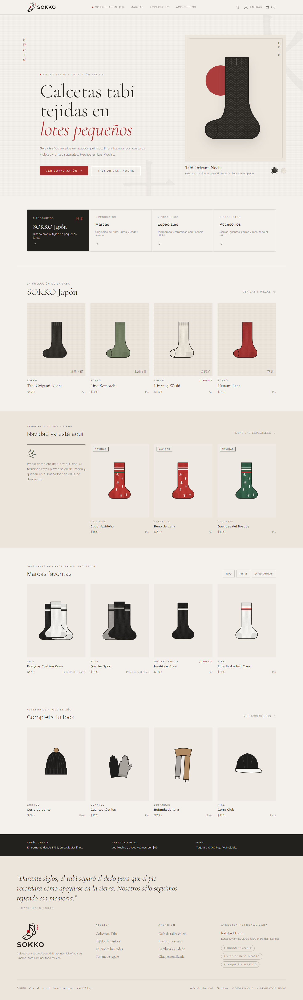
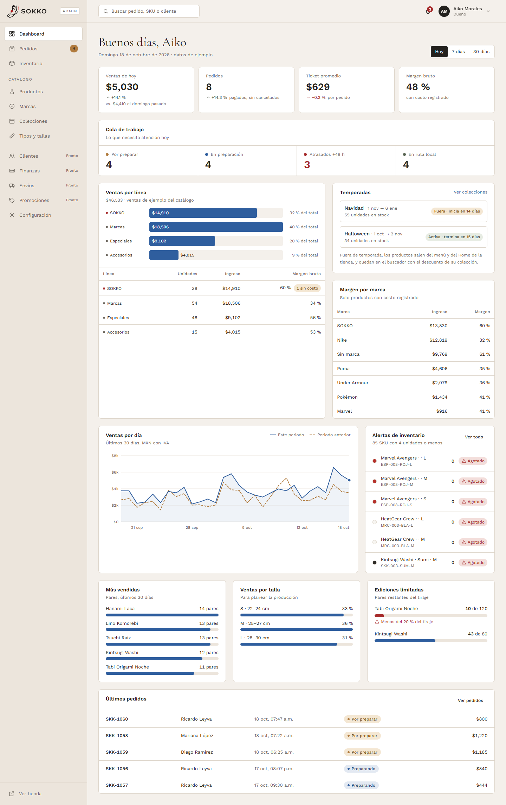
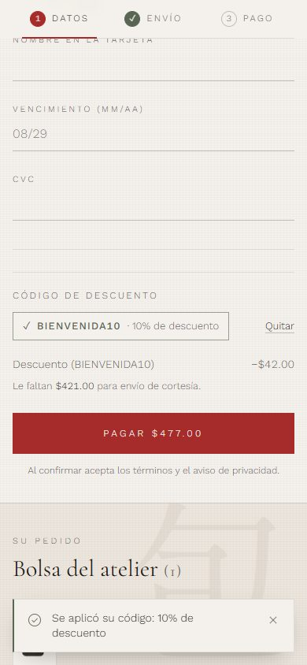
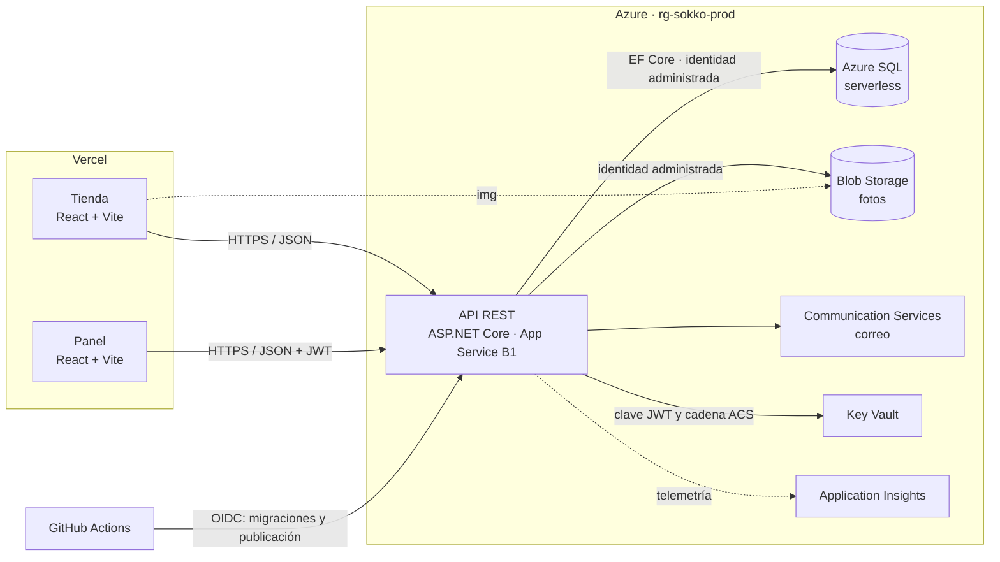

<div align="center">

# SOKKO（ソッコ）

### *Confort que Renace cada paso*

E-Commerce de calcetines con estética japonesa minimalista,
construido con una **Arquitectura Orientada a Servicios (SOA)**.


**[Tienda](https://sokko-tienda.vercel.app)** · **[Panel](https://sokko-panel.vercel.app)** · **[API](https://app-sokko-qifdnnh6tfjpc.azurewebsites.net/api/health)**

</div>

---

## Qué es SOKKO

SOKKO es la tienda en línea de un atelier de calcetines en Los Mochis, Sinaloa. Una sola API REST en .NET atiende a dos consumidores independientes: la **tienda** para compradores y el **panel** para el equipo interno (Dueño y Operaciones). El proyecto es el integrador de la asignatura Arquitectura Orientada a Servicios y está desplegado en Azure y Vercel.

| Tienda (escritorio) | Panel (Dueño) | Checkout con cupón (móvil) |
|---|---|---|
|  |  |  |

## Funcionalidades

**Tienda** (`apps/web-store`, pública)

| Área | Qué hace |
|---|---|
| Catálogo | Cuatro líneas (SOKKO, Marcas, Especiales, Accesorios), búsqueda, filtros, ficha con galería, tallas por sistema y temporadas |
| Bolsa y checkout | Compra como invitado o con cuenta, cotización de envío por CP, cupón, tarjeta simulada u OXXO Pay, confirmación por correo |
| Cuenta | Registro, acceso, recuperar contraseña, Mi perfil, Mis pedidos y Favoritos |
| Rastreo | Seguimiento por folio y correo, con paquetería y número de guía |
| Informativas | Nosotros, Envíos, Preguntas frecuentes, Contacto (con límite y honeypot) y páginas legales |

**Panel** (`apps/admin-panel`, interno). El servidor aplica los mismos permisos ([`Services/Permissions.cs`](apps/api-service/Services/Permissions.cs)).

| Sección | Dueño | Operaciones |
|---|---|---|
| Dashboard | KPIs con pesos | KPIs sin pesos |
| Pedidos y Envíos | Todo, incluido confirmar pagos | Preparar, enviar con guía, entregar, cancelar; sin columna Total |
| Inventario | Ajustes, kárdex e importación CSV | Ajustes y kárdex |
| Catálogo (productos, marcas, colecciones, tipos) | Consultar y editar, costos y fotos | Solo consultar, sin costos |
| Mensajes | Bandeja de contacto | Bandeja de contacto |
| Clientes, Reportes (CSV), Promociones, Configuración | Sí | "Esta sección es solo para el Dueño" |

## Arquitectura



Un proveedor (la API) y dos consumidores con el mismo contrato HTTP. La lógica vive en servicios clasificados según Erl: de entidad (`UserService`, `OrderService`, `InventoryService`…), de tarea (`CheckoutOrder`, `FulfillOrder`, `QuoteOrder`) y utilitarios (`EmailSender`, `IImageStorage`, `IPaymentGateway`, `CsvWriter`). Detalle en [`docs/design/DESIGN_DB.md` §6](docs/design/DESIGN_DB.md) y en el [reporte técnico](docs/entrega/REPORTE_TECNICO.md).

## Stack

| Capa | Tecnología (versión del repo) |
|---|---|
| Tienda y panel | React 19.2, React Router 7.18, Vite 8.3, Tailwind CSS 4.3, lucide-react 1.57 (tienda) |
| Pruebas front | Vitest 5.0, jsdom 26.1, Playwright 1.56 (e2e de la tienda), oxlint 1.81 |
| API | ASP.NET Core en .NET 10 (`net10.0`), EF Core SQL Server 10.0.14, JwtBearer 10.0.14, OpenAPI 10.0.12, Swagger UI 10.3.0 |
| Azure SDK | Azure.Identity 1.21.0, Azure.Storage.Blobs 12.30.1, Azure.Communication.Email 1.1.0 |
| Pruebas API | xUnit v3 4.0.2, Microsoft.AspNetCore.Mvc.Testing 10.0.14 |
| Datos | SQL Server (local) y Azure SQL Database (producción), 9 migraciones EF Core |
| Infraestructura | Bicep ([`infra/`](infra/README.md)), GitHub Actions, Vercel |

## Puesta en marcha local

Requisitos: Node.js 20.19+ (o 22.12+), .NET SDK 10 y SQL Server (Developer, Express o Docker).

### 1. API (`apps/api-service`)

```bash
cd apps/api-service
dotnet tool restore            # dotnet-ef con la versión de dotnet-tools.json
dotnet ef database update      # crea la BD "Sokko", aplica migraciones y siembra datos demo
dotnet run                     # http://localhost:5080
```

- `appsettings.Development.json` apunta a `Server=localhost` con autenticación de Windows. Con Express use `Server=localhost\SQLEXPRESS`.
- **Docker:** levante `mcr.microsoft.com/mssql/server:2022-latest` y cree `appsettings.Development.local.json` (Git lo ignora) con su propia cadena `ConnectionStrings:Sokko`.
- **Semilla de Development:** 24 productos, 120 SKU con kárdex inicial, 34 pedidos demo y las cuentas de la tabla de abajo. Volver a correrla no duplica nada.
- Salud: `GET /api/health` (revisa la BD) y `GET /api/health/live` (no la toca). OpenAPI en `/openapi/v1.json` y Swagger UI en `/swagger`, solo en Development.
- Cambios al modelo: `dotnet ef migrations add <Nombre>`. La prueba `Migrations_are_in_sync_with_the_model` falla si se olvida.

### 2. Tienda y panel

```bash
npm --prefix apps/web-store install
npm --prefix apps/web-store run dev       # http://localhost:5173
npm --prefix apps/admin-panel install
npm --prefix apps/admin-panel run dev     # http://localhost:5174
```

- La URL de la API llega por `VITE_API_URL` (ver `.env.example` de cada app).
- **Sin API:** `VITE_USE_MOCKS=true` (o no definir `VITE_API_URL`) usa los datos simulados de `src/services`, con cupones de ejemplo.

## Pruebas y CI/CD

```bash
# API: usa la BD Sokko_Tests en el mismo servidor (la crea, migra y siembra en cada corrida)
cd apps/api-service.Tests && dotnet test -c Release

# Tienda y panel
cd apps/web-store && npm run lint && npm test && npm run build
cd apps/admin-panel && npm run lint && npm test && npm run build

# e2e de la tienda (Chrome instalado; build en modo mock servida con vite preview)
cd apps/web-store && npm run test:e2e
```

| Suite | Pruebas |
|---|---|
| `apps/api-service.Tests` (xUnit, unitarias e integración con SQL Server) | 847 |
| `apps/web-store` (Vitest) | 206 en 23 archivos |
| `apps/admin-panel` (Vitest) | 241 en 23 archivos |
| `apps/web-store/e2e` (Playwright: sin scroll horizontal de 320 a 1920 px) | 10 |

**CI** ([`ci.yml`](.github/workflows/ci.yml)) corre en cada PR y push a `main`; un job solo corre si cambió su app:

| Job | Valida |
|---|---|
| `changes` | Qué apps cambiaron (`dorny/paths-filter`) |
| `web-store` / `admin-panel` | `npm ci`, `lint` (oxlint), `test` (Vitest) y `build` |
| `api-service` | `restore`, `build -c Release`, SQL Server 2022 en contenedor, `dotnet ef database update` y `dotnet test` |

**Despliegue** ([`deploy.yml`](.github/workflows/deploy.yml)): corre después de que CI pasa en un push a `main` (o a mano desde `main`) y solo si la variable de repositorio `DEPLOY_ENABLED` es `true`. Entra a Azure por OIDC, sin secretos guardados; aplica las migraciones con un `dotnet ef migrations bundle` antes de publicar la API. Vercel publica la tienda y el panel desde su integración con GitHub. Detalle en [`infra/README.md`](infra/README.md).

## Cuentas de prueba

| Ambiente | Rol | Correo | Contraseña |
|---|---|---|---|
| Local (semilla de Development) | Dueño | `hola@sokko.mx` | `Kyoto2026` |
| Local | Operaciones | `daniel@sokko.mx`, `kevin@sokko.mx` | `Operaciones2026` |
| Local | Cliente | `nexus@sokko.mx` | `NexusCode2026` |
| Producción | Cliente | `cliente@sokko.mx` | `Pruebas2026` |
| Producción | Operaciones | `daniel@sokko.mx`, `kevin@sokko.mx` | `Pruebas2026` |
| Producción | Dueño | — | La entrega el equipo |

Pago con tarjeta simulado ([`paymentToken.js`](apps/web-store/src/services/paymentToken.js)): `4242 4242 4242 4242` se aprueba, `4000 0000 0000 0002` se rechaza y `4000 0000 0000 9995` responde fondos insuficientes. El número nunca sale del navegador: la API recibe un token.

## Estructura

```text
socks-ecommerce-hub/
├── apps/
│   ├── web-store/          Tienda · React + Vite + Tailwind (src/, e2e/)
│   ├── admin-panel/        Panel · React + Vite + Tailwind (config/, domain/, services/, pages/)
│   ├── api-service/        API · ASP.NET Core (Controllers/, DTOs/, Models/, Services/, Data/)
│   └── api-service.Tests/  Pruebas xUnit de la API
├── infra/                  Bicep (main.bicep, storage.bicep) y sql-setup.sql
├── docs/
│   ├── design/             Especificaciones (DESIGN*.md, DECISIONES*.md), mockups y capturas
│   ├── infra/AZURE.md      Suscripción, regiones y recursos desplegados
│   ├── entrega/            Reporte técnico y guion de la demo
│   └── brand/              Logotipos
├── .github/workflows/      ci.yml y deploy.yml
└── CONTEXTO_MAESTRO.md     Referencia arquitectónica
```

| Documento | Contenido |
|---|---|
| [`docs/design/DESIGN.md`](docs/design/DESIGN.md) | Sistema visual Kyoto Artisan |
| [`docs/design/DESIGN_DB.md`](docs/design/DESIGN_DB.md) | Esquema, reglas de negocio, mapa SOA y decisiones D-01…D-40 |
| [`docs/design/DESIGN_CHECKOUT.md`](docs/design/DESIGN_CHECKOUT.md) | Checkout, pagos e idempotencia |
| [`docs/design/DESIGN_AUTH.md`](docs/design/DESIGN_AUTH.md) | Autenticación y roles |
| [`docs/design/DESIGN_ADMIN.md`](docs/design/DESIGN_ADMIN.md), [`DESIGN_CATALOG_UI.md`](docs/design/DESIGN_CATALOG_UI.md) | Panel y catálogo |
| [`docs/infra/AZURE.md`](docs/infra/AZURE.md), [`infra/README.md`](infra/README.md) | Infraestructura y despliegue |
| [`docs/entrega/REPORTE_TECNICO.md`](docs/entrega/REPORTE_TECNICO.md) | Reporte técnico de cierre |
| [`docs/entrega/GUION_DEMO.md`](docs/entrega/GUION_DEMO.md) | Guion de la demostración |

## Equipo NEXUS CODE

- Jesús Cervantes López
- Lucio Adrián Martínez Pérez
- Said Eduardo Sarmiento Santillanes
- Carlos David Ponce Gamboa

Docente: María de los Ángeles López Atondo.
Universidad Autónoma de Occidente, Unidad Regional Los Mochis · Licenciatura en Ingeniería de Software · 7.º semestre · Grupo 01 Matutino.

---

<div align="center"><sub>Proyecto académico · Arquitectura Orientada a Servicios · Los Mochis, Sinaloa</sub></div>
