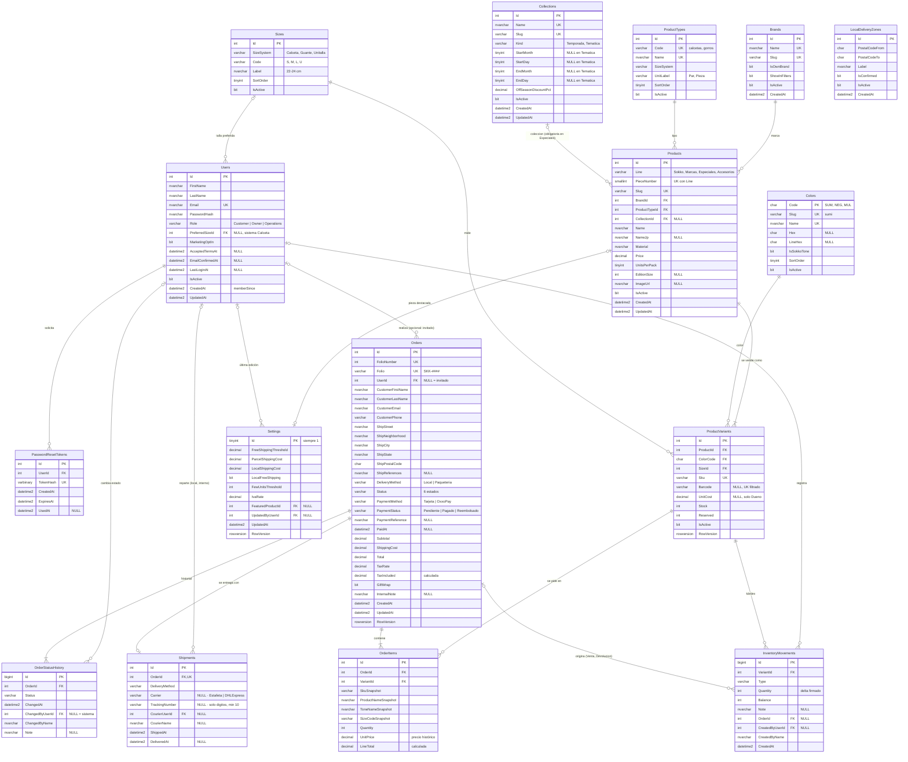

# DESIGN_DB.md — Esquema de base de datos · SOKKO (ソッコ)

> **Propósito:** propuesta del esquema de **SQL Server** que respaldará `apps/api-service` (EF Core). Documento para **revisión de arquitectura (Said)** antes de escribir entidades, configuraciones o migraciones.
> **Fuentes:** `CONTEXTO_MAESTRO.md`, `DESIGN.md` §4 y §9, `DESIGN_AUTH.md` §5 y §8, `DESIGN_ADMIN.md` §3, §5, §6 y §9, `DECISIONES_ADMIN.md`, `DECISIONES_CATALOGO.md` (catálogo multilínea, v0.4), y las reglas ejecutables de `apps/web-store/src/data/catalog.mock.js`, `apps/web-store/src/services/authService.js`, `apps/admin-panel/src/data/seed.js` y `apps/admin-panel/src/domain/*.js`.
> **Alcance:** solo diseño. **No hay código C# ni migraciones en esta fase.** La fase siguiente (EF Core) toma este archivo como fuente de verdad.
> **Estado:** ✅ Aprobado (v0.4.4) · catálogo multilínea (`DECISIONES_CATALOGO.md` T-01…T-13). La v0.3.1 (pedidos, inventario, envíos, usuarios) sigue aprobada y no cambia.

---

## Índice

1. [Convenciones y decisiones técnicas](#1-convenciones-y-decisiones-técnicas)
2. [Diagrama entidad-relación](#2-diagrama-entidad-relación)
3. [Especificación por tabla](#3-especificación-por-tabla)
4. [Reglas de negocio: BD vs. servicios .NET](#4-reglas-de-negocio-bd-vs-servicios-net)
5. [Datos semilla](#5-datos-semilla)
6. [Mapa SOA (clasificación de Erl)](#6-mapa-soa-clasificación-de-erl)
7. [Puntos abiertos para revisión](#7-puntos-abiertos-para-revisión)
8. [Historial de decisiones y cambios](#8-historial-de-decisiones-y-cambios)

---

## 1. Convenciones y decisiones técnicas

### 1.1 Nomenclatura

| Elemento | Convención | Ejemplo |
|---|---|---|
| Esquema | `dbo` (un solo esquema; el proyecto es pequeño) | `dbo.Orders` |
| Tablas | Inglés, **PascalCase, plural** | `ProductVariants`, `OrderStatusHistory` (sustantivo incontable, se deja en singular) |
| Columnas | Inglés, PascalCase | `UnitPrice`, `CreatedAt` |
| PK | `Id` | `Orders.Id` |
| FK | `{Entidad}Id` o `{Entidad}Code` para catálogos con clave natural | `OrderId`, `ColorCode` |
| Restricciones | `PK_{Tabla}`, `FK_{Tabla}_{Referida}`, `UQ_{Tabla}_{Cols}`, `CK_{Tabla}_{Regla}`, `IX_{Tabla}_{Cols}`, `DF_{Tabla}_{Col}` | `CK_ProductVariants_ReservedLeStock` |
| Valores de enums | ASCII, PascalCase, **sin acentos** | `PorPreparar`, `Devolucion`, `OxxoPay` |

Los nombres en inglés siguen lo que ya usan `DESIGN.md` §9 y `DESIGN_AUTH.md` §8 (`Products`, `PieceNumber`, `PasswordHash`…) y coinciden 1:1 con las propiedades de C# en EF Core, sin mapeos manuales. Los **valores** de los enums de negocio quedan en español porque son vocabulario del cliente (`Paqueteria`, `OxxoPay`, `Merma`) y así aparecen en `DECISIONES_ADMIN.md`. Los roles quedan en inglés (`Owner`, `Operations`, `Customer`) porque así los define el contrato de autorización (`[Authorize(Roles = "...")]`). **Ningún valor de enum en BD lleva espacios ni acentos**; la traducción a los códigos que ya usan los frontends está en §1.6.

### 1.2 Tipos de datos

| Dato | Tipo SQL Server | Motivo |
|---|---|---|
| Dinero (MXN) | `DECIMAL(10,2)` | Aritmética exacta en base 10: `FLOAT`/`REAL` acumulan error binario (0.1 + 0.2 ≠ 0.3) y `MONEY` redondea a 4 decimales en divisiones intermedias y no es portable. 10,2 cubre hasta 99,999,999.99 MXN, de sobra para un pedido o un reporte mensual. Mapea a `decimal` en C# sin pérdida. |
| Tasas (IVA) | `DECIMAL(5,4)` | 0.1600 con 4 decimales permite tasas como 0.0800 (frontera) sin redondeo. |
| Fechas y horas | `DATETIME2(3)` **en UTC**, default `SYSUTCDATETIME()` | Precisión de milisegundos, rango 0001–9999 y 6–8 bytes (menos que `DATETIMEOFFSET`). Guardar siempre UTC evita ambigüedad; la conversión a la hora del negocio (`America/Mazatlan`, UTC−7, sin horario de verano desde 2022) se hace en .NET para "Hoy", "7d", "30d" y "atrasado +48 h". Columnas con sufijo `At` (`CreatedAt`, `ShippedAt`). |
| Texto visible | `NVARCHAR(n)` | Unicode: nombres en japonés (`折紙・夜`), acentos y `ñ`. |
| Códigos técnicos | `VARCHAR(n)` / `CHAR(n)` | SKU, códigos de color/talla, *slugs*, código de barras, CP y enums son ASCII; ocupan la mitad. |
| Banderas | `BIT NOT NULL` con default | `GiftWrap`, `IsActive`, `MarketingOptIn`. |
| Cantidades (unidades vendibles) | `INT` | Enteros; los CHECK impiden negativos. Una unidad es un par, un paquete o una pieza según `ProductTypes.UnitLabel` y `Products.UnitsPerPack` (T-10). |
| Porcentajes de descuento | `DECIMAL(5,4)` | `Collections.OffSeasonDiscountPct` = 0.3000 (30 %), igual que las tasas. |
| Hashes | `VARBINARY(32)` (SHA-256) / `NVARCHAR(256)` (PasswordHasher) | El token de restablecimiento se guarda como hash binario; la contraseña en el formato Base64 de `PasswordHasher<TUser>` (PBKDF2). |
| Concurrencia | `ROWVERSION` | Concurrencia optimista **solo para ediciones desde el panel** (catálogo, ajustes manuales de stock, transiciones de pedido, configuración) en `ProductVariants`, `Orders` y `Settings`. El checkout y la salida de inventario **no** dependen de ella: usan `UPDATE` atómicos condicionados (§4.1). |

**Intercalación:** explícita a nivel de base de datos, **`Modern_Spanish_100_CI_AI`** (no se depende de la predeterminada de la instancia). En EF Core se fija en el modelo con `UseCollation`, así la crea igual la migración en local, Docker o Azure SQL.
- *CI* (sin distinguir mayúsculas) y *AI* (sin distinguir acentos): la búsqueda del panel por folio, cliente, correo o SKU (`matchesQuery` en `orders.js`, que normaliza acentos) se resuelve con un `LIKE` normal: "lopez" encuentra "López" sin `COLLATE` en cada consulta.
- `VARCHAR` usa la página de códigos 1252, suficiente para los códigos ASCII (SKU, CP, enums).
- Los `CHECK` de patrón sobre códigos ASCII (*slugs*, `Colors.Code`, `Sizes.Code`, `Sku`, `Barcode`, `Hex`) llevan `COLLATE Latin1_General_100_BIN2`: con *CI_AI*, `[a-z]` también acepta mayúsculas y letras acentuadas (v0.4.3).
- **`UQ_Users_Email` sigue siendo correcto:** dos correos que solo difieren en mayúsculas (`Hola@` / `hola@`) colisionan, que es lo que pide R-01. Con *AI* también colisionan variantes que solo difieren en acentos (`jose@` / `josé@`); se acepta a propósito, porque los buzones reales son ASCII y así se evitan cuentas casi idénticas. La API sigue normalizando con `trim().ToLowerInvariant()` (igual que `authService.js`).
- Los demás `UNIQUE` sobre texto (`Colors.Name`, `Brands.Name`, `Collections.Name`, `Sku`, `Folio`) tampoco cambian de comportamiento: sus valores son ASCII en mayúsculas o nombres de catálogo que no deben repetirse con otro acento.

### 1.3 Enums: `VARCHAR + CHECK` en lugar de tablas catálogo

| Criterio | `VARCHAR + CHECK` ✅ (elegido para enums de flujo) | Tabla catálogo (elegido para Colores, Tallas, Marcas, Tipos y Colecciones) |
|---|---|---|
| ¿Quién cambia los valores? | Solo el equipo de desarrollo (cada valor nuevo exige código nuevo: transiciones, botones, reglas) | El Dueño, desde el panel (color nuevo, talla XL, marca, colección de temporada) |
| ¿Tienen atributos propios? | No (solo el código) | Sí (nombre, hex, etiqueta en cm, orden, código de SKU) |
| Lectura de datos | El valor se lee directo en la tabla (`Status = 'Enviado'`) sin JOIN | Requiere JOIN para mostrar el nombre |
| Mapeo EF Core | `enum` de C# + `HasConversion<string>()` | Entidad con navegación |

**Regla:** si la lógica del sistema depende del valor (estados del pedido, tipo de movimiento, método de pago o de entrega, rol, paquetería, **línea de producto, tipo de colección, sistema de tallas, unidad**), es un enum con `CHECK`. Si es un dato que el negocio administra y que tiene atributos, es una tabla catálogo. Por eso `Colors`, `Sizes`, `Brands`, `ProductTypes` y `Collections` son tablas y las 4 líneas no lo son (T-01: son fijas y cada una cambia la tienda). Además, se guarda el texto y no un entero para que una consulta en SSMS se lea sola y la entrega escolar sea auditable.

### 1.4 Borrado: lógico, no físico

- **Nunca se borran** `Users`, `Products`, `ProductVariants`, `Brands`, `Collections`, `Orders` ni el kárdex: tienen historia contable. Se desactivan con `IsActive = 0`.
- Por eso **todas** las FK son `ON DELETE NO ACTION`, incluidas las que apuntan a `Orders` (`OrderItems`, `OrderStatusHistory`, `Shipments`, `InventoryMovements`) y a `ProductVariants` (`OrderItems`, `InventoryMovements`). Un `DELETE` accidental sobre un pedido o un SKU con historia **falla** en lugar de arrastrar líneas, historial, envío o kárdex.
- La **única** excepción es `PasswordResetTokens.UserId` (`CASCADE`): el token no tiene valor de auditoría.
- **EF Core:** una FK requerida es `Cascade` por convención, así que cada relación se configura con `OnDelete(DeleteBehavior.NoAction)` explícito (salvo la de `PasswordResetTokens`). La revisión de la migración debe confirmar que no aparece ningún `ON DELETE CASCADE` adicional.
- Purgar pedidos de prueba en Development es un paso explícito del *seeder* (borra hijos y luego el pedido), nunca una cascada.
- Con una sola cascada tampoco existe riesgo del error 1785 de SQL Server (*"may cause cycles or multiple cascade paths"*).

### 1.5 Folio del pedido `SKK-####`

- `CREATE SEQUENCE dbo.OrderFolioSeq AS INT START WITH 1001 INCREMENT BY 1` (sin caché, `NO CACHE`, para no perder números tras un reinicio).
- `Orders.FolioNumber INT NOT NULL DEFAULT (NEXT VALUE FOR dbo.OrderFolioSeq)` y `Orders.Folio AS ('SKK-' + CAST(FolioNumber AS VARCHAR(10))) PERSISTED` con `UNIQUE`.
- Se usa una secuencia en vez de `IDENTITY` para que el folio sea independiente de la PK y para que la API pueda reservarlo antes de insertar si lo necesita. Al partir de 1001 siempre hay al menos 4 dígitos (`SKK-1001`), como en el panel (`SKK-1027`…`SKK-1060`).

### 1.6 Equivalencias de enums: BD ↔ API (JSON) ↔ etiqueta UI

Valores de BD en ASCII PascalCase **sin espacios ni acentos**. Los valores de la API son **códigos** en `snake_case` minúsculas (nunca etiquetas con espacios o acentos); la etiqueta que ve el usuario la resuelve cada frontend con un mapa único por enum (`apps/admin-panel/src/domain/enums.js`).

| Enum (columna) | Valor BD | API (JSON) | Etiqueta UI | Conversión |
|---|---|---|---|---|
| Estado (`Orders.Status`, `OrderStatusHistory.Status`) | `PorPreparar` | `por_preparar` | Por preparar | `SnakeCaseLower` |
| | `Preparando` | `preparando` | Preparando | `SnakeCaseLower` |
| | `Enviado` | `enviado` | Enviado | `SnakeCaseLower` |
| | `EnRuta` | `en_ruta` | En ruta local | `SnakeCaseLower` |
| | `Entregado` | `entregado` | Entregado | `SnakeCaseLower` |
| | `Cancelado` | `cancelado` | Cancelado | `SnakeCaseLower` |
| | `Pagado` (solo historial) | `pagado` | Pagado | `SnakeCaseLower` |
| Entrega (`Orders.DeliveryMethod`, `Shipments.DeliveryMethod`) | `Local` | `local` | Entrega local | `SnakeCaseLower` |
| | `Paqueteria` | `paqueteria` | Paquetería | `SnakeCaseLower` |
| Método de pago (`Orders.PaymentMethod`) | `Tarjeta` | `tarjeta` | Tarjeta | `SnakeCaseLower` |
| | `OxxoPay` | `oxxo_pay` | OXXO Pay | `SnakeCaseLower` |
| Estado de pago (`Orders.PaymentStatus`) | `Pendiente` | `pendiente` | Pendiente de pago | `SnakeCaseLower` |
| | `Pagado` | `pagado` | Pagado | `SnakeCaseLower` |
| | `Reembolsado` | `reembolsado` | Reembolsado | `SnakeCaseLower` |
| Paquetería (`Shipments.Carrier`) | `Estafeta` | `estafeta` | Estafeta | **Explícito** |
| | `DHLExpress` | `dhl_express` | DHL Express | **Explícito** |
| Movimiento (`InventoryMovements.Type`) | `Entrada` | `entrada` | Entrada | `SnakeCaseLower` |
| | `Merma` | `merma` | Merma | `SnakeCaseLower` |
| | `Devolucion` | `devolucion` | Devolución | `SnakeCaseLower` |
| | `ConteoFisico` | `conteo_fisico` | Conteo físico | `SnakeCaseLower` |
| | `Venta` | `venta` | Venta | `SnakeCaseLower` |
| | `InventarioInicial` | `inventario_inicial` | Inventario inicial | `SnakeCaseLower` |
| Rol (`Users.Role`) | `Owner` | `dueno` | Dueño | **Explícito** (`config/roles.js`) |
| | `Operations` | `operaciones` | Operaciones | **Explícito** |
| | `Customer` | `customer` | — (tienda) | `SnakeCaseLower` |
| Línea (`Products.Line`) · v0.4 | `Sokko` | `sokko` | SOKKO Japón | `SnakeCaseLower` |
| | `Marcas` | `marcas` | Marcas | `SnakeCaseLower` |
| | `Especiales` | `especiales` | Especiales | `SnakeCaseLower` |
| | `Accesorios` | `accesorios` | Accesorios | `SnakeCaseLower` |
| Tipo de colección (`Collections.Kind`) · v0.4 | `Temporada` | `temporada` | Temporada | `SnakeCaseLower` |
| | `Tematica` | `tematica` | Temática | `SnakeCaseLower` |
| Sistema de tallas (`ProductTypes.SizeSystem`, `Sizes.SizeSystem`) · v0.4 | `Calceta` | `calceta` | Calceta | `SnakeCaseLower` |
| | `Guante` | `guante` | Guante | `SnakeCaseLower` |
| | `Unitalla` | `unitalla` | Unitalla | `SnakeCaseLower` |
| Unidad (`ProductTypes.UnitLabel`) · v0.4 | `Par` | `par` | par / pares | `SnakeCaseLower` |
| | `Pieza` | `pieza` | pieza / piezas | `SnakeCaseLower` |

- **`SnakeCaseLower`**: `JsonStringEnumConverter(JsonNamingPolicy.SnakeCaseLower)` produce el código de la API a partir del nombre del `enum` de C# (`EnRuta` → `en_ruta`, `OxxoPay` → `oxxo_pay`, `ConteoFisico` → `conteo_fisico`). Cubre estado, entrega, método y estado de pago, tipo de movimiento y, desde v0.4, línea, tipo de colección, sistema de tallas y unidad.
- **Explícito** (diccionario por enum en la capa de DTO, con una prueba unitaria que recorra todos los valores en ambos sentidos):
  - **Paquetería:** API `snake_case` (`estafeta`, `dhl_express`) ↔ BD PascalCase (`Estafeta`, `DHLExpress`). Se mapea a mano para no depender de cómo la política parte las siglas (`DHL`).
  - **Rol:** los códigos del panel (`dueno`, `operaciones`) no salen del nombre en inglés (`Owner`, `Operations`).
- Ningún valor de API lleva espacios ni acentos; las etiquetas (`DHL Express`, `OXXO Pay`, `Conteo físico`) son solo de UI.
- En EF Core todos se guardan con `HasConversion<string>()`: el valor de BD es el nombre del miembro del `enum`.
- **Línea:** `DECISIONES_CATALOGO` T-01 escribe los códigos en minúsculas (`sokko`, `especiales`…); esos son los valores de **API**. En BD siguen la convención de esta tabla (`Sokko`, `Especiales`…), igual que el resto de enums.

---

## 2. Diagrama entidad-relación

> `LocalDeliveryZones` no tiene FK: se consulta por rango contra `Orders.ShipPostalCode` en el servicio de envíos.

---

## 3. Especificación por tabla

Convención de las tablas: **N** = acepta `NULL`. Las columnas sin **N** son `NOT NULL`.

### 3.1 `Users` — cuentas de clientes y personal

**Para qué sirve:** una sola tabla de identidad para compradores (`Customer`) y personal interno (`Owner`, `Operations`). La usa el login de la tienda (`DESIGN_AUTH` §8) y el del panel (`DESIGN_ADMIN` §4/§9).

| Columna | Tipo | N | Default | Notas |
|---|---|---|---|---|
| `Id` | `INT IDENTITY(1,1)` | | | **PK** `PK_Users` |
| `FirstName` | `NVARCHAR(80)` | | | |
| `LastName` | `NVARCHAR(80)` | | | |
| `Email` | `NVARCHAR(254)` | | | **UQ** `UQ_Users_Email`. Guardado en minúsculas y sin espacios (RFC 5321: 254) |
| `PasswordHash` | `NVARCHAR(256)` | | | Salida de `PasswordHasher<User>` (PBKDF2 + sal). Nunca texto plano |
| `Role` | `VARCHAR(20)` | | `'Customer'` | `CK_Users_Role`: `IN ('Customer','Owner','Operations')` |
| `PreferredSizeId` | `INT` | N | | **FK** → `Sizes(Id)` `ON DELETE NO ACTION`. v0.4: antes `PreferredSizeCode → Sizes(Code)`; con tallas por sistema el código ya no es único (P-16). Solo tallas del sistema `Calceta` (lo valida el servicio); la API sigue exponiendo `preferredSize: "M"` |
| `MarketingOptIn` | `BIT` | | `0` | Aviso de ediciones limitadas |
| `AcceptedTermsAt` | `DATETIME2(3)` | N | | `CK_Users_CustomerAcceptedTerms`: `Role <> 'Customer' OR AcceptedTermsAt IS NOT NULL` |
| `EmailConfirmedAt` | `DATETIME2(3)` | N | | Confirmación por correo (futuro) |
| `LastLoginAt` | `DATETIME2(3)` | N | | |
| `IsActive` | `BIT` | | `1` | Baja lógica; un usuario inactivo no puede iniciar sesión |
| `CreatedAt` | `DATETIME2(3)` | | `SYSUTCDATETIME()` | Se expone como `memberSince` |
| `UpdatedAt` | `DATETIME2(3)` | | `SYSUTCDATETIME()` | Lo actualiza la API |

- `CK_Users_Email`: `Email LIKE '_%@_%._%'` (filtro grueso; la validación completa la hace la API con la regex de `DESIGN_AUTH` §5.1).
- **Índices:** `UQ_Users_Email` (búsqueda en login) · `IX_Users_Role` filtrado `WHERE Role <> 'Customer'` (lista de usuarios internos en Configuración).
- **¿Por qué `Users.Role` y no `Roles` + `UserRoles`?** `DESIGN_ADMIN` §9 deja abiertas ambas opciones. En v1 cada persona tiene **un solo rol** y los roles son fijos en el código (`config/roles.js`), así que la columna con `CHECK` alcanza y se evitan dos tablas y un JOIN en cada login. El rol viaja al JWT como *claim*. Ver punto abierto **P-01**: hay una cuenta demo que es Dueño *y* compradora.

### 3.2 `PasswordResetTokens` — enlaces para restablecer contraseña

**Para qué sirve:** guardar el token de un solo uso de `POST /api/auth/forgot-password`, válido 30 minutos (`DESIGN_AUTH` §4.4).

| Columna | Tipo | N | Default | Notas |
|---|---|---|---|---|
| `Id` | `INT IDENTITY` | | | **PK** |
| `UserId` | `INT` | | | **FK** → `Users(Id)` `ON DELETE CASCADE` |
| `TokenHash` | `VARBINARY(32)` | | | **UQ**. SHA-256 del token; el token en claro solo viaja en el correo |
| `CreatedAt` | `DATETIME2(3)` | | `SYSUTCDATETIME()` | |
| `ExpiresAt` | `DATETIME2(3)` | | | `CK_PasswordResetTokens_Expiry`: `ExpiresAt > CreatedAt` |
| `UsedAt` | `DATETIME2(3)` | N | | Se marca al usarlo; un token usado no vuelve a servir |

- **Índices:** `UQ_PasswordResetTokens_TokenHash` (búsqueda en `reset-password`) · `IX_PasswordResetTokens_UserId_ExpiresAt` (invalidar los tokens anteriores al emitir uno nuevo y depurar los vencidos).

### 3.3 `Colors` — colores y diseños (antes `Tones`) · v0.4

**Para qué sirve:** una sola tabla de color o diseño para todas las líneas (T-05). Los 4 tonos Kyoto (`TONES` en `catalog.mock.js`) quedan con `IsSokkoTone = 1`; las demás líneas usan colores genéricos (`NEG`, `BLA`, `GRI`) o `MUL` para diseños estampados. Alimenta el filtro por color, las muestras y la parte del SKU.

| Columna | Tipo | N | Default | Notas |
|---|---|---|---|---|
| `Code` | `CHAR(3)` | | | **PK** natural y código del SKU: `SUM`, `WAS`, `LAC`, `MAT`, `NEG`, `MUL`… `CK_Colors_Code`: `Code COLLATE Latin1_General_100_BIN2 LIKE '[A-Z][A-Z][A-Z]'` |
| `Slug` | `VARCHAR(20)` | | | **UQ**. Código de API: `sumi`, `washi`, `laca`, `matcha` (los que ya usa el JSON de `DESIGN` §9), `negro`, `multicolor`… `CK`: `Slug NOT LIKE '%[^a-z0-9-]%'` |
| `Name` | `NVARCHAR(40)` | | | **UQ**. "Tinta Sumi", "Negro" |
| `Hex` | `CHAR(7)` | N | | `CK_Colors_Hex`: `Hex IS NULL OR Hex LIKE '#[0-9A-F][0-9A-F][0-9A-F][0-9A-F][0-9A-F][0-9A-F]'`. `NULL` en `MUL` (diseño estampado: la muestra es la imagen) |
| `LineHex` | `CHAR(7)` | N | | Color del trazo sobre la muestra (mismo CHECK) |
| `IsSokkoTone` | `BIT` | | `0` | `1` = tono Kyoto, exclusivo de la línea `Sokko` (R-32) |
| `SortOrder` | `TINYINT` | | `0` | Orden en filtros |
| `IsActive` | `BIT` | | `1` | |

- **Cambio frente a v0.3:** `Tones.Code` (`sumi`) y `Tones.SkuCode` (`SUM`) se fusionan. El código de 3 letras pasa a ser la PK (T-05) y el código de API se conserva como `Slug`, así el JSON de la tienda no cambia. D-20 queda sustituida por D-27.
- **Índices:** `UQ_Colors_Slug` · `UQ_Colors_Name` · `IX_Colors_IsSokkoTone` (filtro de la tienda SOKKO Japón).

### 3.4 `Sizes` — tallas por sistema · v0.4

**Para qué sirve:** tallas agrupadas por **sistema** (T-04): `Calceta` (S/M/L en cm), `Guante` (S/M/L) y `Unitalla` (gorras, gorros, bufandas, mangas, lentes). El tipo de producto (`ProductTypes.SizeSystem`) decide qué tallas aplican.

| Columna | Tipo | N | Default | Notas |
|---|---|---|---|---|
| `Id` | `INT IDENTITY` | | | **PK** (v0.4; antes la PK era `Code`) |
| `SizeSystem` | `VARCHAR(10)` | | | `CK_Sizes_SizeSystem`: `IN ('Calceta','Guante','Unitalla')` |
| `Code` | `VARCHAR(3)` | | | `S`, `M`, `L`, `U`… Es el sufijo del SKU. `CK_Sizes_Code`: `Code COLLATE Latin1_General_100_BIN2 NOT LIKE '%[^A-Z0-9]%'` |
| `Label` | `NVARCHAR(20)` | | | "22–24 cm", "Mediana", "Unitalla" |
| `SortOrder` | `TINYINT` | | `0` | |
| `IsActive` | `BIT` | | `1` | |

- `UQ_Sizes_System_Code` (`SizeSystem`, `Code`): `M` puede existir en `Calceta` y en `Guante`, pero no dos veces en el mismo sistema.
- `UQ_Sizes_System_SortOrder` (`SizeSystem`, `SortOrder`).
- El sistema `Unitalla` tiene una sola talla: `U`.

### 3.5 `Products` — productos del catálogo · v0.4

**Para qué sirve:** el producto (modelo): línea, marca, tipo, colección, nombre, material, precio y tiraje. No tiene stock: el stock vive en la variante.

| Columna | Tipo | N | Default | Notas |
|---|---|---|---|---|
| `Id` | `INT IDENTITY` | | | **PK**. En la semilla, los 6 de SOKKO se insertan igual a `PieceNumber` (7, 12, 3…) para que coincidan con el mock |
| `Line` | `VARCHAR(12)` | | | v0.4 (T-01). `CK_Products_Line`: `IN ('Sokko','Marcas','Especiales','Accesorios')` |
| `PieceNumber` | `SMALLINT` | | | Número del producto **dentro de su línea** y base del SKU. `CK_Products_PieceNumber`: `BETWEEN 1 AND 999`. v0.4: el `UNIQUE` pasa a (`Line`, `PieceNumber`), así `SKK-001` y `MRC-001` conviven |
| `Slug` | `VARCHAR(120)` | | | v0.4. **UQ**. URL directa `GET /api/products/{slug}` (R-28). `CK`: `Slug NOT LIKE '%[^a-z0-9-]%'` |
| `BrandId` | `INT` | | | v0.4 (T-02). **FK** → `Brands(Id)` `ON DELETE NO ACTION`. Obligatorio; los de SOKKO apuntan a la marca propia |
| `ProductTypeId` | `INT` | | | v0.4 (T-03). **FK** → `ProductTypes(Id)` `ON DELETE NO ACTION` |
| `CollectionId` | `INT` | N | | v0.4 (T-06). **FK** → `Collections(Id)` `ON DELETE NO ACTION`. Obligatorio en `Especiales` (`CK_Products_CollectionRequired`) |
| `Name` | `NVARCHAR(120)` | | | |
| `NameJp` | `NVARCHAR(60)` | N | | "折紙・夜". v0.4: acepta `NULL` porque solo SOKKO Japón lleva kanji. `CK_Products_NameJp`: `Line <> 'Sokko' OR NameJp IS NOT NULL` |
| `Material` | `NVARCHAR(200)` | | | En Marcas, la composición del proveedor |
| `Price` | `DECIMAL(10,2)` | | | Precio de lista, IVA incluido, por **unidad vendible** (un paquete de 3 es una unidad). `CK_Products_Price`: `> 0`. El precio fuera de temporada **no** se guarda: se calcula (R-29) |
| `UnitsPerPack` | `TINYINT` | | `1` | v0.4 (T-10). Pares o piezas por unidad vendible: 3 en un paquete Nike de 3 pares. `CK_Products_UnitsPerPack`: `BETWEEN 1 AND 24` |
| `EditionSize` | `INT` | N | | Tiraje de edición limitada (120, 80). `CK`: `IS NULL OR > 0` |
| `ImageUrl` | `NVARCHAR(500)` | N | | |
| `IsActive` | `BIT` | | `1` | Producto publicado (R-28 decide además si se lista) |
| `CreatedAt` / `UpdatedAt` | `DATETIME2(3)` | | `SYSUTCDATETIME()` | |

- `CK_Products_CollectionRequired`: `Line <> 'Especiales' OR CollectionId IS NOT NULL` (T-06, R-31). Las demás líneas pueden tener colección o no (por ejemplo, una gorra navideña en Accesorios).
- `UQ_Products_Line_PieceNumber` (`Line`, `PieceNumber`) · `UQ_Products_Slug`.
- **Índices:** `IX_Products_Line_IsActive` (`Line`, `IsActive`) `INCLUDE (BrandId, ProductTypeId, CollectionId, Price)` para los listados por línea · `IX_Products_BrandId` · `IX_Products_ProductTypeId` · `IX_Products_CollectionId` filtrado `WHERE CollectionId IS NOT NULL`.
- **Sin `Cost` en `Products`** (v0.4): el costo pasa a la variante (`ProductVariants.UnitCost`, T-09), porque una talla o un color pueden costar distinto al proveedor.
- La pieza destacada del hero (`featuredId`) **no** es columna de `Products`, sino `Settings.FeaturedProductId`, y sigue siendo de la línea `Sokko` (lo valida el servicio).
- **Reglas entre tablas** (servicio, R-32): un producto `Sokko` apunta a la marca propia (`Brands.IsOwnBrand = 1`) y solo usa colores con `IsSokkoTone = 1`; un producto de otra línea no usa tonos Kyoto.

### 3.5a `Brands` — marcas · v0.4

**Para qué sirve:** la marca de cada producto (T-02): SOKKO (propia), las que se revenden (Nike, Puma, Under Armour…), las **licencias** de los productos licenciados (Marvel, Pokémon…) y "Sin marca" para los genéricos (P-15). Alimenta el filtro "por marca" de la línea Marcas, el menú (`GET /api/catalog/nav`) y los reportes de ventas y margen por marca.

| Columna | Tipo | N | Default | Notas |
|---|---|---|---|---|
| `Id` | `INT IDENTITY` | | | **PK** |
| `Name` | `NVARCHAR(60)` | | | **UQ**. "Nike", "SOKKO" |
| `Slug` | `VARCHAR(60)` | | | **UQ**. Código de API y de URL: `nike`, `under-armour`, `pokemon`, `sin-marca`. `CK`: `Slug NOT LIKE '%[^a-z0-9-]%'` |
| `IsOwnBrand` | `BIT` | | `0` | `1` solo en SOKKO |
| `ShowInFilters` | `BIT` | | `1` | v0.4.2. `0` = no aparece en el filtro de marcas ni en `/api/catalog/nav`, aunque tenga productos visibles. Solo "Sin marca" va en `0` |
| `IsActive` | `BIT` | | `1` | Baja lógica; una marca con productos no se borra |
| `CreatedAt` | `DATETIME2(3)` | | `SYSUTCDATETIME()` | |

- `UQ_Brands_OwnBrand`: índice único filtrado sobre (`IsOwnBrand`) `WHERE IsOwnBrand = 1` → como máximo una marca propia.
- **Licencias como marca (P-15):** una calceta de Pokémon o de Marvel es mercancía con licencia oficial comprada a distribuidor; su marca es la licencia, así el filtro y el reporte "ventas por marca" la muestran. El distribuidor no se modela en v1.
- **Índices:** los `UQ` de `Name` y `Slug` cubren el filtro y el menú.

### 3.5b `ProductTypes` — tipos de producto · v0.4

**Para qué sirve:** qué es el producto (T-03): calcetas, gorras, gorros, guantes, bufandas, mangas o lentes. El tipo define el **sistema de tallas** que aplica y cómo se cuenta (`par` o `pieza`).

| Columna | Tipo | N | Default | Notas |
|---|---|---|---|---|
| `Id` | `INT IDENTITY` | | | **PK** |
| `Code` | `VARCHAR(20)` | | | **UQ**. Código de API: `calcetas`, `gorras`, `gorros`, `guantes`, `bufandas`, `mangas`, `lentes`. `CK`: `Code NOT LIKE '%[^a-z0-9-]%'` |
| `Name` | `NVARCHAR(40)` | | | **UQ**. "Calcetas", "Guantes" |
| `SizeSystem` | `VARCHAR(10)` | | | `CK_ProductTypes_SizeSystem`: `IN ('Calceta','Guante','Unitalla')` |
| `UnitLabel` | `VARCHAR(6)` | | `'Pieza'` | `CK_ProductTypes_UnitLabel`: `IN ('Par','Pieza')`. La tienda arma "par", "paquete de 3 pares" o "pieza" con esto y `Products.UnitsPerPack` |
| `SortOrder` | `TINYINT` | | `0` | Orden en menús y filtros |
| `IsActive` | `BIT` | | `1` | |

- **Índices:** los `UQ` de `Code` y `Name`.
- Cambiar el `SizeSystem` de un tipo que ya tiene productos rompería R-32: el servicio lo rechaza.

### 3.5c `Collections` — colecciones de temporada y temáticas · v0.4

**Para qué sirve:** agrupa productos de **temporada** (Navidad, Halloween…), con una **ventana anual que se repite cada año** y descuento fuera de temporada, y **temáticos** (Anime, Superhéroes…), siempre visibles (T-06). Alimenta R-28 (visibilidad) y R-29 (precio).

| Columna | Tipo | N | Default | Notas |
|---|---|---|---|---|
| `Id` | `INT IDENTITY` | | | **PK** |
| `Name` | `NVARCHAR(80)` | | | **UQ**. "Navidad" (sin año: la colección se repite cada año) |
| `Slug` | `VARCHAR(80)` | | | **UQ**. Código de API: `navidad`. `CK`: `Slug NOT LIKE '%[^a-z0-9-]%'` |
| `Kind` | `VARCHAR(10)` | | | `CK_Collections_Kind`: `IN ('Temporada','Tematica')` |
| `StartMonth` | `TINYINT` | N | | v0.4.2. Mes de inicio (1–12). `CK_Collections_StartMonth`: `StartMonth IS NULL OR StartMonth BETWEEN 1 AND 12` |
| `StartDay` | `TINYINT` | N | | Día de inicio, **inclusivo**. `CK_Collections_StartDay`: día válido para `StartMonth` (abajo) |
| `EndMonth` | `TINYINT` | N | | Mes de fin (1–12). `CK_Collections_EndMonth`: `EndMonth IS NULL OR EndMonth BETWEEN 1 AND 12` |
| `EndDay` | `TINYINT` | N | | Día de fin, **inclusivo**. `CK_Collections_EndDay`: día válido para `EndMonth` |
| `StartKey` | `AS (StartMonth * 100 + StartDay) PERSISTED` | N | | Calculada: `1101` = 1-nov. Simplifica la consulta de R-28 |
| `EndKey` | `AS (EndMonth * 100 + EndDay) PERSISTED` | N | | Calculada: `106` = 6-ene |
| `OffSeasonDiscountPct` | `DECIMAL(5,4)` | | `0.3000` | Descuento fuera de temporada (T-08, P-12). `CK_Collections_Discount`: `OffSeasonDiscountPct >= 0 AND OffSeasonDiscountPct < 1` |
| `IsActive` | `BIT` | | `1` | Baja lógica |
| `CreatedAt` / `UpdatedAt` | `DATETIME2(3)` | | `SYSUTCDATETIME()` | |

- `CK_Collections_Window`: `(Kind = 'Tematica' AND StartMonth IS NULL AND StartDay IS NULL AND EndMonth IS NULL AND EndDay IS NULL) OR (Kind = 'Temporada' AND StartMonth IS NOT NULL AND StartDay IS NOT NULL AND EndMonth IS NOT NULL AND EndDay IS NOT NULL)`. Una temática no tiene ventana; una de temporada tiene los 4 valores.
- `CK_Collections_StartDay` (y `CK_Collections_EndDay`, igual con `EndMonth`/`EndDay`): `StartDay IS NULL OR (StartDay >= 1 AND ((StartMonth IN (1,3,5,7,8,10,12) AND StartDay <= 31) OR (StartMonth IN (4,6,9,11) AND StartDay <= 30) OR (StartMonth = 2 AND StartDay <= 28)))`. El 29 de febrero no se acepta, para que la ventana exista todos los años.
- **Ventana anual recurrente (v0.4.2):** la colección se captura una sola vez ("Navidad: 1-nov → 6-ene") y vale cada año; no hay que darla de alta de nuevo. Los dos extremos son **inclusivos** y se interpretan en la hora local del negocio.
- **Algoritmo "¿está en temporada hoy?"** (`CatalogService.IsInSeason`, R-28):
  1. `hoy` = fecha local en `America/Mazatlan` (UTC−7, sin horario de verano), obtenida con `Clock` a partir de la hora UTC del servidor.
  2. `t = mes(hoy) × 100 + día(hoy)`; `s = StartKey`; `e = EndKey`.
  3. Si `s <= e` (no cruza de año): en temporada si `s <= t <= e`.
  4. Si `s > e` (cruza de año, por ejemplo 1-dic → 6-ene): en temporada si `t >= s` **o** `t <= e`.
  5. Una temática siempre está "en temporada".
- **Casos de ejemplo** con una ventana que cruza de año, 1-dic → 6-ene (`s = 1201`, `e = 106`):

  | Fecha local | `t` | ¿En temporada? | Motivo |
  |---|---|---|---|
  | 30-nov | `1130` | No | `1130 < 1201` y `1130 > 106`: pretemporada (P-14) |
  | 31-dic | `1231` | Sí | `1231 >= 1201` |
  | 3-ene | `103` | Sí | `103 <= 106` |
  | 7-ene | `107` | No | `107 > 106` y `107 < 1201`: ya terminó |

  Con la Navidad de la semilla (1-nov → 6-ene, `s = 1101`), el 30-nov sí está en temporada (`1130 >= 1101`).
- La misma regla en SQL, para filtrar en la consulta con `@t` calculado en .NET: `Kind = 'Tematica' OR (StartKey <= EndKey AND @t BETWEEN StartKey AND EndKey) OR (StartKey > EndKey AND (@t >= StartKey OR @t <= EndKey))`.
- En una temática `OffSeasonDiscountPct` no se usa, porque nunca está fuera de temporada.
- **Índices:** `UQ_Collections_Slug` · `UQ_Collections_Name` · `IX_Collections_Kind_Window` (`Kind`, `StartKey`, `EndKey`) `INCLUDE (OffSeasonDiscountPct)` filtrado `WHERE IsActive = 1`: colecciones en temporada para el menú y para R-28. Con pocas colecciones basta un recorrido; el índice evita leer la tabla completa en cada listado.

### 3.6 `ProductVariants` — SKU vendible (producto × color × talla)

**Para qué sirve:** la unidad de inventario y de venta. Cada fila es un SKU con su stock, sus unidades apartadas y, desde v0.4, su costo y su código de barras.

| Columna | Tipo | N | Default | Notas |
|---|---|---|---|---|
| `Id` | `INT IDENTITY` | | | **PK** |
| `ProductId` | `INT` | | | **FK** → `Products(Id)` `ON DELETE NO ACTION` |
| `ColorCode` | `CHAR(3)` | | | v0.4 (antes `ToneCode`). **FK** → `Colors(Code)` `ON DELETE NO ACTION` |
| `SizeId` | `INT` | | | v0.4 (antes `SizeCode`). **FK** → `Sizes(Id)` `ON DELETE NO ACTION`. Debe ser del sistema de tallas del tipo del producto (R-32) |
| `Sku` | `VARCHAR(20)` | | | **UQ**. `{LÍNEA}-{PieceNumber 3 dígitos}-{Colors.Code}-{Sizes.Code}` (T-11) → `SKK-007-SUM-M`, `MRC-001-NEG-L`, `ACC-001-NEG-U`. Ver `CK_ProductVariants_SkuFormat` abajo |
| `Barcode` | `VARCHAR(32)` | N | | v0.4 (T-12). Código de barras o UPC del proveedor. Único entre los que no son `NULL` (índice filtrado, abajo). `CK`: `Barcode IS NULL OR Barcode NOT LIKE '%[^0-9A-Za-z]%'` |
| `UnitCost` | `DECIMAL(10,2)` | N | | v0.4 (T-09, R-30). Costo de compra por unidad vendible. `CK_ProductVariants_UnitCost`: `UnitCost IS NULL OR UnitCost >= 0`. **Solo el Dueño** lo recibe en la API |
| `Stock` | `INT` | | `0` | Unidades físicas en almacén (pares, paquetes o piezas). `CK_ProductVariants_Stock`: `Stock >= 0` |
| `Reserved` | `INT` | | `0` | Unidades apartadas por pedidos sin enviar. `CK_ProductVariants_Reserved`: `Reserved >= 0` |
| `IsActive` | `BIT` | | `1` | |
| `RowVersion` | `ROWVERSION` | | | Concurrencia optimista solo para ediciones del panel (catálogo, ajuste manual). El checkout y la salida usan `UPDATE` atómico (§4.1) |

- `CK_ProductVariants_ReservedLeStock`: `Reserved <= Stock` → **disponible = Stock − Reserved nunca es negativo**. Es la **red de seguridad**: el servicio valida antes (R-27) para que la API nunca responda 500 por este CHECK.
- **R-27 · Movimientos que bajan el stock frente a lo apartado:**
  - **Merma** ≤ `Stock − Reserved`. Mensaje: "No puede sacar más de {disponible} pares; {apartados} están apartados para pedidos."
  - **Conteo físico** o **importación** (`InventarioInicial`) con un número menor que `Reserved` se rechaza: "El conteo ({n}) es menor que los {apartados} pares apartados. Cancele o surta esos pedidos antes de ajustar."
  - La API responde **409** (conflicto con pedidos apartados) o **422** (cantidad inválida) con ese mensaje; nunca deja que salte el CHECK. En la importación, la fila se marca con error en la vista previa y no se aplica.
  - El dominio del panel (`apps/admin-panel/src/domain/inventory.js`, que hoy valida la Merma contra `stock`) se alinea en un **PR aparte del frontend**; este documento no lo modifica.
- `CK_ProductVariants_SkuFormat` (v0.4, T-11):
  `LEFT(Sku, 4) IN ('SKK-','MRC-','ESP-','ACC-') AND (Sku COLLATE Latin1_General_100_BIN2 LIKE '[A-Z][A-Z][A-Z]-[0-9][0-9][0-9]-[A-Z][A-Z][A-Z]-[A-Z0-9]' OR Sku COLLATE Latin1_General_100_BIN2 LIKE '[A-Z][A-Z][A-Z]-[0-9][0-9][0-9]-[A-Z][A-Z][A-Z]-[A-Z0-9][A-Z0-9]' OR Sku COLLATE Latin1_General_100_BIN2 LIKE '[A-Z][A-Z][A-Z]-[0-9][0-9][0-9]-[A-Z][A-Z][A-Z]-[A-Z0-9][A-Z0-9][A-Z0-9]')`.
  Acepta los 4 prefijos y tallas de 1 a 3 caracteres, en mayúsculas y sin `%` abierto. **Los SKU de SOKKO no cambian.** En v0.3 el sufijo se comparaba con `SizeCode` de la misma fila; con `SizeId` la talla ya no está en la fila, así que el servicio garantiza que el prefijo corresponda a `Products.Line`, el número a `PieceNumber`, el color a `ColorCode` y el sufijo a `Sizes.Code` (R-06).
- `UQ_ProductVariants_Product_Color_Size`: (`ProductId`, `ColorCode`, `SizeId`) → no hay dos SKU para la misma combinación.
- `UQ_ProductVariants_Barcode`: índice **único filtrado** sobre `Barcode` `WHERE Barcode IS NOT NULL`. Un `UNIQUE` normal de SQL Server solo admite **un** `NULL`, y la mayoría de las variantes (todas las de SOKKO) no tienen código de barras.
- **Índices:** `UQ_ProductVariants_Sku` (búsqueda del panel, importación CSV) · `IX_ProductVariants_ColorCode` (filtro por color) · `IX_ProductVariants_SizeId` · `UQ_ProductVariants_Barcode` (búsqueda por escáner).
- **R-32 · la talla pertenece al sistema del tipo:** `Sizes.SizeSystem` de la variante debe ser igual a `ProductTypes.SizeSystem` del producto. Cruza tres tablas, así que un `CHECK` no lo puede expresar. Se valida en el **servicio** (`CatalogService` al crear o editar variantes, y al cambiar el tipo de un producto) con mensaje claro. Alternativas consideradas:
  - **Trigger** `AFTER INSERT, UPDATE` en `ProductVariants` (y otro en `Products` al cambiar `ProductTypeId`): cierra el hueco aunque alguien escriba por SQL directo, pero EF Core 7+ necesita `HasTrigger()` en el modelo (desactiva el `OUTPUT` en los `INSERT`), la lógica queda repartida entre C# y T-SQL, y el catálogo lo edita solo el Dueño, con poco volumen. **No en v1**; se reconsidera si aparece importación masiva por SQL.
  - **FK compuestas** (`SizeSystem` copiado en `Products` y `ProductVariants`): lo garantiza la BD sin trigger, pero obliga a llaves alternas, que en EF Core son inmutables (el mismo problema que se evitó en `Shipments`, D-13). Descartado.
- "Disponible" (`Stock − Reserved`) y el estado `agotado/pocos/ok` **no** se guardan: se calculan en consulta, porque el umbral vive en `Settings` y cambia.

### 3.7 `InventoryMovements` — kárdex

**Para qué sirve:** bitácora inmutable de cada cambio de stock (`DESIGN_ADMIN` §5.3). Es el respaldo de `ProductVariants.Stock`: el último `Balance` de un SKU debe ser igual a su `Stock`.

| Columna | Tipo | N | Default | Notas |
|---|---|---|---|---|
| `Id` | `BIGINT IDENTITY` | | | **PK** (crece rápido) |
| `VariantId` | `INT` | | | **FK** → `ProductVariants(Id)` `ON DELETE NO ACTION` |
| `Type` | `VARCHAR(20)` | | | `CK_InventoryMovements_Type`: `IN ('Entrada','Merma','Devolucion','ConteoFisico','Venta','InventarioInicial')` |
| `Quantity` | `INT` | | | Delta **firmado** (+ entra, − sale) |
| `Balance` | `INT` | | | Saldo después del movimiento. `CK_InventoryMovements_Balance`: `>= 0` |
| `Note` | `NVARCHAR(250)` | N | | Motivo. "Pedido SKK-1042" en ventas |
| `OrderId` | `INT` | N | | **FK** → `Orders(Id)` `ON DELETE NO ACTION`. Obligatorio en `Venta` y `Devolucion`; opcional en los demás |
| `CreatedByUserId` | `INT` | N | | **FK** → `Users(Id)` `ON DELETE NO ACTION`. `NULL` = proceso automático |
| `CreatedByName` | `NVARCHAR(80)` | | | Copia del nombre ("Daniel R.") para que el kárdex se lea aunque el usuario cambie |
| `CreatedAt` | `DATETIME2(3)` | | `SYSUTCDATETIME()` | |

Reglas CHECK de coherencia por tipo:
- `CK_InventoryMovements_Sign`:
  `(Type IN ('Entrada','Devolucion') AND Quantity > 0) OR (Type IN ('Merma','Venta') AND Quantity < 0) OR (Type IN ('ConteoFisico','InventarioInicial'))`. El conteo y la importación fijan el stock, así que su delta puede ser +, − o 0.
- `CK_InventoryMovements_NoteRequired`: `Type NOT IN ('Merma','Devolucion') OR (Note IS NOT NULL AND LEN(LTRIM(RTRIM(Note))) > 0)`. El `IS NOT NULL` es necesario: con `Note = NULL`, `LEN(...) > 0` da *UNKNOWN* y un `CHECK` lo deja pasar (v0.4.3).
- `CK_InventoryMovements_OrderRequired`: `Type NOT IN ('Venta','Devolucion') OR OrderId IS NOT NULL`. Una venta y una devolución siempre apuntan a su pedido; el resto puede o no llevarlo.
- La forma de Devolución del panel aún no pide el folio (`MovementForm.jsx`) y el `seed.js` demo genera devoluciones sin pedido: ambos se ajustan en el PR del frontend.

**Índices:** `IX_InventoryMovements_VariantId_CreatedAt` (`VariantId`, `CreatedAt DESC`) `INCLUDE (Type, Quantity, Balance, CreatedByName, Note)`, para el kárdex del más reciente al más antiguo · `IX_InventoryMovements_OrderId` filtrado `WHERE OrderId IS NOT NULL`.

> La API solo hace `INSERT` en esta tabla. Sin `UPDATE` ni `DELETE`: un error se corrige con un movimiento compensatorio (`ConteoFisico`).

### 3.8 `Orders` — pedidos

**Para qué sirve:** la cabecera del pedido con copia de los datos del cliente y del envío, totales, pago, estado operativo y nota interna.

| Columna | Tipo | N | Default | Notas |
|---|---|---|---|---|
| `Id` | `INT IDENTITY` | | | **PK** (interna; la API expone `Folio`) |
| `FolioNumber` | `INT` | | `NEXT VALUE FOR dbo.OrderFolioSeq` | **UQ**. `CK`: `>= 1000` |
| `Folio` | `AS ('SKK-' + CAST(FolioNumber AS VARCHAR(10))) PERSISTED` | | | **UQ** `UQ_Orders_Folio`. Llave pública: `/api/admin/orders/{folio}` |
| `UserId` | `INT` | N | | **FK** → `Users(Id)` `ON DELETE NO ACTION`. `NULL` = **compra como invitado** |
| `CustomerFirstName` | `NVARCHAR(80)` | | | **Copia** al momento de la compra |
| `CustomerLastName` | `NVARCHAR(80)` | | | |
| `CustomerEmail` | `NVARCHAR(254)` | | | Para confirmación y búsqueda (también en invitados) |
| `CustomerPhone` | `VARCHAR(15)` | | | Requerido por paquetería y repartidor (ver **P-05**) |
| `ShipStreet` | `NVARCHAR(150)` | | | Calle y número |
| `ShipNeighborhood` | `NVARCHAR(100)` | | | Colonia |
| `ShipCity` | `NVARCHAR(80)` | | | "Los Mochis" |
| `ShipState` | `NVARCHAR(40)` | | | "Sinaloa" |
| `ShipPostalCode` | `CHAR(5)` | | | `CK_Orders_PostalCode`: `LIKE '[0-9][0-9][0-9][0-9][0-9]'` |
| `ShipReferences` | `NVARCHAR(250)` | N | | Entre calles, color de casa (útil en entrega local) |
| `DeliveryMethod` | `VARCHAR(12)` | | | `CK_Orders_DeliveryMethod`: `IN ('Local','Paqueteria')`. Lo calcula el servidor con el CP |
| `Status` | `VARCHAR(15)` | | `'PorPreparar'` | `CK_Orders_Status`: `IN ('PorPreparar','Preparando','Enviado','EnRuta','Entregado','Cancelado')` |
| `PaymentMethod` | `VARCHAR(10)` | | | `CK_Orders_PaymentMethod`: `IN ('Tarjeta','OxxoPay')` |
| `PaymentStatus` | `VARCHAR(12)` | | `'Pendiente'` | `CK`: `IN ('Pendiente','Pagado','Reembolsado')`. Tarjeta nace `Pagado`; OXXO Pay nace `Pendiente`. Ver **P-03** |
| `PaymentReference` | `NVARCHAR(100)` | N | | Id de la pasarela o referencia OXXO (`TODO(api)`) |
| `PaidAt` | `DATETIME2(3)` | N | | `CK_Orders_PaidAt`: `PaymentStatus = 'Pendiente' OR PaidAt IS NOT NULL` |
| `Subtotal` | `DECIMAL(10,2)` | | | `CK`: `>= 0`. Σ `OrderItems.LineTotal` (lo garantiza el servicio) |
| `ShippingCost` | `DECIMAL(10,2)` | | | `CK`: `>= 0`. Tarifa cobrada (0, 49, 99) **congelada** al comprar |
| `Total` | `DECIMAL(10,2)` | | | `CK_Orders_Total`: `Total = Subtotal + ShippingCost` |
| `TaxRate` | `DECIMAL(5,4)` | | | IVA vigente al comprar (0.1600). Copia de `Settings.IvaRate`. `CK_Orders_TaxRate`: `BETWEEN 0 AND 1` |
| `TaxIncluded` | `AS (CAST(ROUND(Total - Total / (1 + TaxRate), 2) AS DECIMAL(10,2))) PERSISTED` | | | IVA incluido, informativo (`DESIGN` §4.4). Para el reporte del contador. v0.4.3: el `CAST` deja la columna en `DECIMAL(10,2)` (sin él, SQL Server la tipa con 9 decimales) |
| `GiftWrap` | `BIT` | | `1` | Furoshiki, **true por defecto** y sin costo (`DESIGN` §4.4) |
| `InternalNote` | `NVARCHAR(500)` | N | | Nota del personal; nunca se expone al cliente |
| `CreatedAt` | `DATETIME2(3)` | | `SYSUTCDATETIME()` | Base del cálculo "atrasado +48 h" |
| `UpdatedAt` | `DATETIME2(3)` | | `SYSUTCDATETIME()` | |
| `RowVersion` | `ROWVERSION` | | | Evita que dos operadores avancen el mismo pedido a la vez |

CHECK de coherencia entre método de entrega y estado (`orders.js` → `nextStatus`):
- `CK_Orders_StatusMatchesDelivery`: `NOT (Status = 'Enviado' AND DeliveryMethod = 'Local') AND NOT (Status = 'EnRuta' AND DeliveryMethod = 'Paqueteria')`.

CHECK de pago antes de surtir (OXXO Pay):
- `CK_Orders_PaymentBeforeFulfillment`: `PaymentStatus = 'Pagado' OR Status IN ('PorPreparar','Cancelado')`. Un pedido OXXO sin pagar no puede pasar a `Preparando`, `Enviado`, `EnRuta` ni `Entregado`; un pedido `Reembolsado` solo puede estar `Cancelado` (o `PorPreparar` mientras se cancela en la misma transacción).
- La pestaña "OXXO pendiente" del panel pasa a ser `PaymentMethod = 'OxxoPay' AND PaymentStatus = 'Pendiente'`.

`DeliveryMethod` es editable (sin llave alterna) mientras el pedido no tenga envío: el servicio solo lo permite en `PorPreparar`/`Preparando` y lo recalcula si se corrige el CP (§3.11).

**Índices:**
- `IX_Orders_Status_CreatedAt` (`Status`, `CreatedAt`) `INCLUDE (DeliveryMethod, PaymentMethod, PaymentStatus, Total)`: pestañas de Pedidos, cola de trabajo y atrasados.
- `IX_Orders_CreatedAt` (`CreatedAt`) `INCLUDE (Status, Total, ShippingCost, Subtotal)`: KPIs y gráfica del dashboard por rango.
- `IX_Orders_PendingPayment` (`CreatedAt`) filtrado `WHERE PaymentStatus = 'Pendiente'` `INCLUDE (PaymentMethod, Status)`: pestaña "OXXO pendiente" y vencimiento de 72 h (P-03).
- `IX_Orders_UserId_CreatedAt` filtrado `WHERE UserId IS NOT NULL`: "Mis pedidos" (`GET /api/orders/mine`).
- Lista completa, con los de FK, en §3.15.
- `IX_Orders_CustomerEmail`: búsqueda en el panel y número de pedidos por cliente (incluye invitados).

**¿Por qué copiar los datos del cliente y del envío?** El pedido es un documento histórico: si el cliente cambia de nombre o de domicilio, la guía y el reporte de ese pedido no deben cambiar. Además, el invitado no tiene fila en `Users`.

### 3.9 `OrderItems` — líneas del pedido

**Para qué sirve:** qué SKU, cuántos pares y a qué precio se vendieron.

| Columna | Tipo | N | Default | Notas |
|---|---|---|---|---|
| `Id` | `INT IDENTITY` | | | **PK** |
| `OrderId` | `INT` | | | **FK** → `Orders(Id)` `ON DELETE NO ACTION` |
| `VariantId` | `INT` | | | **FK** → `ProductVariants(Id)` `ON DELETE NO ACTION` |
| `SkuSnapshot` | `VARCHAR(20)` | | | Copia del SKU |
| `ProductNameSnapshot` | `NVARCHAR(120)` | | | Copia del nombre de la pieza |
| `ToneNameSnapshot` | `NVARCHAR(40)` | | | "Tinta Sumi", "Negro". Desde v0.4 copia `Colors.Name`; se conserva el nombre de columna porque `OrderItems` no cambia (`DECISIONES_CATALOGO` §5) |
| `SizeCodeSnapshot` | `VARCHAR(3)` | | | |
| `Quantity` | `INT` | | | `CK_OrderItems_Quantity`: `> 0` |
| `UnitPrice` | `DECIMAL(10,2)` | | | **Precio histórico** (`UnitPriceAtPurchase` en `DESIGN` §9): el precio **cobrado**, con el descuento de R-29 si aplicaba al comprar. `CK`: `>= 0` |
| `LineTotal` | `AS (CAST(Quantity * UnitPrice AS DECIMAL(10,2))) PERSISTED` | | | |

- `UQ_OrderItems_Order_Variant` (`OrderId`, `VariantId`): una línea por SKU por pedido; repetir un SKU suma cantidad, igual que el carrito (`DESIGN` §4.4) y el seed.
- **Índices:** `IX_OrderItems_VariantId` (más vendidas y ventas por talla del dashboard).
- `ON DELETE NO ACTION` desde `Orders` (§1.4): las líneas son historial de ventas y no se borran en cascada.

### 3.10 `OrderStatusHistory` — historial de estados

**Para qué sirve:** la línea de tiempo del detalle del pedido (`{ status, at, by }` en `orders.js`) y la auditoría de quién movió qué.

| Columna | Tipo | N | Default | Notas |
|---|---|---|---|---|
| `Id` | `BIGINT IDENTITY` | | | **PK** |
| `OrderId` | `INT` | | | **FK** → `Orders(Id)` `ON DELETE NO ACTION` |
| `Status` | `VARCHAR(15)` | | | `CK`: `IN ('Pagado','PorPreparar','Preparando','Enviado','EnRuta','Entregado','Cancelado')`. Incluye el hito `Pagado`, que el panel muestra en la línea de tiempo |
| `ChangedAt` | `DATETIME2(3)` | | `SYSUTCDATETIME()` | |
| `ChangedByUserId` | `INT` | N | | **FK** → `Users(Id)` `ON DELETE NO ACTION`. `NULL` = sistema |
| `ChangedByName` | `NVARCHAR(80)` | | | "Tienda en línea", "Aiko M." |
| `Note` | `NVARCHAR(250)` | N | | Motivo de cancelación, etc. |

- **Hito `Pagado`:** se inserta en la misma transacción en que se registra `Orders.PaidAt` (`ChangedAt = PaidAt`), **no** al crear el pedido. Con Tarjeta coincide con la creación; con OXXO Pay llega cuando se confirma el pago. El *seeder* demo del panel (`apps/admin-panel/src/data/seed.js`, que hoy lo pone al crear también en OXXO) se ajusta en el PR del frontend.
- **Índices:** `IX_OrderStatusHistory_OrderId_ChangedAt`.

### 3.11 `Shipments` — entrega del pedido

**Para qué sirve:** los datos de salida física del pedido: paquetería + guía, o repartidor local. Se crea al pasar a `Enviado`/`EnRuta`.

| Columna | Tipo | N | Default | Notas |
|---|---|---|---|---|
| `Id` | `INT IDENTITY` | | | **PK** |
| `OrderId` | `INT` | | | **FK** → `Orders(Id)` `ON DELETE NO ACTION`. **UQ** (1 envío por pedido en v1) |
| `DeliveryMethod` | `VARCHAR(12)` | | | Copia del método del pedido al crear el envío. `CK`: `IN ('Local','Paqueteria')`. Que coincida con `Orders.DeliveryMethod` lo valida el servicio (R-12) |
| `Carrier` | `VARCHAR(20)` | N | | `CK`: `IS NULL OR IN ('Estafeta','DHLExpress')` (API: `estafeta`, `dhl_express`, §1.6) |
| `TrackingNumber` | `VARCHAR(30)` | N | | `CK_Shipments_Tracking`: `IS NULL OR (LEN(TrackingNumber) >= 10 AND TrackingNumber NOT LIKE '%[^0-9]%')`, equivalente a `^\d{10,}$` |
| `CourierUserId` | `INT` | N | | **FK** → `Users(Id)` `ON DELETE NO ACTION`. Repartidor **interno** (personal de Operaciones o Dueño; el rol lo valida el servicio) |
| `CourierName` | `NVARCHAR(80)` | N | | Repartidor **externo** (texto libre) o copia del nombre del interno |
| `ShippedAt` | `DATETIME2(3)` | | `SYSUTCDATETIME()` | |
| `DeliveredAt` | `DATETIME2(3)` | N | | `CK`: `IS NULL OR DeliveredAt >= ShippedAt` |

- `CK_Shipments_ByMethod`:
  `(DeliveryMethod = 'Paqueteria' AND Carrier IS NOT NULL AND TrackingNumber IS NOT NULL AND CourierUserId IS NULL AND CourierName IS NULL) OR (DeliveryMethod = 'Local' AND (CourierUserId IS NOT NULL OR CourierName IS NOT NULL) AND Carrier IS NULL AND TrackingNumber IS NULL)`. En Local basta con uno de los dos: repartidor interno (FK) o externo (nombre).
- **Sin FK compuesta** (cambio de la versión 0.1): una FK compuesta hacia `Orders(Id, DeliveryMethod)` obligaba a una llave alterna, y en EF Core las llaves alternas son inmutables, así que `Orders.DeliveryMethod` no se habría podido corregir ni antes de enviar. Ahora la FK es simple (`OrderId`) y el servicio garantiza que `Shipments.DeliveryMethod = Orders.DeliveryMethod` al crear el envío y que el método del pedido ya no cambie después.
- **Índices:** `UQ_Shipments_OrderId` · `IX_Shipments_TrackingNumber` filtrado `WHERE TrackingNumber IS NOT NULL` (búsqueda por guía) · `IX_Shipments_CourierUserId` filtrado `WHERE CourierUserId IS NOT NULL`.
- **Costo cobrado:** `DESIGN_ADMIN` §9 lo sugiere en `Shipments`, pero aquí se queda solo en `Orders.ShippingCost`. Así hay una sola fuente del total y el pedido existe con su costo desde antes de enviarse (ver **D-14**).
- **¿Por qué una tabla aparte y no columnas en `Orders`?** Separa lo comercial (pedido) de lo logístico (salida) y deja lista la evolución a **varios envíos por pedido** (envío parcial, reenvío por devolución): basta con quitar el `UNIQUE(OrderId)`.

### 3.12 `Settings` — configuración del negocio (fila única)

**Para qué sirve:** los parámetros que la tienda lee con `GET /api/config` y el Dueño edita en Configuración.

| Columna | Tipo | N | Default | Notas |
|---|---|---|---|---|
| `Id` | `TINYINT` | | `1` | **PK**. `CK_Settings_Singleton`: `Id = 1` |
| `FreeShippingThreshold` | `DECIMAL(10,2)` | | | `CK`: `> 0`. 799 |
| `ParcelShippingCost` | `DECIMAL(10,2)` | | | `CK`: `>= 0`. 99 |
| `LocalShippingCost` | `DECIMAL(10,2)` | | | `CK`: `>= 0`. 49 |
| `LocalFreeShipping` | `BIT` | | `1` | El umbral también aplica a la entrega local |
| `FewUnitsThreshold` | `INT` | | | `CK`: `>= 0`. 4 |
| `IvaRate` | `DECIMAL(5,4)` | | | `CK`: `BETWEEN 0 AND 1`. 0.1600 |
| `FeaturedProductId` | `INT` | N | | **FK** → `Products(Id)` `ON DELETE NO ACTION`. Pieza del hero |
| `UpdatedByUserId` | `INT` | N | | **FK** → `Users(Id)` `ON DELETE NO ACTION` |
| `UpdatedAt` | `DATETIME2(3)` | | `SYSUTCDATETIME()` | |
| `RowVersion` | `ROWVERSION` | | | |

**¿Por qué una fila tipada y no una tabla clave-valor (`Key`, `Value`)?** Con columnas reales cada valor tiene su tipo y su `CHECK` (un costo no puede ser texto ni negativo), EF Core lo mapea a una clase normal y no hay que convertir cadenas. La desventaja (agregar un parámetro requiere migración) no pesa: cada parámetro nuevo trae código nuevo de todos modos.

**Contrato nuevo de `GET /api/config`.** `DESIGN` §9 expone un solo `shippingCost`; con este esquema la respuesta pasa a tener estos campos (todos de `Settings`):

| Campo JSON | Columna | Valor semilla |
|---|---|---|
| `freeShippingThreshold` | `FreeShippingThreshold` | 799 |
| `parcelShippingCost` | `ParcelShippingCost` (sustituye a `shippingCost`) | 99 |
| `localShippingCost` | `LocalShippingCost` | 49 |
| `localFreeShipping` | `LocalFreeShipping` | `true` |
| `fewUnitsThreshold` | `FewUnitsThreshold` | 4 |
| `ivaRate` | `IvaRate` | 0.16 |

Las zonas locales no viajan en `/api/config`: la tienda cotiza por CP con `POST /api/shipping/quote` y el checkout recalcula en el servidor. `web-store` (`config/commerce.js`, hoy con `SHIPPING_COST`) y `admin-panel` se adaptan a este contrato en la **rama de integración** con la API, no en este PR.

**Contratos de catálogo (v0.4).** Sustituyen a `GET /api/products?section=home` de `DESIGN` §9, que queda como un caso particular (`?line=sokko&section=home`). Todos los códigos son los de API de §1.6 y los *slugs* de cada tabla; la API **nunca** expone `UnitCost` en estas rutas públicas (R-30).

`GET /api/products` — listado de la tienda.

| Parámetro | Ejemplo | Efecto |
|---|---|---|
| `line` | `sokko`, `marcas`, `especiales`, `accesorios` | Filtra por `Products.Line` |
| `brand` | `nike` | Filtra por `Brands.Slug` |
| `type` | `guantes` | Filtra por `ProductTypes.Code` |
| `collection` | `halloween` | Filtra por `Collections.Slug` |
| `section` | `home` | Selección del Home: hero SOKKO (`Settings.FeaturedProductId`), "Temporada" (solo con colección activa), "Marcas favoritas", "Completa tu look" |
| `q` | `navidad` | Búsqueda por nombre, material, marca y colección (sin distinguir mayúsculas ni acentos, §1.2; con la intercalación española, `ñ` y `n` son letras distintas) |
| `page`, `pageSize` | `1`, `24` | Paginación; `pageSize` máximo 48 |

- **Sin `q`**: aplica R-28 y excluye los productos de colecciones de temporada fuera de fecha, además de los inactivos.
- **Con `q`**: incluye la temporada inactiva, marcada con `offSeason: true` y con el precio de R-29 (`C-02`).
- **Respuesta (v0.4.4):** `{ "items": [...], "total": 24, "page": 1, "pageSize": 24 }`. Parámetros inválidos: `400` con `ProblemDetails`.
- **Orden (v0.4.4):** línea (SOKKO primero), `CreatedAt` y `PieceNumber`; las variantes y los colores, en orden de alta (`ProductVariants.Id`).

Cada producto de la respuesta:

| Campo | Ejemplo | Origen |
|---|---|---|
| `id`, `slug`, `pieceNumber` | `204`, `"calabaza-nocturna"`, `4` | `Products` (v0.4.4: `pieceNumber`) |
| `line` | `"especiales"` | `Products.Line` (§1.6) |
| `brand` | `{ "slug": "sin-marca", "name": "Sin marca", "isOwnBrand": false, "showInFilters": false }` | `Brands` |
| `type` | `{ "code": "calcetas", "name": "Calcetas", "unitLabel": "par", "sizeSystem": "calceta" }` | `ProductTypes` |
| `collection` | `{ "slug": "halloween", "name": "Halloween", "kind": "temporada", "inSeason": true, "startMonth": 10, "startDay": 1, "endMonth": 11, "endDay": 2 }` o `null`. La ventana es `null` en una temática | `Collections` (R-28) |
| `name`, `nameJp`, `material`, `imageUrl`, `editionSize` | | `Products` (`nameJp` es `null` fuera de SOKKO) |
| `unitsPerPack` | `3` | `Products.UnitsPerPack` ("paquete de 3 pares") |
| `price` | `179.00` | Precio de lista |
| `finalPrice` | `125.30` | Precio a cobrar: igual a `price`, o con descuento si `offSeason` (R-29) |
| `offSeason`, `discountPct` | `true`, `0.30` | R-28 / R-29. La tienda muestra "Fuera de temporada · −30 %" y `price` tachado |
| `colors` | `[{ "code": "NAR", "slug": "calabaza", "name": "Calabaza", "hex": "#D06A26", "lineHex": "#F4F0EB", "isSokkoTone": false }]` | v0.4.4. Colores de sus variantes activas (`Colors`) |
| `variants` | `[{ "sku": "ESP-004-NAR-M", "color": "calabaza", "size": "M", "stock": 4 }]` | `ProductVariants` activas (`color` = `Colors.Slug`, `size` = `Sizes.Code`, `stock` = disponible, `Stock − Reserved`) |

`GET /api/products/{slug}` — ficha por URL directa: mismo objeto, **también** para temporada inactiva (R-28), más `sizes`, su tabla de tallas según `type.sizeSystem`: `[{ "code": "S", "label": "22–24 cm" }]` (v0.4.4; no viaja en los listados). Cada `variants[].stock` es el disponible de esa combinación de color y talla: la ficha muestra "Agotado" y desactiva la compra con `0`, y "Pocas unidades" con `fewUnitsThreshold` o menos. `404` si el producto no existe o está inactivo.

`GET /api/catalog/nav` — datos para armar el menú de la tienda:

| Campo | Contenido |
|---|---|
| `lines` | Las 4 líneas en orden de menú (SOKKO primero, T-01): `[{ "code": "especiales", "label": "Especiales", "count": 5, "hiddenCount": 3, "hiddenCollections": [{ "slug": "navidad", "name": "Navidad" }] }, …]`. `count` son los visibles y `hidden*` los que R-28 oculta hoy (v0.4.4) |
| `brands` | Marcas con `ShowInFilters = 1` y al menos un producto **visible** (R-28): `[{ "slug": "nike", "name": "Nike" }]`. "Sin marca" nunca aparece |
| `collections` | Colecciones activas: temáticas y de temporada dentro de su ventana hoy (R-28): `[{ "slug": "halloween", "name": "Halloween", "kind": "temporada", "startMonth": 10, "startDay": 1, "endMonth": 11, "endDay": 2, "offSeasonDiscountPct": 0.30 }]` (v0.4.4: ventana y descuento) |
| `types` | Tipos con productos visibles, para el filtro de Accesorios: `[{ "code": "guantes", "name": "Guantes" }]` |
| `featuredSlug` | v0.4.4. Slug de la pieza del hero (`Settings.FeaturedProductId`), o `null` si no hay una activa: `"tabi-origami-noche"` |

`POST /api/shipping/quote` (v0.4.4) — entrada `{ "postalCode": "81250", "subtotal": 800 }`; salida `{ "method": "local", "cost": 0 }` (R-14). `400` con `ProblemDetails` si el CP no tiene 5 dígitos.

Rutas de administración (solo Dueño, `[Authorize(Roles = "Owner")]`): CRUD de `/api/admin/brands`, `/api/admin/collections` y `/api/admin/product-types`. El DTO de variante del panel tiene dos formas: con `unitCost` (Dueño) y sin él (Operaciones).

### 3.13 `LocalDeliveryZones` — zona de entrega local

**Para qué sirve:** los CP o rangos de CP donde aplica la entrega local con repartidor (Los Mochis y ejidos de Ahome).

| Columna | Tipo | N | Default | Notas |
|---|---|---|---|---|
| `Id` | `INT IDENTITY` | | | **PK** |
| `PostalCodeFrom` | `CHAR(5)` | | | `CK`: `LIKE '[0-9][0-9][0-9][0-9][0-9]'` |
| `PostalCodeTo` | `CHAR(5)` | | | Mismo CHECK. Un CP suelto se guarda con `From = To` |
| `Label` | `NVARCHAR(80)` | | | "Los Mochis" |
| `IsConfirmed` | `BIT` | | `1` | `0` = "por confirmar con el cliente" |
| `IsActive` | `BIT` | | `1` | |
| `CreatedAt` | `DATETIME2(3)` | | `SYSUTCDATETIME()` | |

- `CK_LocalDeliveryZones_Range`: `PostalCodeFrom <= PostalCodeTo`. Con `CHAR(5)` de solo dígitos, el orden de texto es igual al numérico y conserva el cero inicial (CP `06700` de CDMX).
- `UQ_LocalDeliveryZones_Range` (`PostalCodeFrom`, `PostalCodeTo`).
- **Índices:** el `UQ` cubre la consulta `WHERE @cp BETWEEN PostalCodeFrom AND PostalCodeTo AND IsActive = 1`.
- **Se guarda como rango y no como texto `"81200–81299"`** (como en el panel) para poder consultar con `BETWEEN` y validar `From <= To` en la BD. La API convierte a texto (`formatZone`) y viceversa (`parseZone`).
- Que dos rangos no se encimen no se puede expresar con un CHECK de fila: lo valida el servicio (§4).

### 3.14 Tablas consideradas y descartadas (v1)

| Tabla | Decisión | Motivo |
|---|---|---|
| `Roles` / `UserRoles` | ❌ No en v1 | Un rol por persona y roles fijos en código (§3.1). Se agregan si aparece Contabilidad (P2) o una persona con dos roles |
| `Customers` separada de `Users` | ❌ | El invitado se resuelve con la copia de datos en `Orders`; un cliente registrado es un `User` |
| `Addresses` (libreta de direcciones) | ⏳ P1 | No hay pantalla que la use; hoy la dirección vive copiada en el pedido |
| `Carriers` | ❌ | Dos valores fijos ligados a lógica (formato de guía) → enum con CHECK |
| `DailySales` (agregado) | ❌ | Se calcula de `Orders` con `IX_Orders_CreatedAt`; con el volumen esperado no hace falta materializar. Se puede proponer una **vista** `vw_DailySales` en la fase de API |
| `AuditLogs` | ⏳ P2 | `DESIGN_ADMIN` §9 la marca como P2. `OrderStatusHistory` y `InventoryMovements` ya cubren lo crítico |
| `Payments` | ⏳ Al integrar pasarela | En v1 el pago es simulado y cabe en 4 columnas de `Orders`. Con pagos parciales o reintentos se separa |
| `Carts` / `CartItems` | ❌ | Sin tabla de carrito: vive en el navegador (`localStorage` `sokko.cart.v1`, `DESIGN` §4.4); el checkout recalcula precios y envío en el servidor |
| `Bundles` (paquetes armados) | ❌ v1 · v0.4 | Gorro + bufanda + calcetas como un solo artículo: el cliente no lo pidió (T-13). Un paquete del proveedor, como el Nike de 3 pares, **no** es un bundle: es un producto con `UnitsPerPack = 3` |
| `Lines` (tabla de líneas) | ❌ · v0.4 | Las 4 líneas son fijas y cambian la tienda: enum con `CHECK` (T-01, §1.3) |

### 3.15 Índices (resumen)

SQL Server **no** indexa las FK por sí solo; EF Core sí crea por convención un índice para cada FK que no esté cubierta por otro índice cuyo prefijo sean esas columnas. La lista completa que debe salir en la migración:

| Tabla | Índice | Columnas | Motivo |
|---|---|---|---|
| `Users` | `UQ_Users_Email` | `Email` | Login, R-01 |
| | `IX_Users_Role` (filtrado `Role <> 'Customer'`) | `Role` | Usuarios internos en Configuración |
| | `IX_Users_PreferredSizeId` | `PreferredSizeId` | FK (convención EF) |
| `PasswordResetTokens` | `UQ_PasswordResetTokens_TokenHash` | `TokenHash` | `reset-password` |
| | `IX_PasswordResetTokens_UserId_ExpiresAt` | `UserId`, `ExpiresAt` | Cubre la FK `UserId`; invalidar y depurar |
| `Colors` | `UQ_Colors_Slug`, `UQ_Colors_Name` · `IX_Colors_IsSokkoTone` | | Unicidad; filtro de SOKKO Japón |
| `Sizes` | `UQ_Sizes_System_Code` · `UQ_Sizes_System_SortOrder` | `SizeSystem`, `Code` / `SortOrder` | Unicidad por sistema |
| `Brands` | `UQ_Brands_Name`, `UQ_Brands_Slug` · `UQ_Brands_OwnBrand` (filtrado `IsOwnBrand = 1`) | | Unicidad; una sola marca propia |
| `ProductTypes` | `UQ_ProductTypes_Code`, `UQ_ProductTypes_Name` | | Unicidad |
| `Collections` | `UQ_Collections_Slug`, `UQ_Collections_Name` · `IX_Collections_Kind_Window` (filtrado `IsActive = 1`) | `Kind`, `StartKey`, `EndKey` + `INCLUDE (OffSeasonDiscountPct)` | Unicidad; colecciones en temporada (R-28) |
| `Products` | `UQ_Products_Line_PieceNumber` · `UQ_Products_Slug` | `Line`, `PieceNumber` / `Slug` | SKU por línea; URL directa |
| | `IX_Products_Line_IsActive` | `Line`, `IsActive` + `INCLUDE (BrandId, ProductTypeId, CollectionId, Price)` | Listados por línea |
| | `IX_Products_BrandId` · `IX_Products_ProductTypeId` · `IX_Products_CollectionId` (filtrado) | | FK; filtros `brand`, `type`, `collection` |
| `ProductVariants` | `UQ_ProductVariants_Sku` | `Sku` | Búsqueda, importación CSV |
| | `UQ_ProductVariants_Product_Color_Size` | `ProductId`, `ColorCode`, `SizeId` | R-05; cubre la FK `ProductId` |
| | `IX_ProductVariants_ColorCode` | `ColorCode` | FK; filtro por color |
| | `IX_ProductVariants_SizeId` | `SizeId` | FK (convención EF); ventas por talla |
| | `UQ_ProductVariants_Barcode` (filtrado `Barcode IS NOT NULL`) | `Barcode` | Búsqueda por escáner (T-12) |
| `InventoryMovements` | `IX_InventoryMovements_VariantId_CreatedAt` | `VariantId`, `CreatedAt DESC` + `INCLUDE` | Kárdex; cubre la FK `VariantId` |
| | `IX_InventoryMovements_OrderId` (filtrado `OrderId IS NOT NULL`) | `OrderId` | FK; ventas y devoluciones de un pedido |
| | `IX_InventoryMovements_CreatedByUserId` | `CreatedByUserId` | FK (convención EF) |
| `Orders` | `UQ_Orders_FolioNumber`, `UQ_Orders_Folio` | | Folio público |
| | `IX_Orders_Status_CreatedAt` | `Status`, `CreatedAt` + `INCLUDE (DeliveryMethod, PaymentMethod, PaymentStatus, Total)` | Pestañas de Pedidos, cola de trabajo, atrasados +48 h |
| | `IX_Orders_CreatedAt` | `CreatedAt` + `INCLUDE (Status, Total, ShippingCost, Subtotal)` | Dashboard por rango |
| | `IX_Orders_PendingPayment` (filtrado `PaymentStatus = 'Pendiente'`) | `CreatedAt` + `INCLUDE (PaymentMethod, Status)` | Pestaña "OXXO pendiente" y vencimiento de 72 h (P-03) |
| | `IX_Orders_UserId_CreatedAt` (filtrado `UserId IS NOT NULL`) | `UserId`, `CreatedAt` | FK; "Mis pedidos" |
| | `IX_Orders_CustomerEmail` | `CustomerEmail` | Búsqueda y pedidos por cliente |
| `OrderItems` | `UQ_OrderItems_Order_Variant` | `OrderId`, `VariantId` | Una línea por SKU; cubre la FK `OrderId` |
| | `IX_OrderItems_VariantId` | `VariantId` | FK; más vendidas |
| `OrderStatusHistory` | `IX_OrderStatusHistory_OrderId_ChangedAt` | `OrderId`, `ChangedAt` | Línea de tiempo; cubre la FK `OrderId` |
| | `IX_OrderStatusHistory_ChangedByUserId` | `ChangedByUserId` | FK (convención EF) |
| `Shipments` | `UQ_Shipments_OrderId` | `OrderId` | 1:1; cubre la FK |
| | `IX_Shipments_TrackingNumber` (filtrado) · `IX_Shipments_CourierUserId` (filtrado) | | Búsqueda por guía; FK y entregas por repartidor |
| `Settings` | `IX_Settings_FeaturedProductId`, `IX_Settings_UpdatedByUserId` | | FK (convención EF; tabla de una fila, costo nulo) |
| `LocalDeliveryZones` | `UQ_LocalDeliveryZones_Range` | `PostalCodeFrom`, `PostalCodeTo` | Consulta por CP |

---

## 4. Reglas de negocio: BD vs. servicios .NET

**Principio:** la BD garantiza los **invariantes de una fila** (no dejar el sistema en un estado imposible aunque falle el código), y los servicios garantizan las **reglas de proceso** (secuencias, cálculos entre tablas, mensajes para el usuario). Las reglas críticas se aplican en los dos lados: el servicio da el mensaje amable y la BD es la red de seguridad.

| # | Regla | Fuente | En SQL Server | En .NET (servicio) |
|---|---|---|---|---|
| R-01 | Correo único por cuenta, sin distinguir mayúsculas | AUTH §5.3 | `UQ_Users_Email` + intercalación CI | Normaliza y devuelve `409` "Este correo ya tiene una cuenta…" |
| R-02 | Contraseña: ≥ 8, mayúsculas, minúsculas, número | AUTH §5.2 | — (solo ve el hash) | Valida y hashea con `PasswordHasher` |
| R-03 | Rol válido | ADMIN §3 | `CK_Users_Role` | `[Authorize(Roles = …)]` y *claim* en el JWT |
| R-04 | Token de restablecimiento: 30 min y un solo uso | AUTH §4.4 | `CK` `ExpiresAt > CreatedAt`, `UQ` del hash | Fija `ExpiresAt = now + 30 min`, compara hash, marca `UsedAt`, responde `202` siempre |
| R-05 | Un SKU por combinación producto-color-talla | DESIGN §9 | `UQ_ProductVariants_Product_Color_Size`, `UQ` de `Sku` | Genera el SKU con el formato |
| R-06 | Formato de SKU `{SKK·MRC·ESP·ACC}-###-XXX-T` (v0.4, T-11) | ADMIN §6.1, CATALOGO T-11 | `CK_ProductVariants_SkuFormat` (prefijo y forma) | Garantiza que el prefijo corresponda a la línea y el resto al producto, el color y la talla |
| R-07 | Stock y apartados nunca negativos; apartado ≤ stock | ADMIN §5.1, §5.3 | `CK` `Stock >= 0`, `Reserved >= 0`, `Reserved <= Stock` | Valida disponible antes de apartar ("No hay pares suficientes") |
| R-08 | Pedido pagado aparta pares | ADMIN §5.1 | `CK_ProductVariants_ReservedLeStock` (red de seguridad) | `UPDATE` atómico condicionado por línea en la transacción del checkout (§4.1) |
| R-09 | Enviar / salir a ruta descuenta stock y escribe "Venta" | ADMIN §5.1 | `CK_InventoryMovements_OrderRequired`, `CK` de signo | `Stock -= qty`, `Reserved -= qty` con `OUTPUT inserted.Stock` como `Balance`, inserta movimiento, todo en **una transacción** (§4.1) |
| R-10 | Cancelar libera apartados | ADMIN §5.1 | — | `Reserved -= qty` atómico + historial (§4.1) |
| R-11 | Transiciones válidas según método de entrega y pago | ADMIN §5.1 | `CK_Orders_StatusMatchesDelivery`, `CK_Orders_PaymentBeforeFulfillment` (combinaciones imposibles) | Máquina de estados (`nextStatus`, `canCancel`); una tabla de filas sueltas no conoce el estado anterior |
| R-12 | Paquetería exige paquetería + guía `^\d{10,}$`; local exige repartidor interno o externo | ADMIN §5.1 | `CK_Shipments_ByMethod`, `CK_Shipments_Tracking` | Mensajes "Escriba el número de guía…" / "Elija quién lleva el pedido."; copia `Orders.DeliveryMethod` al envío y no permite cambiarlo después |
| R-13 | Total = subtotal + envío | DESIGN §4.4 | `CK_Orders_Total` | **Recalcula todo en el servidor**: nunca confía en totales del cliente |
| R-14 | Envío: local si el CP está en zona; gratis desde umbral (local solo si `LocalFreeShipping`) | ADMIN §5.2 | `CK` de montos ≥ 0 en `Settings` | `computeShipping` reproducido en C# con pruebas |
| R-15 | Precio histórico en el pedido | DESIGN §9 | `OrderItems.UnitPrice NOT NULL` | Copia `Products.Price` al crear la línea |
| R-16 | Folio único `SKK-####` | ADMIN §6.1 | `SEQUENCE` + `UQ_Orders_Folio` | — |
| R-17 | Atrasado = en bodega +48 h | ADMIN §5.1 | `IX_Orders_Status_CreatedAt` (rendimiento) | Calcula con `CreatedAt` y la hora del servidor |
| R-18 | Kárdex: saldo nunca negativo; motivo obligatorio en Merma y Devolución; Venta y Devolución ligadas a su pedido | ADMIN §5.3 | `CK_InventoryMovements_Balance`, `CK_..._NoteRequired`, `CK_..._Sign`, `CK_..._OrderRequired` | Valida cantidades y mensajes ("No puede sacar más de {n} pares.") |
| R-19 | Último saldo del kárdex = stock del SKU | ADMIN §6.1 | — (cruza filas) | Movimiento y stock en la misma transacción; prueba de integración que lo verifica |
| R-20 | Importación CSV: SKU existente, stock entero ≥ 0, duplicados | ADMIN §5.4 | FK/`UQ` de SKU, `CK` de stock | `previewCsv` en C#; aplica solo filas válidas como `InventarioInicial`. v0.4: columnas nuevas `line`, `brand`, `type`, `collection`, `unit_cost`, `barcode` (`DECISIONES_CATALOGO` §5) |
| R-21 | CP de 5 dígitos; rango con inicio ≤ fin | ADMIN §5.2 | `CK` de formato y `From <= To` | Valida y además evita rangos encimados |
| R-22 | Configuración: montos enteros ≥ 0, umbral > 0, al menos una zona | ADMIN §7 | `CK` de `Settings` | "Al menos un CP" y enteros (la BD admite centavos) |
| R-23 | Una sola fila de configuración | — | `CK_Settings_Singleton` | — |
| R-24 | Operaciones no ve montos en pesos | ADMIN §3 | — | Los DTOs de Operaciones omiten montos |
| R-25 | Concurrencia: dos operadores sobre el mismo pedido o SKU desde el panel | — | `ROWVERSION` | Captura `DbUpdateConcurrencyException` → `409` con mensaje. El checkout y la salida no usan este mecanismo (§4.1) |
| R-26 | Cliente registrado acepta términos | AUTH §4.3 | `CK_Users_CustomerAcceptedTerms` | Rechaza el registro sin `acceptedTerms` |
| R-27 | Merma ≤ `Stock − Reserved`; Conteo físico o importación por debajo de `Reserved` se rechaza | ADMIN §5.3, §5.4 | `CK_ProductVariants_ReservedLeStock` (red de seguridad) | Valida antes de escribir y responde `409`/`422` con mensaje claro, **nunca 500** (§3.6). El panel se alinea en un PR aparte del frontend |
| R-28 | Visibilidad por temporada: un producto de una colección `Temporada` fuera de su ventana anual `[inicio, fin]` (inclusiva, hora de `America/Mazatlan`, puede cruzar de año), **antes o después** de la temporada (P-14), no aparece en listados, Home ni menú, pero sí en la búsqueda `q` y por URL directa | CATALOGO C-02, T-07 | `CK_Collections_Window` y `CK_Collections_StartDay`/`EndDay` (ventana coherente); `IX_Collections_Kind_Window` (rendimiento); la visibilidad **no** se guarda | `CatalogService.IsInSeason(collection, hoy)` con el algoritmo de §3.5c; filtra listados, `section=home` y `/api/catalog/nav`, y la incluye con `q` y `/{slug}` |
| R-29 | Precio fuera de temporada = `Price × (1 − OffSeasonDiscountPct)`, a 2 decimales; la tienda tacha el original | CATALOGO C-02, T-08 | `CK_Collections_Discount` (`0 ≤ pct < 1`); `OrderItems.UnitPrice` guarda el precio cobrado | `CatalogService.GetEffectivePrice(product, hoy)`: precio base, o con descuento si `IsInSeason` es falso (`Math.Round(…, 2, MidpointRounding.AwayFromZero)`). `CheckoutOrder` cobra ese precio; nunca se confía en el precio del navegador |
| R-30 | Costo por variante, solo para el Dueño; margen calculado, no guardado | CATALOGO C-03, T-09 | `CK_ProductVariants_UnitCost` (`NULL` o `≥ 0`) | DTO con `unitCost` solo para `Owner`; Operaciones y la tienda no reciben el campo; edición con `[Authorize(Roles = "Owner")]`; margen = `UnitPrice − UnitCost` en reportes |
| R-31 | Un producto de Especiales pertenece a una colección; una temática no tiene ventana y una de temporada tiene los 4 valores con días válidos | CATALOGO T-06 | `CK_Products_CollectionRequired`, `CK_Collections_Window`, `CK_Collections_StartDay`/`EndDay` | Mensajes del formulario del panel |
| R-32 | Coherencia del catálogo: la talla de la variante es del sistema de su tipo; los tonos Kyoto y la marca propia son solo de SOKKO; el prefijo del SKU corresponde a la línea | CATALOGO T-04, T-05, T-11 | — (cruza tablas; trigger opcional, ver §3.6) | `CatalogService` / `InventoryService` validan al crear o editar productos y variantes, y al cambiar el tipo de un producto |

### 4.1 Transacciones de inventario y concurrencia

Las operaciones que tocan `Stock`/`Reserved` desde la tienda o al surtir **no** leen la fila, la modifican en memoria y la guardan: cada cambio es un `UPDATE` atómico condicionado, que SQL Server ejecuta con bloqueo de fila. Así dos compras simultáneas del último par no pueden apartarlo las dos, sin reintentos ni `409` por `RowVersion`.

| Operación | Transacción (`READ COMMITTED`) | Si falla |
|---|---|---|
| **Apartar** (checkout, `CheckoutOrder`) | Por cada línea, **en orden ascendente de `VariantId`**: `UPDATE ProductVariants SET Reserved = Reserved + @q WHERE Id = @id AND IsActive = 1 AND Stock - Reserved >= @q`, y se verifica `@@ROWCOUNT = 1`. Después se insertan `Orders`, `OrderItems` y, si el pago es con Tarjeta, el hito `Pagado`. | `@@ROWCOUNT = 0` en cualquier línea → `ROLLBACK` y `409` "No hay pares suficientes de {SKU}" |
| **Surtir** (`Enviado`/`EnRuta`, `FulfillOrder`) | Por línea, en orden ascendente de `VariantId`: `UPDATE … SET Stock = Stock - @q, Reserved = Reserved - @q OUTPUT inserted.Stock WHERE Id = @id AND Reserved >= @q`. El valor de `OUTPUT inserted.Stock` es el `Balance` del movimiento `Venta`. Luego `Shipments`, `Orders.Status` (con `RowVersion`) y `OrderStatusHistory`. | Fila no afectada → `ROLLBACK` y `409` (inconsistencia de apartados; se registra para revisión) |
| **Cancelar** (`FulfillOrder`) | Por línea, en orden ascendente de `VariantId`: `UPDATE … SET Reserved = Reserved - @q WHERE Id = @id AND Reserved >= @q`; luego estado e historial. | Igual que surtir |
| **Ajuste manual / importación** (`AdjustInventory`, `ImportInventory`) | Valida R-27; `UPDATE … SET Stock = @nuevo OUTPUT inserted.Stock WHERE Id = @id AND RowVersion = @rv AND @nuevo >= Reserved` e inserta el movimiento con ese `Balance`. | `409` si cambió la fila (otro operador o una venta) o si queda por debajo de lo apartado |

- **Orden de bloqueo:** todas las transacciones que tocan varias variantes las actualizan en orden ascendente de `VariantId`, así dos pedidos con los mismos SKU nunca se esperan en círculo (sin *deadlocks*).
- **Balance del kárdex:** siempre sale de `OUTPUT inserted.Stock` del mismo `UPDATE`, nunca de una lectura previa; con eso R-19 (último saldo = stock) se mantiene aunque haya ventas y ajustes simultáneos.
- **`RowVersion`** queda solo para ediciones desde el panel (catálogo, ajustes manuales, transiciones de pedido, configuración). Un `UPDATE` atómico de checkout también cambia el `RowVersion` de la variante, de modo que un ajuste manual abierto sobre ese SKU recibe `409` y se recarga.
- **EF Core:** estos `UPDATE` se ejecutan con SQL parametrizado dentro de la transacción del `DbContext` (no con el seguimiento de cambios), porque `ExecuteUpdate` no devuelve `OUTPUT`.
- **Precio cobrado (v0.4):** al apartar, `CheckoutOrder` pide a `CatalogService.GetEffectivePrice` el precio vigente de cada línea en ese instante (R-29) y lo guarda en `OrderItems.UnitPrice`. Si el precio cambia entre el carrito y el pago, manda el del servidor.

---

## 5. Datos semilla

La semilla corre en la fase de EF Core (idempotente, solo en Development salvo catálogos y configuración). Fechas de semilla en UTC.

**Implementación (v0.4.4):** §5.1–§5.3, §5.5 y §5.6 van en las migraciones `InitialCreate` y `AlignCatalogWithStore` (`HasData`, todos los ambientes). §5.4, §5.4a y §5.7 los aplica `DevelopmentDataSeeder` con `UseSeeding` al correr `dotnet ef database update` en Development. Por eso la migración deja `Settings.FeaturedProductId = NULL` y el *seeder* lo apunta a la pieza 7; en producción lo elige el Dueño desde el panel.

**Fuente de verdad del catálogo demo (v0.4.4):** `apps/web-store/src/data/catalogSeed.js`; una prueba compara slugs, precios y stock con la semilla de .NET. Los costos y códigos de barras salen de `apps/admin-panel/src/data/catalogAdmin.js`.

### 5.1 `Colors` (14)

Los 4 tonos Kyoto conservan sus valores; los demás son para las otras líneas (T-05). `MUL` ya no tiene productos en la semilla, pero sigue disponible para diseños estampados.

| Code | Slug | Name | Hex | LineHex | IsSokkoTone | SortOrder |
|---|---|---|---|---|---|---|
| `SUM` | `sumi` | Tinta Sumi | `#2C2925` | `#F4F0EB` | 1 | 1 |
| `WAS` | `washi` | Blanco Washi | `#EFE8DC` | `#23211E` | 1 | 2 |
| `LAC` | `laca` | Rojo Laca | `#9E2F2C` | `#F4F0EB` | 1 | 3 |
| `MAT` | `matcha` | Oliva Matcha | `#6E7A5E` | `#F4F0EB` | 1 | 4 |
| `NEG` | `negro` | Negro | `#1F1D1B` | `#F4F0EB` | 0 | 5 |
| `BLA` | `blanco` | Blanco | `#F7F5F1` | `#23211E` | 0 | 6 |
| `GRI` | `gris` | Gris jaspe | `#A7A39C` | `#23211E` | 0 | 7 |
| `MUL` | `multicolor` | Multicolor | `#7A5C8E` | `#F4F0EB` | 0 | 8 |
| `ROJ` | `rojo` | Rojo | `#B5302B` | `#F4F0EB` | 0 | 9 |
| `VER` | `verde` | Verde pino | `#2F5A43` | `#F4F0EB` | 0 | 10 |
| `NAR` | `calabaza` | Calabaza | `#D06A26` | `#F4F0EB` | 0 | 11 |
| `AZU` | `azul` | Azul noche | `#26385C` | `#F4F0EB` | 0 | 12 |
| `AMA` | `amarillo` | Amarillo | `#E3B53B` | `#23211E` | 0 | 13 |
| `CAM` | `camello` | Camello | `#B08A63` | `#23211E` | 0 | 14 |

### 5.2 `Sizes` (7)

| Id | SizeSystem | Code | Label | SortOrder |
|---|---|---|---|---|
| 1 | Calceta | `S` | 22–24 cm | 1 |
| 2 | Calceta | `M` | 25–27 cm | 2 |
| 3 | Calceta | `L` | 28–30 cm | 3 |
| 4 | Guante | `S` | Palma 17–19 cm | 1 |
| 5 | Guante | `M` | Palma 19–21 cm | 2 |
| 6 | Guante | `L` | Palma 21–23 cm | 3 |
| 7 | Unitalla | `U` | Talla única | 1 |

Las tallas de guante y las de calcetas de marca siguen pendientes con el cliente (**P-13**).

### 5.3 `Brands` (7), `ProductTypes` (7) y `Collections` (4)

| Id | Brand | Slug | IsOwnBrand | ShowInFilters |
|---|---|---|---|---|
| 1 | SOKKO | `sokko` | 1 | 1 |
| 2 | Nike | `nike` | 0 | 1 |
| 3 | Puma | `puma` | 0 | 1 |
| 4 | Under Armour | `under-armour` | 0 | 1 |
| 5 | Pokémon | `pokemon` | 0 | 1 |
| 6 | Sin marca | `sin-marca` | 0 | **0** |
| 7 | Marvel | `marvel` | 0 | 1 |

Pokémon y Marvel son licencias (P-15). "Sin marca" agrupa los genéricos (temporada sin licencia y accesorios) y nunca sale en el filtro de marcas.

| Id | Code | Name | SizeSystem | UnitLabel | SortOrder |
|---|---|---|---|---|---|
| 1 | `calcetas` | Calcetas | Calceta | Par | 1 |
| 2 | `gorras` | Gorras | Unitalla | Pieza | 2 |
| 3 | `gorros` | Gorros | Unitalla | Pieza | 3 |
| 4 | `guantes` | Guantes | Guante | Par | 4 |
| 5 | `bufandas` | Bufandas | Unitalla | Pieza | 5 |
| 6 | `mangas` | Mangas | Unitalla | Par | 6 |
| 7 | `lentes` | Lentes | Unitalla | Pieza | 7 |

Ventanas anuales, inclusivas y en hora local de Los Mochis; se repiten cada año (§3.5c).

| Id | Name | Slug | Kind | StartMonth / StartDay | EndMonth / EndDay | `StartKey`–`EndKey` | Ventana | OffSeasonDiscountPct |
|---|---|---|---|---|---|---|---|---|
| 1 | Navidad | `navidad` | Temporada | 11 / 1 | 1 / 6 | `1101`–`106` | 1-nov → 6-ene (cruza de año) | 0.3000 |
| 2 | Halloween | `halloween` | Temporada | 10 / 1 | 11 / 2 | `1001`–`1102` | 1-oct → 2-nov | 0.3000 |
| 3 | Anime | `anime` | Tematica | NULL / NULL | NULL / NULL | — | Siempre visible | 0.3000 (no se usa) |
| 4 | Superhéroes | `superheroes` | Tematica | NULL / NULL | NULL / NULL | — | Siempre visible | 0.3000 (no se usa) |

Al 26-oct-2026, Halloween está en temporada y Navidad todavía no: sus productos solo salen en la búsqueda y por URL, con −30 %. Es lo que se espera: la pretemporada cuenta como fuera de temporada, y el Dueño decide cuándo arranca la Navidad con su fecha de inicio (P-14).

### 5.4 `Products` (24) y `ProductVariants` (120 SKU)

`Id = PieceNumber` en SOKKO (D-21) y centena de la línea en las demás. `CreatedAt` sigue el orden de `catalogSeed.js`. `ImageUrl = NULL` e `IsActive = 1` en todos; `EditionSize` solo en SOKKO 7 (120) y 3 (80); `NameJp` solo en SOKKO. `Material` es la `note` de `catalogSeed.js`.

| Id | Line | Pieza | Slug | Name | Brand | Type | Collection | Price | UnitsPerPack | SKU | Stock | UnitCost |
|---|---|---|---|---|---|---|---|---|---|---|---|---|
| 7 | Sokko | 7 | `tabi-origami-noche` | Tabi Origami Noche | SOKKO | calcetas | — | 420.00 | 1 | 6 | 15 | 168.00 |
| 12 | Sokko | 12 | `lino-komorebi` | Lino Komorebi | SOKKO | calcetas | — | 380.00 | 1 | 6 | 13 | 152.00 |
| 3 | Sokko | 3 | `kintsugi-washi` | Kintsugi Washi | SOKKO | calcetas | — | 460.00 | 1 | 9 | 3 | 190.00 |
| 21 | Sokko | 21 | `hanami-laca` | Hanami Laca | SOKKO | calcetas | — | 395.00 | 1 | 6 | 26 | 158.00 |
| 15 | Sokko | 15 | `tsuchi-raiz` | Tsuchi Raíz | SOKKO | calcetas | — | 360.00 | 1 | 6 | 17 | NULL |
| 9 | Sokko | 9 | `mizu-calma` | Mizu Calma | SOKKO | calcetas | — | 340.00 | 1 | 9 | 37 | 128.00 |
| 101 | Marcas | 1 | `nike-everyday-cushion-3` | Everyday Cushion Crew | Nike | calcetas | — | 449.00 | 3 | 6 | 22 | 305.00 |
| 102 | Marcas | 2 | `puma-quarter-3` | Quarter Sport | Puma | calcetas | — | 329.00 | 3 | 6 | 18 | 214.00 |
| 103 | Marcas | 3 | `ua-heatgear-crew` | HeatGear Crew | Under Armour | calcetas | — | 189.00 | 1 | 6 | 4 | 121.00 |
| 104 | Marcas | 4 | `nike-elite-basketball` | Elite Basketball Crew | Nike | calcetas | — | 299.00 | 1 | 6 | 9 | 196.00 |
| 201 | Especiales | 1 | `copo-navideno` | Copo Navideño | Sin marca | calcetas | Navidad | 199.00 | 1 | 6 | 30 | 82.00 |
| 202 | Especiales | 2 | `reno-de-lana` | Reno de Lana | Sin marca | calcetas | Navidad | 219.00 | 1 | 3 | 12 | 95.00 |
| 203 | Especiales | 3 | `duendes-del-bosque` | Duendes del Bosque | Sin marca | calcetas | Navidad | 189.00 | 1 | 6 | 17 | 80.00 |
| 204 | Especiales | 4 | `calabaza-nocturna` | Calabaza Nocturna | Sin marca | calcetas | Halloween | 179.00 | 1 | 6 | 21 | 70.00 |
| 205 | Especiales | 5 | `telarana-nocturna` | Telaraña Nocturna | Sin marca | calcetas | Halloween | 169.00 | 1 | 6 | 9 | 66.00 |
| 206 | Especiales | 6 | `luna-de-calabazas` | Luna de Calabazas | Sin marca | calcetas | Halloween | 189.00 | 1 | 3 | 4 | 74.00 |
| 207 | Especiales | 7 | `pokemon-pikachu` | Calceta Pokémon Pikachu | Pokémon | calcetas | Anime | 239.00 | 1 | 3 | 14 | 140.00 |
| 208 | Especiales | 8 | `marvel-avengers` | Marvel Avengers | Marvel | calcetas | Superhéroes | 229.00 | 1 | 6 | 3 | 135.00 |
| 301 | Accesorios | 1 | `gorro-de-punto` | Gorro de punto | Sin marca | gorros | — | 249.00 | 1 | 2 | 16 | 98.00 |
| 302 | Accesorios | 2 | `guantes-tactiles` | Guantes táctiles | Sin marca | guantes | — | 199.00 | 1 | 6 | 11 | 84.00 |
| 303 | Accesorios | 3 | `bufanda-de-lana` | Bufanda de lana | Sin marca | bufandas | — | 289.00 | 1 | 2 | 8 | 120.00 |
| 304 | Accesorios | 4 | `gorra-nike-club` | Gorra Club | Nike | gorras | — | 499.00 | 1 | 2 | 6 | 340.00 |
| 305 | Accesorios | 5 | `lentes-de-sol-polarizados` | Lentes de sol polarizados | Sin marca | lentes | — | 299.00 | 1 | 1 | 2 | 110.00 |
| 306 | Accesorios | 6 | `mangas-uv` | Mangas UV | Sin marca | mangas | — | 149.00 | 1 | 2 | 19 | 52.00 |

### 5.4a Reparto del stock e inventario inicial

Un SKU por color × talla del sistema del tipo, con `Reserved = 0`, el `UnitCost` del producto y SKU `{LÍNEA}-{Pieza}-{Color}-{Talla}`. El stock del producto se reparte en orden de color y talla: parejo, y el sobrante va a las primeras variantes (misma regla que la tienda y el panel). Por eso **11 SKU nacen agotados**: 6 de Kintsugi Washi, 2 de HeatGear Crew y 3 de Marvel Avengers. `Barcode` solo en Marcas: `0195238{Pieza}{índice de color}{índice de talla}` (`MRC-001-NEG-M` = `019523800111`).

**Totales:** 24 productos · **120 SKU** · **336 unidades vendibles** (SOKKO 111, Marcas 53, Especiales 110, Accesorios 62). En una BD nueva, cada SKU con stock recibe un `InventarioInicial` (`Quantity = Balance = stock`, `CreatedByName = 'Semilla'`): **109 movimientos**.

**BD de Development ya sembrada (v0.4.3):** el *seeder* agrega por slug y SKU lo que falte, sin duplicar. Elimina los 8 productos de la semilla anterior que ocupan sus piezas y SKU (se detiene con error si tienen pedidos o movimientos que no sean de la semilla). Los SKU que solo tienen movimientos de la semilla toman costo y código de barras, y un cambio de stock se registra como `ConteoFisico` (D-12). Una BD así queda con los mismos productos, SKU y stock, y con más movimientos que una nueva.

Visibilidad de la semilla al 26-oct-2026 (R-28, hoy = `1026`): Halloween (`1001`–`1102`) está en temporada y Navidad (`1101`–`106`) no; se listan 21 productos; `copo-navideno` solo aparece en la búsqueda y por URL, a 139.30 (199.00 × 0.70).

### 5.5 `Settings` (1 fila)

| Columna | Valor |
|---|---|
| `Id` | 1 |
| `FreeShippingThreshold` | 799.00 |
| `ParcelShippingCost` | 99.00 |
| `LocalShippingCost` | 49.00 |
| `LocalFreeShipping` | 1 (local gratis desde el umbral) |
| `FewUnitsThreshold` | 4 ("pocas unidades", T-10) |
| `IvaRate` | 0.1600 |
| `FeaturedProductId` | 7 (Tabi Origami Noche) |

### 5.6 `LocalDeliveryZones` (2)

| PostalCodeFrom | PostalCodeTo | Label | IsConfirmed |
|---|---|---|---|
| `81200` | `81299` | Los Mochis | 1 |
| `81300` | `81399` | Ejidos de Ahome | **0 · por confirmar con el cliente** |

### 5.7 `Users` demo (solo Development)

Contraseñas hasheadas con `PasswordHasher<User>` en la semilla; **nunca** en texto plano en la BD ni en `appsettings`. Las contraseñas demo son las que ya publican `DESIGN_AUTH` §4.2 y `DESIGN_ADMIN` §4.

| Nombre | Correo | Rol | Contraseña demo | PreferredSize | MarketingOptIn | Origen |
|---|---|---|---|---|---|---|
| Aiko Morales | `hola@sokko.mx` | **Owner** | `Kyoto2026` | M (`Sizes.Id` 2, sistema Calceta) | 1 | AUTH §4.2 (cliente demo) **y** ADMIN §4 (Dueño) → ver **P-01** |
| Daniel Ruiz | `daniel@sokko.mx` | Operations | `Operaciones2026` | NULL | 0 | ADMIN §4 |
| Kevin Armenta | `kevin@sokko.mx` | Operations | `Operaciones2026` | NULL | 0 | ADMIN §4 |
| Nexus Code | `nexus@sokko.mx` | **Customer** | `NexusCode2026` | NULL | 0 | `authService.js` (correo ocupado para probar `409`) |

`AcceptedTermsAt` = `CreatedAt` para el cliente; `CreatedAt` de Aiko = `2026-03-21T00:00:00Z` y de Nexus = `2026-01-15T00:00:00Z` (los `memberSince` del mock).

### 5.8 Pedidos demo (opcional, solo Development)

Los ~34 pedidos de `admin-panel/src/data/seed.js` (folios `SKK-1027`…`SKK-1060`) **no** forman parte de la semilla base. Se propone, como paso separado, un *seeder* de desarrollo que los replique para que el dashboard y la cola de trabajo tengan datos (ver **P-08**). Si se usa, la secuencia del folio se reinicia en 1061 después de cargarlos.

---

## 6. Mapa SOA (clasificación de Erl)

Según Thomas Erl, un **servicio de entidad** expone operaciones agnósticas sobre un concepto de negocio y es reutilizable por varios procesos. Un **servicio de tarea** orquesta un proceso concreto que cruza varias entidades, y un **servicio de utilidad** ofrece capacidades transversales no ligadas al negocio. Esta tabla sigue la clasificación de `DESIGN_ADMIN` §9 y `DESIGN_AUTH` §8.

### 6.1 Servicios y tablas

| Servicio | Tipo Erl | Tablas que **escribe** | Tablas que **lee** | Consumidores |
|---|---|---|---|---|
| `CatalogService` (Productos) | Entidad | `Products`, `Colors`, `Sizes` (el alta de SKU la pide a `InventoryService`) | `ProductVariants`, `Brands`, `ProductTypes`, `Collections`, `Settings` (pieza destacada). Capacidades de precio y visibilidad: `GetEffectivePrice` (precio base + R-29) e `IsInSeason` (R-28) | web-store (`GET /api/products`, `/api/catalog/nav`), `CheckoutOrder`, `ExportService`, admin |
| `BrandService` (Marcas) · v0.4 | Entidad | `Brands` | — | Catálogo, admin `/brands` (solo Dueño) |
| `ProductTypeService` (Tipos) · v0.4 | Entidad | `ProductTypes` | `Sizes` | Catálogo, admin `/product-types` (solo Dueño) |
| `CollectionService` (Colecciones) · v0.4 | Entidad | `Collections` | — | `CatalogService` (ventana y descuento para R-28/R-29), admin `/collections` (solo Dueño) |
| `UserService` (Usuarios) | Entidad | `Users` | `Sizes` | Auth, admin (`/users`) |
| `OrderService` (Pedidos) | Entidad | `Orders`, `OrderItems`, `OrderStatusHistory`, `Shipments` | — | Checkout, Fulfill, admin |
| `InventoryService` (Inventario) | Entidad | **Único escritor** de `ProductVariants` (alta de SKU, `Stock`, `Reserved`, `IsActive`) e `InventoryMovements` | `Settings.FewUnitsThreshold` | Catálogo, Checkout, Fulfill, Adjust, Import |
| `SettingsService` (Configuración) | Entidad | `Settings`, `LocalDeliveryZones` | — | web-store (`GET /api/config`), admin |
| `QuoteShipping` (cotización de envío) | **Tarea** | — (no tiene tabla) | `Settings`, `LocalDeliveryZones` vía `SettingsService` | Checkout, `POST /api/shipping/quote` |
| `CheckoutOrder` | **Tarea** | (vía entidades) `Orders`, `OrderItems`, `OrderStatusHistory`, `ProductVariants.Reserved` | `Products` (precio con `CatalogService.GetEffectivePrice`), `Settings`, `LocalDeliveryZones` | web-store `POST /api/orders` |
| `FulfillOrder` | **Tarea** | (vía entidades) `Orders.Status`, `OrderStatusHistory`, `Shipments`, `ProductVariants`, `InventoryMovements` | `Users` (repartidores) | admin `/orders/{folio}/transitions`, `/cancel` |
| `AdjustInventory` | **Tarea** | (vía entidades) `ProductVariants.Stock`, `InventoryMovements` | — | admin `/inventory/{sku}/movements` |
| `ImportInventory` | **Tarea** | (vía entidades) `ProductVariants.Stock`, `InventoryMovements` (`InventarioInicial`) | `ProductVariants` (SKU) | admin `/inventory/import` |
| `RegisterCustomer` / `ResetPassword` | **Tarea** | (vía entidades) `Users`, `PasswordResetTokens` | — | web-store `/api/auth/*` |
| `AuthService` (hash + JWT + RBAC) | **Utilidad** | — (`LastLoginAt` lo escribe `UserService`) | `Users` | Todos |
| `AuditService` (P2) | **Utilidad** | `AuditLogs` (P2) | — | Todos |
| `ExportService` (Excel/CSV) | **Utilidad** | — | `Orders`, `OrderItems`, `ProductVariants` | admin (finanzas, plantilla CSV) |
| `Clock` / `TimeZone` | **Utilidad** | — | — | Fechas UTC ↔ `America/Mazatlan` |

### 6.2 Matriz tabla × tipo de servicio

| Tabla | Entidad (dueño) | Tarea (orquesta) | Utilidad |
|---|---|---|---|
| `Users` | UserService | RegisterCustomer, ResetPassword | AuthService |
| `PasswordResetTokens` | UserService | ResetPassword | AuthService (hash del token) |
| `Colors`, `Sizes` | CatalogService | — | — |
| `Brands` | BrandService | — | ExportService (ventas y margen por marca) |
| `ProductTypes` | ProductTypeService | — | — |
| `Collections` | CollectionService | CheckoutOrder (lectura, vía `CatalogService`) | — |
| `Products` | CatalogService (incluye `GetEffectivePrice` e `IsInSeason`) | CheckoutOrder (precio cobrado) | ExportService (margen) |
| `ProductVariants` | InventoryService (único escritor; CatalogService le pide el alta) | CheckoutOrder, FulfillOrder, AdjustInventory, ImportInventory | ExportService |
| `InventoryMovements` | InventoryService | FulfillOrder, AdjustInventory, ImportInventory | ExportService |
| `Orders`, `OrderItems` | OrderService | CheckoutOrder, FulfillOrder | ExportService |
| `OrderStatusHistory` | OrderService | CheckoutOrder, FulfillOrder | AuditService (P2) |
| `Shipments` | OrderService | FulfillOrder | — |
| `Settings`, `LocalDeliveryZones` | SettingsService | CheckoutOrder, QuoteShipping (lectura) | — |

**Regla de capas:** una tabla tiene **un solo** servicio de entidad que la escribe; los de tarea nunca escriben directo en el `DbContext`, sino que llaman a los servicios de entidad dentro de una transacción compartida (`IDbContextTransaction` / unidad de trabajo). Así se cumple el principio de **abstracción** de `CONTEXTO_MAESTRO` §3.

**Cotización de envío como tarea:** `QuoteShipping` no es dueña de ninguna tabla (por eso no es de entidad) y aplica una regla de negocio (CP en zona, umbral, `LocalFreeShipping`), por eso tampoco es de utilidad, que en Erl es transversal y agnóstica del negocio. Es una tarea pequeña y reutilizable: la llaman el carrito (`POST /api/shipping/quote`) y `CheckoutOrder`.

**Precio efectivo como capacidad del catálogo, no como utilidad (v0.4.2, P-17):** en Erl, un servicio de **utilidad** es transversal y **no tiene lógica de negocio** (hora, autenticación, auditoría, exportación). El precio fuera de temporada sí es lógica de negocio: depende de la colección, de su ventana y del % que fija el Dueño. Por eso no es utilidad. Tampoco es una tarea: no orquesta un proceso ni cruza entidades por su cuenta, sino que responde una pregunta sobre **un producto** ("¿cuánto cuesta hoy?", "¿está en temporada?"). Es una capacidad agnóstica del servicio de **entidad** del catálogo: `CatalogService.GetEffectivePrice` (precio base + R-29) y `CatalogService.IsInSeason` (R-28), que leen la colección a través de `CollectionService`. La consumen `CatalogService` mismo (listados, búsqueda, ficha), la tarea `CheckoutOrder` (precio cobrado) y la utilidad `ExportService` (margen). **Diferencia con `QuoteShipping`:** la cotización de envío no pertenece a ninguna entidad; **orquesta** varias (zonas locales y `Settings` de `SettingsService`, más el CP y el subtotal del carrito) para un paso del proceso de compra. Por eso es una tarea.

---

## 7. Puntos abiertos para revisión

| Id | Pregunta | Propuesta en este documento | Alternativa |
|---|---|---|---|
| **P-01** | `hola@sokko.mx` es cliente demo en la tienda **y** Dueño en el panel. Con `Email UNIQUE` y un solo rol, ¿cómo se resuelve? | Una sola fila con `Role = 'Owner'`. El login de la tienda acepta cualquier usuario activo (el Dueño también puede comprar) y el del panel exige `Owner` u `Operations` | (a) `Roles` + `UserRoles` (multi-rol), (b) cambiar el correo del cliente demo |
| **P-02** | Valores de enums: ¿español PascalCase (`PorPreparar`, `EnRuta`) o los códigos del frontend (`por_preparar`, `en_ruta`)? | ✅ Aceptada en revisión: PascalCase sin espacios en BD; equivalencias y conversión en §1.6 | Guardar los códigos del frontend tal cual |
| **P-03** | OXXO Pay: ¿el pedido se crea `PorPreparar` con `PaymentStatus = 'Pendiente'` y **aparta** pares desde ese momento? ¿Vence? | Sí aparta (evita sobreventa) y se agrega `PaymentStatus`; `CK_Orders_PaymentBeforeFulfillment` impide surtirlo sin pago. Un trabajo posterior cancela los OXXO no pagados en 72 h y libera los pares (**pendiente de confirmar con el cliente**) | Apartar solo al confirmar el pago (riesgo de sobreventa) |
| **P-04** | ¿Se agrega un 7.º estado `PendientePago` en lugar de `PaymentStatus`? | No: se respetan los 6 estados del panel y el pago va en su propia columna | Estado extra (cambia el panel) |
| **P-05** | Datos de envío: ninguna pantalla de checkout los define aún. ¿Basta con calle, colonia, ciudad, estado, CP, referencias y teléfono? | Sí (mínimo de Estafeta/DHL) | Separar número exterior/interior |
| **P-06** | La zona `81300–81399` está "por confirmar". ¿Aplica ya la tarifa local o no? | Sí aplica (igual que el panel hoy); `IsConfirmed = 0` solo es informativo | Que `IsConfirmed = 0` no cuente como local |
| **P-07** | Stock de semilla por talla: el mock solo da stock por tono | Reparto S/M/L de §5.4 (suma igual al mock) | Usar los números aleatorios de `admin-panel/seed.js` |
| **P-08** | ¿Se cargan los 34 pedidos demo del panel en la BD de desarrollo? | Sí, en un *seeder* separado y solo en Development | No cargar pedidos |
| **P-09** | El costo cobrado de envío, ¿también en `Shipments` como sugiere ADMIN §9? | Solo en `Orders.ShippingCost` (una fuente) | Duplicarlo |
| **P-10** | Inicio del folio | `SKK-1001` en producción; 1061 si se cargan los pedidos demo | Otro número |
| **P-11** | Usuarios: baja lógica sin borrado físico. ¿Y una solicitud de borrado de datos personales (derechos ARCO)? | Anonimizar (`FirstName = 'Cliente'`, correo sustituto) sin borrar la fila | Borrado físico (rompe pedidos) |
| **P-12** · v0.4 | Descuento fuera de temporada (`DECISIONES_CATALOGO` P-04) | 30 % por omisión, editable por el Dueño en cada colección (`OffSeasonDiscountPct`) | Un solo % global en `Settings` |
| **P-13** · v0.4 | Tallas reales de las calcetas de marca y de los guantes (`DECISIONES_CATALOGO` P-05): ¿S/M/L o rango de número de calzado? | Semilla con S/M/L en ambos sistemas; si el cliente usa números, se agregan tallas al sistema (`Code` admite 3 caracteres, por ejemplo `25`) sin cambiar el esquema | Un sistema nuevo `CalcetaNumero` |
| **P-14** · v0.4 | Pretemporada: T-07 oculta y descuenta **fuera** de la ventana de la colección, también **antes** de que empiece. ¿Se quiere vender Navidad con −30 % en octubre? | ✅ **Resuelto (Said, 26-oct-2026; v0.4.2):** pretemporada = fuera de temporada, tal cual T-07. Fuera de la ventana anual, **antes o después**, el producto se oculta de listados, Home y menú, y en la búsqueda y la URL directa sale con el descuento. El Dueño controla cuándo arranca la temporada con su fecha de inicio (`StartMonth`/`StartDay`) | Descartada: antes del inicio, oculto y **sin** descuento |
| **P-15** · v0.4 | Marca de los productos sin marca comercial y de los licenciados (anime, superhéroes) | ✅ **Resuelto (Said, v0.4.2):** los licenciados usan como marca la **licencia** (Marvel, Pokémon…); los genéricos usan "Sin marca", con `Brands.ShowInFilters = 0` para que no salga en el filtro ni en el menú | Descartadas: una marca "Genérica" para todo; registrar al distribuidor como marca |
| **P-16** · v0.4 | `DECISIONES_CATALOGO` §5 decía que `Users` no cambia, pero `Sizes` deja de tener `Code` único | ✅ **Resuelto (Said, v0.4.2):** se acepta `Users.PreferredSizeCode` → `PreferredSizeId` (la API sigue igual, `preferredSize: "M"`). `DECISIONES_CATALOGO` §5 se corrigió: `Users` ya no está en "Sin cambios" | Descartada: FK compuesta a (`SizeSystem`, `Code`) con una columna calculada `'Calceta'` |
| **P-17** · v0.4 | `PricingService` como utilidad o como tarea (ver §6) | ✅ **Resuelto (Said, v0.4.2):** ni utilidad ni tarea. El precio efectivo y la temporada son capacidades del servicio de **entidad** del catálogo (`CatalogService.GetEffectivePrice` e `IsInSeason`), consumidas por `CheckoutOrder` y `ExportService`. Justificación en §6 | Descartadas: `PricingService` como utilidad (tiene lógica de negocio) o como tarea `PriceProduct` (no orquesta) |

---

## 8. Historial de decisiones y cambios

Bitácora de auditoría. Cada decisión tiene un identificador para citarla en PR, código (`// ver DESIGN_DB D-07`) y migraciones.

### 8.1 Decisiones

| Id | Fecha | Decisión | Motivo | Alternativas descartadas | Estado |
|---|---|---|---|---|---|
| D-01 | 2026-10-21 | Tablas y columnas en inglés, PascalCase, tablas en plural | Coherencia con `DESIGN` §9 y `DESIGN_AUTH` §8, que ya nombran `Products`, `PasswordHash`, etc.; mapeo 1:1 con C# | Español (`Pedidos`): rompe la coherencia con los contratos ya escritos | Aprobada |
| D-02 | 2026-10-21 | Dinero en `DECIMAL(10,2)` | Exactitud decimal; `FLOAT` introduce error binario y `MONEY` redondea en divisiones y es exclusivo de SQL Server | `FLOAT`, `MONEY`, centavos en `INT` (obliga a convertir en todas las capas) | Aprobada |
| D-03 | 2026-10-21 | Fechas `DATETIME2(3)` en UTC con `SYSUTCDATETIME()`; zona del negocio `America/Mazatlan` en .NET | Sin ambigüedad ni horario de verano; los rangos "Hoy/7d/30d" se calculan en la zona del cliente | `DATETIME` (precisión 3.33 ms, rango menor), `DATETIMEOFFSET` (más bytes; el offset no aporta con un solo negocio), hora local | Aprobada |
| D-04 | 2026-10-21 | Enums de flujo como `VARCHAR + CHECK`; `Tones` y `Sizes` como tablas catálogo | Los enums dependen de código; tonos y tallas los administra el negocio y tienen atributos | Todo como tablas catálogo (JOINs sin beneficio) o todo como `CHECK` (no cumple `DESIGN` §9) | **Cambiada** (v0.4: `Colors`, `Sizes` por sistema, `Brands`, `ProductTypes`, `Collections`; D-26 a D-29) |
| D-05 | 2026-10-21 | Valores de enums en español ASCII PascalCase sin espacios; roles en inglés; tabla de equivalencias BD ↔ API ↔ UI (§1.6) | Vocabulario del cliente y del contrato de autorización; sin acentos ni espacios para evitar problemas de intercalación y de mapeo (`DHL Express` → `DHLExpress`) | Ver P-02 | **Cambiada** (rev. 0.2: §1.6 y `DHLExpress`) |
| D-06 | 2026-10-21 | `Users.Role` (columna) en lugar de `Roles` + `UserRoles` | Un rol por persona en v1; menos tablas y JOINs en el login | `UserRoles` (queda como evolución para P2) | Por validar (P-01) |
| D-07 | 2026-10-21 | Borrado lógico (`IsActive`) y **todas** las FK `NO ACTION`; `CASCADE` solo en `PasswordResetTokens`; `OnDelete(DeleteBehavior.NoAction)` explícito en EF | Historia contable intacta: un `DELETE` accidental falla en lugar de borrar líneas, historial o envío; sin rutas de cascada múltiples | `CASCADE` en dependientes de `Orders` (versión 0.1) | **Cambiada** (rev. 0.2) |
| D-08 | 2026-10-21 | Folio por `SEQUENCE` + columna calculada persistida `SKK-####` | Folio legible, único y separado de la PK interna; disponible antes del INSERT | Folio = `Id` (expone la PK), generarlo en .NET con `MAX()+1` (condición de carrera) | Aprobada |
| D-09 | 2026-10-21 | Copia de datos del cliente y de envío en `Orders`; `UserId` opcional | Soporta invitados y preserva el documento histórico | Tabla `Addresses` referenciada (pierde historia al editar) | Aprobada |
| D-10 | 2026-10-21 | Precio histórico y copias (nombre, SKU, tono, talla) en `OrderItems` | El pedido no cambia si cambia el catálogo | Leer siempre de `Products` (reescribe la historia) | Aprobada |
| D-11 | 2026-10-21 | Stock y apartados en `ProductVariants` con `CHECK Reserved <= Stock`; disponible calculado | Garantía en la BD contra sobreventa; un solo número que mantener | Columna `Available` guardada (puede desincronizarse) | Aprobada |
| D-12 | 2026-10-21 | Kárdex de solo inserción con delta firmado, saldo y CHECKs por tipo | Trazabilidad completa; correcciones por movimiento compensatorio | Permitir editar movimientos (pierde auditoría) | Aprobada |
| D-13 | 2026-10-21 | `Shipments` 1:1 con FK simple (`OrderId`), copia de `DeliveryMethod` y CHECK por método; repartidor interno (FK) o externo (nombre) | La BD impide guía en entregas locales o repartidor en paquetería; `Orders.DeliveryMethod` sigue editable en EF (sin llave alterna); lista para varios envíos | FK compuesta a `Orders(Id, DeliveryMethod)` (versión 0.1: llave alterna inmutable en EF), columnas en `Orders` | **Cambiada** (rev. 0.3) |
| D-14 | 2026-10-21 | Costo de envío solo en `Orders.ShippingCost` | Una sola fuente del total; existe antes del envío | Duplicarlo en `Shipments` (sugerido en ADMIN §9) | Por validar (P-09) |
| D-15 | 2026-10-21 | `PaymentStatus`, `PaidAt` y `PaymentReference` en `Orders`; `CK_Orders_PaymentBeforeFulfillment`; hito `Pagado` al registrar `PaidAt` | OXXO Pay paga después; el panel necesita "OXXO pendiente" sin inventar un 7.º estado, y un pedido sin pago no se surte | Estado `PendientePago`, tabla `Payments` (prematura con pago simulado) | **Cambiada** (rev. 0.2: CHECK e hito); P-03 por confirmar con el cliente |
| D-16 | 2026-10-21 | `Settings` como fila única tipada con `CHECK Id = 1` | Tipos y CHECK por parámetro; mapeo directo a una clase | Clave-valor (`NVARCHAR` sin validación) | Aprobada |
| D-17 | 2026-10-21 | Zonas locales como rangos `CHAR(5)` (`From`, `To`) con `IsConfirmed` | Consulta con `BETWEEN`, CP con cero inicial, marca de "por confirmar" | Texto `"81200–81299"` (no consultable), `INT` (pierde el cero inicial) | Aprobada |
| D-18 | 2026-10-21 | `ROWVERSION` en `ProductVariants`, `Orders` y `Settings` solo para ediciones del panel; apartar, surtir y cancelar con `UPDATE` atómico condicionado, orden ascendente de `VariantId` y `OUTPUT inserted.Stock` (§4.1) | Sin sobreventa ni *deadlocks* en el checkout y sin `409` por contención; el saldo del kárdex sale del mismo `UPDATE` | `RowVersion` en el checkout (409 con SKU muy pedidos), bloqueo pesimista con lectura previa | **Cambiada** (rev. 0.2) |
| D-19 | 2026-10-21 | `TaxRate` copiado y `TaxIncluded` calculado en `Orders` | El reporte de IVA del contador no cambia si cambia la tasa | Recalcular con la tasa vigente | Aprobada |
| D-20 | 2026-10-21 | `Tones.SkuCode` explícito en lugar de derivar las 3 letras del código | El SKU sigue siendo único aunque llegue un tono con el mismo prefijo | Derivar con `LEFT(Code,3)` (como `skuOf` del panel hoy) | **Sustituida** por D-27 (v0.4) |
| D-21 | 2026-10-21 | Semilla con `Products.Id = PieceNumber` y stock por talla repartido desde el mock | Coincidencia con los datos que ya ven la tienda y el panel | Ids nuevos (rompe enlaces y pruebas) | Por validar (P-07) |
| D-22 | 2026-10-21 | Tablas descartadas o pospuestas: `UserRoles`, `Customers`, `Addresses`, `Carriers`, `DailySales`, `AuditLogs`, `Payments`, `Carts` | Sin pantalla ni regla que las necesite en v1 (§3.14) | Crearlas desde ahora (complejidad sin uso) | Aprobada |
| D-23 | 2026-10-22 | Intercalación explícita de la BD `Modern_Spanish_100_CI_AI` | Búsqueda del panel sin distinguir mayúsculas ni acentos con un `LIKE` normal; mismo resultado en cualquier instancia; `UQ_Users_Email` sigue siendo *case-insensitive* | Predeterminada de la instancia (`*_CI_AS`, distingue acentos) | Aprobada (rev. 0.3) |
| D-24 | 2026-10-22 | `InventoryMovements.OrderId` obligatorio en `Venta` y `Devolucion` | Una devolución se rastrea hasta el pedido que la originó | Solo en `Venta` (versión 0.1) | Aprobada (rev. 0.3) |
| D-25 | 2026-10-22 | Un solo escritor de `ProductVariants` (`InventoryService`) y cotización de envío como tarea (`QuoteShipping`) | Cumple la regla de capas de §6 y la taxonomía de Erl (sin servicio de entidad sin tabla) | `CatalogService` e `InventoryService` escribiendo la misma tabla; `ShippingService` como entidad | Aprobada (rev. 0.3) |
| D-26 | 2026-10-26 | Línea como enum `Products.Line` `VARCHAR + CHECK` (`Sokko`, `Marcas`, `Especiales`, `Accesorios`; API en minúsculas) | Son 4 fijas y cada una cambia la tienda (T-01) | Tabla `Lines` | Aprobada (v0.4) |
| D-27 | 2026-10-26 | `Tones` → `Colors` con `Code CHAR(3)` como PK y código de SKU, `Slug` como código de API e `IsSokkoTone` | Una sola tabla de color para todas las líneas; el JSON de la tienda no cambia (T-05) | Mantener `Tones` y una tabla aparte para las demás líneas | Aprobada (v0.4), sustituye a D-20 |
| D-28 | 2026-10-26 | `Sizes` por sistema con `Id` como PK y `UNIQUE (SizeSystem, Code)`; `Users.PreferredSizeId` | Accesorios necesitan unitalla y tallas de guante (T-04) | `Code` como PK con prefijos (`G-M`), que ensucian el SKU | Aprobada (v0.4); P-16 resuelto (v0.4.2) |
| D-29 | 2026-10-26 | Tablas `Brands`, `ProductTypes` y `Collections`; `Products.BrandId` y `ProductTypeId` obligatorios, `CollectionId` obligatorio en Especiales | Filtros de tienda, reglas por tipo y temporadas con fechas (T-02, T-03, T-06) | Columnas de texto libre en `Products` | Aprobada (v0.4) |
| D-30 | 2026-10-26 | Visibilidad (R-28) y precio fuera de temporada (R-29) **calculados**, no guardados | Dependen de la fecha; guardarlos exigiría un trabajo programado y podría desincronizarse | Columnas `IsVisible` / `SalePrice` actualizadas por un *job* | **Cambiada** (v0.4.2): se calculan en `CatalogService` (D-38), ya no en `PricingService` |
| D-31 | 2026-10-26 | Costo en `ProductVariants.UnitCost` (sin `Products.Cost`), visible solo para el Dueño | Una talla o un color pueden costar distinto; "Operaciones sin dinero" (T-09) | Costo por producto | Aprobada (v0.4) |
| D-32 | 2026-10-26 | SKU `{SKK·MRC·ESP·ACC}-###-XXX-T` con CHECK de prefijo y forma; la correspondencia con línea, color y talla la garantiza el servicio | Los SKU de SOKKO no cambian y la línea se lee a simple vista (T-11) | CHECK atado a columnas de la fila (ya no es posible con `SizeId`) | Aprobada (v0.4) |
| D-33 | 2026-10-26 | `ProductVariants.Barcode` con índice único **filtrado** `WHERE Barcode IS NOT NULL` | Un `UNIQUE` normal admite un solo `NULL` (T-12) | Constraint `UNIQUE` | Aprobada (v0.4) |
| D-34 | 2026-10-26 | R-32 (talla del sistema del tipo y coherencia de línea) en el servicio; trigger opcional, no en v1 | Cruza tres tablas; EF Core necesita `HasTrigger()`; solo el Dueño edita el catálogo | Trigger obligatorio; FK compuestas (llaves alternas inmutables en EF) | Aprobada (v0.4) |
| D-35 | 2026-10-26 | `Bundles` (paquetes armados) fuera de v1; el paquete del proveedor es un producto con `UnitsPerPack` | El cliente no lo pidió (T-10, T-13) | Tabla `Bundles` desde ahora | Aprobada (v0.4) |
| D-36 | 2026-10-26 | Temporadas como **ventana anual recurrente** (`StartMonth`, `StartDay`, `EndMonth`, `EndDay`, inclusiva, puede cruzar de año) con `StartKey`/`EndKey` calculadas | Navidad y Halloween se repiten cada año; con fechas fijas habría que volver a capturarlas cada año | `StartsAt`/`EndsAt` (`DATETIME2`) de la v0.4 | Aprobada (v0.4.2) |
| D-37 | 2026-10-26 | Licencias como marca (Marvel, Pokémon…); "Sin marca" para genéricos con `Brands.ShowInFilters = 0` | Filtro y reportes por licencia; los genéricos no ensucian el filtro (P-15) | Marca "Genérica"; distribuidor como marca | Aprobada (v0.4.2) |
| D-38 | 2026-10-26 | Precio efectivo (R-29) y temporada (R-28) como capacidades de `CatalogService` (entidad): `GetEffectivePrice` e `IsInSeason` | En Erl la utilidad no tiene lógica de negocio; el precio sí la tiene y es de un producto (P-17) | `PricingService` como utilidad; tarea `PriceProduct` | Aprobada (v0.4.2), cambia D-30 |

### 8.2 Registro de cambios del documento

| Versión | Fecha | Rama | Autor | Cambio |
|---|---|---|---|---|
| 0.1 | 2026-10-21 | `sokko/db-schema` | Equipo backend (NEXUS CODE) | Propuesta inicial: ER, 13 tablas, reglas BD vs. servicios, semilla, mapa SOA, puntos abiertos P-01…P-11 y decisiones D-01…D-22 |
| 0.2 | 2026-10-22 | `sokko/db-schema` | Said (revisión de arquitectura) | Hallazgos 🟡 de la revisión del PR #4: R-27 (Merma y conteo frente a lo apartado), §4.1 transacciones y concurrencia, `NO ACTION` en todas las FK salvo `PasswordResetTokens`, §1.6 equivalencias de enums (`DHLExpress`), `CK_Orders_PaymentBeforeFulfillment` e hito `Pagado` al registrar `PaidAt` |
| 0.3 | 2026-10-22 | `sokko/db-schema` | Said (revisión de arquitectura) | Sugerencias 🟢 de la revisión del PR #4: cardinalidades `\|o` en el ER, §3.15 índices (incluidos los de FK), intercalación `Modern_Spanish_100_CI_AI`, repartidor interno o externo y FK simple en `Shipments`, devolución ligada al pedido, CHECK de SKU exacto, CHECK de `TaxRate`, fila `Carts` en §3.14, mapa SOA con un solo escritor de `ProductVariants` y `QuoteShipping` como tarea, contrato nuevo de `/api/config` |
| 0.3.1 | 2026-10-22 | `said/db-alignment` | Said | Valores de API de los enums como códigos `snake_case` sin espacios ni acentos (§1.6): Carrier `estafeta`/`dhl_express` (explícito, BD sin cambios), PaymentMethod `tarjeta`/`oxxo_pay` y MovementType `entrada`…`inventario_inicial` (ahora con `SnakeCaseLower`). Las etiquetas de UI no cambian |
| 0.4 | 2026-10-26 | `said/catalog-v04` | Said | Catálogo multilínea (`DECISIONES_CATALOGO.md` T-01…T-13): tablas nuevas `Brands`, `ProductTypes` y `Collections` (§3.5a–§3.5c, numeradas así para no mover las referencias existentes); `Tones` → `Colors`; `Sizes` por sistema; `Products` con `Line`, `Slug`, `BrandId`, `ProductTypeId`, `CollectionId`, `UnitsPerPack`; `ProductVariants` con `ColorCode`, `SizeId`, `UnitCost`, `Barcode` y SKU con 4 prefijos; `Users.PreferredSizeId`; enums de §1.6 (línea, tipo de colección, sistema de tallas, unidad); reglas R-28…R-32; contratos `GET /api/products` y `GET /api/catalog/nav`; `BrandService`, `ProductTypeService`, `CollectionService` y `PricingService`; semilla con 14 productos y 64 SKU; P-12…P-17 y D-26…D-35 |
| 0.4.1 | 2026-10-26 | `said/catalog-v04` | Said | P-14 resuelto: la pretemporada cuenta como fuera de temporada (T-07 sin cambios); R-28 lo dice explícitamente |
| 0.4.2 | 2026-10-26 | `said/catalog-v04` | Said | Temporadas recurrentes: `Collections` con ventana anual (`StartMonth`/`StartDay`/`EndMonth`/`EndDay`, inclusiva, cruza de año), algoritmo y casos de "¿está en temporada?", R-28/R-29, índice y semillas (Navidad 1-nov → 6-ene, Halloween 1-oct → 2-nov). P-15 (licencias como marca, "Sin marca" con `ShowInFilters = 0`), P-16 (`Users.PreferredSizeId` aceptado; `DECISIONES_CATALOGO` §5 corregido) y P-17 (`GetEffectivePrice` en `CatalogService`; sin `PricingService`) resueltos. D-36…D-38 |
| 0.4.3 | 2026-10-29 | `carlos/db-efcore` | Carlos | Implementación en EF Core (Prompt 4): `IS NOT NULL` en `CK_InventoryMovements_NoteRequired`, `CAST` a `DECIMAL(10,2)` en `Orders.TaxIncluded`, intercalación binaria en los `CHECK` de *slugs* y código de barras, y reparto de la semilla entre la migración y el *seeder* de Development (§5) |
| 0.4.3 | 2026-10-30 | `carlos/db-efcore` (PR #10) | Said (revisión de arquitectura) | Revisión y aprobación de la v0.4.3 con el merge del PR #10. Decisiones en Propuesta pasan a Aprobada |
| 0.4.4 | 2026-10-30 | `said/seed-align` | Said | Semilla alineada con `apps/web-store/src/data/catalogSeed.js`: migración `AlignCatalogWithStore` (14 colores, Marvel, Superhéroes, etiquetas de talla) y 24 productos con 120 SKU (§5). §3.12 documenta el contrato real: `colors`, `sizes`, `featuredSlug`, paginación, cotización de envío y `variants[].stock` como disponible por combinación |

> Al aprobarse, la siguiente versión marca las decisiones como **Aprobada** o **Cambiada** (con la nueva alternativa y su motivo) y registra la revisión de Said aquí.
