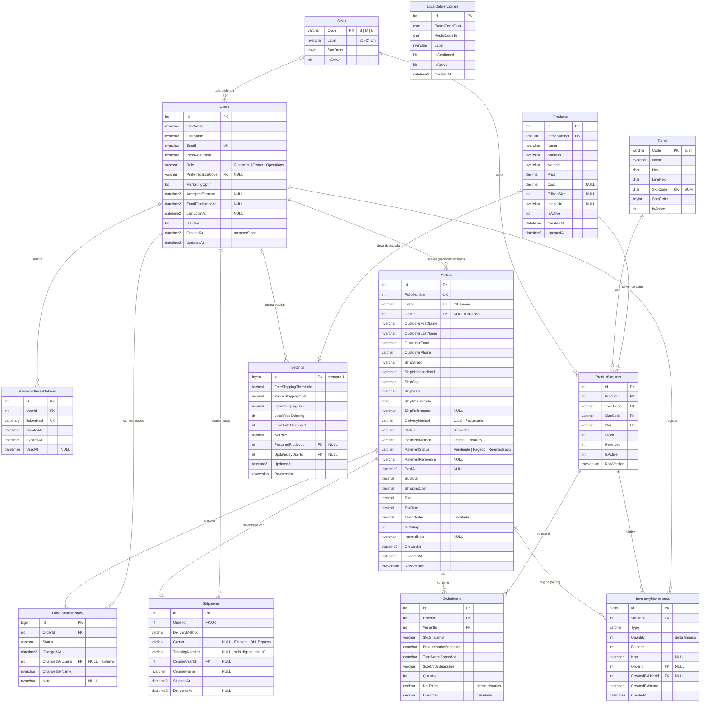

# DESIGN_DB.md — Esquema de base de datos · SOKKO (ソッコ)

> **Propósito:** propuesta del esquema de **SQL Server** que respaldará `apps/api-service` (EF Core). Documento para **revisión de arquitectura (Said)** antes de escribir entidades, configuraciones o migraciones.
> **Fuentes:** `CONTEXTO_MAESTRO.md`, `DESIGN.md` §4 y §9, `DESIGN_AUTH.md` §5 y §8, `DESIGN_ADMIN.md` §3, §5, §6 y §9, `DECISIONES_ADMIN.md`, y las reglas ejecutables de `apps/web-store/src/data/catalog.mock.js`, `apps/web-store/src/services/authService.js`, `apps/admin-panel/src/data/seed.js` y `apps/admin-panel/src/domain/*.js`.
> **Alcance:** solo diseño. **No hay código C# ni migraciones en esta fase.** La fase siguiente (EF Core) toma este archivo como fuente de verdad.
> **Estado:** 🟡 Propuesta · pendiente de aprobación.

---

## Índice

1. [Convenciones y decisiones técnicas](#1-convenciones-y-decisiones-técnicas)
2. [Diagrama entidad-relación](#2-diagrama-entidad-relación)
3. [Especificación por tabla](#3-especificación-por-tabla)
4. [Reglas de negocio: BD vs. servicios .NET](#4-reglas-de-negocio-bd-vs-servicios-net)
5. [Datos semilla](#5-datos-semilla)
6. [Mapa SOA (clasificación de Erl)](#6-mapa-soa-clasificación-de-erl)
7. [Puntos abiertos para revisión](#7-puntos-abiertos-para-revisión)
8. [Historial de decisiones y cambios](#8-historial-de-decisiones-y-cambios)

---

## 1. Convenciones y decisiones técnicas

### 1.1 Nomenclatura

| Elemento | Convención | Ejemplo |
|---|---|---|
| Esquema | `dbo` (un solo esquema; el proyecto es pequeño) | `dbo.Orders` |
| Tablas | Inglés, **PascalCase, plural** | `ProductVariants`, `OrderStatusHistory` (sustantivo incontable, se deja en singular) |
| Columnas | Inglés, PascalCase | `UnitPrice`, `CreatedAt` |
| PK | `Id` | `Orders.Id` |
| FK | `{Entidad}Id` o `{Entidad}Code` para catálogos con clave natural | `OrderId`, `ToneCode` |
| Restricciones | `PK_{Tabla}`, `FK_{Tabla}_{Referida}`, `UQ_{Tabla}_{Cols}`, `CK_{Tabla}_{Regla}`, `IX_{Tabla}_{Cols}`, `DF_{Tabla}_{Col}` | `CK_ProductVariants_ReservedLeStock` |
| Valores de enums | ASCII, PascalCase, **sin acentos** | `PorPreparar`, `Devolucion`, `OxxoPay` |

Los nombres en inglés siguen lo que ya usan `DESIGN.md` §9 y `DESIGN_AUTH.md` §8 (`Products`, `PieceNumber`, `PasswordHash`…) y coinciden 1:1 con las propiedades de C# en EF Core, sin mapeos manuales. Los **valores** de los enums de negocio quedan en español porque son vocabulario del cliente (`Paqueteria`, `OxxoPay`, `Merma`) y así aparecen en `DECISIONES_ADMIN.md`. Los roles quedan en inglés (`Owner`, `Operations`, `Customer`) porque así los define el contrato de autorización (`[Authorize(Roles = "...")]`). **Ningún valor de enum en BD lleva espacios ni acentos**; la traducción a los códigos que ya usan los frontends está en §1.6.

### 1.2 Tipos de datos

| Dato | Tipo SQL Server | Motivo |
|---|---|---|
| Dinero (MXN) | `DECIMAL(10,2)` | Aritmética exacta en base 10: `FLOAT`/`REAL` acumulan error binario (0.1 + 0.2 ≠ 0.3) y `MONEY` redondea a 4 decimales en divisiones intermedias y no es portable. 10,2 cubre hasta 99,999,999.99 MXN, de sobra para un pedido o un reporte mensual. Mapea a `decimal` en C# sin pérdida. |
| Tasas (IVA) | `DECIMAL(5,4)` | 0.1600 con 4 decimales permite tasas como 0.0800 (frontera) sin redondeo. |
| Fechas y horas | `DATETIME2(3)` **en UTC**, default `SYSUTCDATETIME()` | Precisión de milisegundos, rango 0001–9999 y 6–8 bytes (menos que `DATETIMEOFFSET`). Guardar siempre UTC evita ambigüedad; la conversión a la hora del negocio (`America/Mazatlan`, UTC−7, sin horario de verano desde 2022) se hace en .NET para "Hoy", "7d", "30d" y "atrasado +48 h". Columnas con sufijo `At` (`CreatedAt`, `ShippedAt`). |
| Texto visible | `NVARCHAR(n)` | Unicode: nombres en japonés (`折紙・夜`), acentos y `ñ`. |
| Códigos técnicos | `VARCHAR(n)` / `CHAR(n)` | SKU, códigos de tono/talla, CP y enums son ASCII; ocupan la mitad. |
| Banderas | `BIT NOT NULL` con default | `GiftWrap`, `IsActive`, `MarketingOptIn`. |
| Cantidades de pares | `INT` | Enteros; los CHECK impiden negativos. |
| Hashes | `VARBINARY(32)` (SHA-256) / `NVARCHAR(256)` (PasswordHasher) | El token de restablecimiento se guarda como hash binario; la contraseña en el formato Base64 de `PasswordHasher<TUser>` (PBKDF2). |
| Concurrencia | `ROWVERSION` | Concurrencia optimista **solo para ediciones desde el panel** (catálogo, ajustes manuales de stock, transiciones de pedido, configuración) en `ProductVariants`, `Orders` y `Settings`. El checkout y la salida de inventario **no** dependen de ella: usan `UPDATE` atómicos condicionados (§4.1). |

**Intercalación:** la predeterminada de la instancia, `Modern_Spanish_CI_AS` o `SQL_Latin1_General_CP1_CI_AS`, ambas *case-insensitive*. Con esto `UNIQUE(Email)` ya no distingue mayúsculas, aunque la API de todos modos normaliza con `trim().ToLowerInvariant()` (igual que `authService.js`).

### 1.3 Enums: `VARCHAR + CHECK` en lugar de tablas catálogo

| Criterio | `VARCHAR + CHECK` ✅ (elegido para enums de flujo) | Tabla catálogo (elegido para Tonos y Tallas) |
|---|---|---|
| ¿Quién cambia los valores? | Solo el equipo de desarrollo (cada valor nuevo exige código nuevo: transiciones, botones, reglas) | El Dueño, desde el panel (tono nuevo, talla XL) |
| ¿Tienen atributos propios? | No (solo el código) | Sí (nombre, hex, etiqueta en cm, orden, código de SKU) |
| Lectura de datos | El valor se lee directo en la tabla (`Status = 'Enviado'`) sin JOIN | Requiere JOIN para mostrar el nombre |
| Mapeo EF Core | `enum` de C# + `HasConversion<string>()` | Entidad con navegación |

**Regla:** si la lógica del sistema depende del valor (estados del pedido, tipo de movimiento, método de pago o de entrega, rol, paquetería), es un enum con `CHECK`. Si es un dato que el negocio administra y que tiene atributos, es una tabla catálogo. Por eso `Tones` y `Sizes` son tablas (lo pide `DESIGN.md` §9) y los estados no lo son. Además, se guarda el texto y no un entero para que una consulta en SSMS se lea sola y la entrega escolar sea auditable.

### 1.4 Borrado: lógico, no físico

- **Nunca se borran** `Users`, `Products`, `ProductVariants`, `Orders` ni el kárdex: tienen historia contable. Se desactivan con `IsActive = 0`.
- Por eso **todas** las FK son `ON DELETE NO ACTION`, incluidas las que apuntan a `Orders` (`OrderItems`, `OrderStatusHistory`, `Shipments`, `InventoryMovements`) y a `ProductVariants` (`OrderItems`, `InventoryMovements`). Un `DELETE` accidental sobre un pedido o un SKU con historia **falla** en lugar de arrastrar líneas, historial, envío o kárdex.
- La **única** excepción es `PasswordResetTokens.UserId` (`CASCADE`): el token no tiene valor de auditoría.
- **EF Core:** una FK requerida es `Cascade` por convención, así que cada relación se configura con `OnDelete(DeleteBehavior.NoAction)` explícito (salvo la de `PasswordResetTokens`). La revisión de la migración debe confirmar que no aparece ningún `ON DELETE CASCADE` adicional.
- Purgar pedidos de prueba en Development es un paso explícito del *seeder* (borra hijos y luego el pedido), nunca una cascada.
- Con una sola cascada tampoco existe riesgo del error 1785 de SQL Server (*"may cause cycles or multiple cascade paths"*).

### 1.5 Folio del pedido `SKK-####`

- `CREATE SEQUENCE dbo.OrderFolioSeq AS INT START WITH 1001 INCREMENT BY 1` (sin caché, `NO CACHE`, para no perder números tras un reinicio).
- `Orders.FolioNumber INT NOT NULL DEFAULT (NEXT VALUE FOR dbo.OrderFolioSeq)` y `Orders.Folio AS ('SKK-' + CAST(FolioNumber AS VARCHAR(10))) PERSISTED` con `UNIQUE`.
- Se usa una secuencia en vez de `IDENTITY` para que el folio sea independiente de la PK y para que la API pueda reservarlo antes de insertar si lo necesita. Al partir de 1001 siempre hay al menos 4 dígitos (`SKK-1001`), como en el panel (`SKK-1027`…`SKK-1060`).

### 1.6 Equivalencias de enums: BD ↔ API (JSON) ↔ etiqueta UI

Valores de BD en ASCII PascalCase **sin espacios ni acentos**. La columna API es el código que ya usan `apps/admin-panel/src/domain/*.js` y `apps/web-store`, para que los frontends no cambien al conectarse.

| Enum (columna) | Valor BD | API (JSON) | Etiqueta UI | Conversión |
|---|---|---|---|---|
| Estado (`Orders.Status`, `OrderStatusHistory.Status`) | `PorPreparar` | `por_preparar` | Por preparar | `SnakeCaseLower` |
| | `Preparando` | `preparando` | Preparando | `SnakeCaseLower` |
| | `Enviado` | `enviado` | Enviado | `SnakeCaseLower` |
| | `EnRuta` | `en_ruta` | En ruta local | `SnakeCaseLower` |
| | `Entregado` | `entregado` | Entregado | `SnakeCaseLower` |
| | `Cancelado` | `cancelado` | Cancelado | `SnakeCaseLower` |
| | `Pagado` (solo historial) | `pagado` | Pagado | `SnakeCaseLower` |
| Entrega (`Orders.DeliveryMethod`, `Shipments.DeliveryMethod`) | `Local` | `local` | Entrega local | `SnakeCaseLower` |
| | `Paqueteria` | `paqueteria` | Paquetería | `SnakeCaseLower` |
| Método de pago (`Orders.PaymentMethod`) | `Tarjeta` | `Tarjeta` | Tarjeta | **Explícito** |
| | `OxxoPay` | `OXXO Pay` | OXXO Pay | **Explícito** |
| Estado de pago (`Orders.PaymentStatus`) | `Pendiente` | `pendiente` | Pendiente de pago | `SnakeCaseLower` (código nuevo; hoy el panel lo infiere con `isOxxoPending`) |
| | `Pagado` | `pagado` | Pagado | `SnakeCaseLower` |
| | `Reembolsado` | `reembolsado` | Reembolsado | `SnakeCaseLower` |
| Paquetería (`Shipments.Carrier`) | `Estafeta` | `Estafeta` | Estafeta | **Explícito** |
| | `DHLExpress` | `DHL Express` | DHL Express | **Explícito** |
| Movimiento (`InventoryMovements.Type`) | `Entrada` | `Entrada` | Entrada | **Explícito** |
| | `Merma` | `Merma` | Merma | **Explícito** |
| | `Devolucion` | `Devolución` | Devolución | **Explícito** |
| | `ConteoFisico` | `Conteo físico` | Conteo físico | **Explícito** |
| | `Venta` | `Venta` | Venta | **Explícito** |
| | `InventarioInicial` | `Inventario inicial` | Inventario inicial | **Explícito** |
| Rol (`Users.Role`) | `Owner` | `dueno` | Dueño | **Explícito** (`config/roles.js`) |
| | `Operations` | `operaciones` | Operaciones | **Explícito** |
| | `Customer` | `customer` | — (tienda) | `SnakeCaseLower` |

- **`SnakeCaseLower`**: `JsonStringEnumConverter(JsonNamingPolicy.SnakeCaseLower)` produce el código de la API a partir del nombre del `enum` de C# (`EnRuta` → `en_ruta`). Cubre estado, entrega y estado de pago.
- **Explícito**: el código del frontend tiene espacios, acentos o mayúsculas que ninguna política genera (`OXXO Pay`, `DHL Express`, `Conteo físico`, `dueno`). Se mapea con un diccionario por enum en la capa de DTO, con una prueba unitaria que recorra todos los valores en ambos sentidos.
- En EF Core todos se guardan con `HasConversion<string>()`: el valor de BD es el nombre del miembro del `enum`.

---

## 2. Diagrama entidad-relación

> `LocalDeliveryZones` no tiene FK: se consulta por rango contra `Orders.ShipPostalCode` en el servicio de envíos.

---

## 3. Especificación por tabla

Convención de las tablas: **N** = acepta `NULL`. Las columnas sin **N** son `NOT NULL`.

### 3.1 `Users` — cuentas de clientes y personal

**Para qué sirve:** una sola tabla de identidad para compradores (`Customer`) y personal interno (`Owner`, `Operations`). La usa el login de la tienda (`DESIGN_AUTH` §8) y el del panel (`DESIGN_ADMIN` §4/§9).

| Columna | Tipo | N | Default | Notas |
|---|---|---|---|---|
| `Id` | `INT IDENTITY(1,1)` | | | **PK** `PK_Users` |
| `FirstName` | `NVARCHAR(80)` | | | |
| `LastName` | `NVARCHAR(80)` | | | |
| `Email` | `NVARCHAR(254)` | | | **UQ** `UQ_Users_Email`. Guardado en minúsculas y sin espacios (RFC 5321: 254) |
| `PasswordHash` | `NVARCHAR(256)` | | | Salida de `PasswordHasher<User>` (PBKDF2 + sal). Nunca texto plano |
| `Role` | `VARCHAR(20)` | | `'Customer'` | `CK_Users_Role`: `IN ('Customer','Owner','Operations')` |
| `PreferredSizeCode` | `VARCHAR(3)` | N | | **FK** → `Sizes(Code)` `ON DELETE NO ACTION` |
| `MarketingOptIn` | `BIT` | | `0` | Aviso de ediciones limitadas |
| `AcceptedTermsAt` | `DATETIME2(3)` | N | | `CK_Users_CustomerAcceptedTerms`: `Role <> 'Customer' OR AcceptedTermsAt IS NOT NULL` |
| `EmailConfirmedAt` | `DATETIME2(3)` | N | | Confirmación por correo (futuro) |
| `LastLoginAt` | `DATETIME2(3)` | N | | |
| `IsActive` | `BIT` | | `1` | Baja lógica; un usuario inactivo no puede iniciar sesión |
| `CreatedAt` | `DATETIME2(3)` | | `SYSUTCDATETIME()` | Se expone como `memberSince` |
| `UpdatedAt` | `DATETIME2(3)` | | `SYSUTCDATETIME()` | Lo actualiza la API |

- `CK_Users_Email`: `Email LIKE '_%@_%._%'` (filtro grueso; la validación completa la hace la API con la regex de `DESIGN_AUTH` §5.1).
- **Índices:** `UQ_Users_Email` (búsqueda en login) · `IX_Users_Role` filtrado `WHERE Role <> 'Customer'` (lista de usuarios internos en Configuración).
- **¿Por qué `Users.Role` y no `Roles` + `UserRoles`?** `DESIGN_ADMIN` §9 deja abiertas ambas opciones. En v1 cada persona tiene **un solo rol** y los roles son fijos en el código (`config/roles.js`), así que la columna con `CHECK` alcanza y se evitan dos tablas y un JOIN en cada login. El rol viaja al JWT como *claim*. Ver punto abierto **P-01**: hay una cuenta demo que es Dueño *y* compradora.

### 3.2 `PasswordResetTokens` — enlaces para restablecer contraseña

**Para qué sirve:** guardar el token de un solo uso de `POST /api/auth/forgot-password`, válido 30 minutos (`DESIGN_AUTH` §4.4).

| Columna | Tipo | N | Default | Notas |
|---|---|---|---|---|
| `Id` | `INT IDENTITY` | | | **PK** |
| `UserId` | `INT` | | | **FK** → `Users(Id)` `ON DELETE CASCADE` |
| `TokenHash` | `VARBINARY(32)` | | | **UQ**. SHA-256 del token; el token en claro solo viaja en el correo |
| `CreatedAt` | `DATETIME2(3)` | | `SYSUTCDATETIME()` | |
| `ExpiresAt` | `DATETIME2(3)` | | | `CK_PasswordResetTokens_Expiry`: `ExpiresAt > CreatedAt` |
| `UsedAt` | `DATETIME2(3)` | N | | Se marca al usarlo; un token usado no vuelve a servir |

- **Índices:** `UQ_PasswordResetTokens_TokenHash` (búsqueda en `reset-password`) · `IX_PasswordResetTokens_UserId_ExpiresAt` (invalidar los tokens anteriores al emitir uno nuevo y depurar los vencidos).

### 3.3 `Tones` — catálogo de tonos

**Para qué sirve:** colores de tinte del catálogo (`TONES` en `catalog.mock.js`). Alimenta el filtro por tono, las muestras de color y la parte del SKU.

| Columna | Tipo | N | Default | Notas |
|---|---|---|---|---|
| `Code` | `VARCHAR(20)` | | | **PK** natural: `sumi`, `washi`, `laca`, `matcha` (lo que usa el JSON de `DESIGN` §9) |
| `Name` | `NVARCHAR(40)` | | | **UQ**. "Tinta Sumi" |
| `Hex` | `CHAR(7)` | | | `CK_Tones_Hex`: `Hex LIKE '#[0-9A-F][0-9A-F][0-9A-F][0-9A-F][0-9A-F][0-9A-F]'` |
| `LineHex` | `CHAR(7)` | | | Color del trazo sobre el tono (mismo CHECK) |
| `SkuCode` | `CHAR(3)` | | | **UQ**. `SUM`, `WAS`, `LAC`, `MAT`. `CK_Tones_SkuCode`: `LIKE '[A-Z][A-Z][A-Z]'` |
| `SortOrder` | `TINYINT` | | `0` | Orden en filtros |
| `IsActive` | `BIT` | | `1` | |

- `SkuCode` existe aparte del `Code` para que el SKU no dependa de que las 3 primeras letras del código sean únicas (hoy lo son; con un tono "sumire" ya no).

### 3.4 `Sizes` — catálogo de tallas

**Para qué sirve:** tallas S/M/L con su rango en cm.

| Columna | Tipo | N | Default | Notas |
|---|---|---|---|---|
| `Code` | `VARCHAR(3)` | | | **PK** natural: `S`, `M`, `L` (3 caracteres por si llega `XL`) |
| `Label` | `NVARCHAR(20)` | | | "22–24 cm" |
| `SortOrder` | `TINYINT` | | `0` | **UQ** |
| `IsActive` | `BIT` | | `1` | |

### 3.5 `Products` — piezas del catálogo

**Para qué sirve:** la "pieza" (modelo de calcetín): nombre, material, precio y tiraje. No tiene stock: el stock vive en la variante.

| Columna | Tipo | N | Default | Notas |
|---|---|---|---|---|
| `Id` | `INT IDENTITY` | | | **PK**. En la semilla se inserta igual a `PieceNumber` (7, 12, 3…) para que coincida con el mock |
| `PieceNumber` | `SMALLINT` | | | **UQ**. Número editorial de la pieza y base del SKU. `CK_Products_PieceNumber`: `BETWEEN 1 AND 999` |
| `Name` | `NVARCHAR(120)` | | | |
| `NameJp` | `NVARCHAR(60)` | | | "折紙・夜" |
| `Material` | `NVARCHAR(200)` | | | |
| `Price` | `DECIMAL(10,2)` | | | Precio vigente, IVA incluido. `CK_Products_Price`: `> 0` |
| `Cost` | `DECIMAL(10,2)` | N | | Opcional (`DECISIONES_ADMIN`: habilita margen después). `CK`: `IS NULL OR >= 0` |
| `EditionSize` | `INT` | N | | Tiraje de edición limitada (120, 80). `CK`: `IS NULL OR > 0` |
| `ImageUrl` | `NVARCHAR(500)` | N | | |
| `IsActive` | `BIT` | | `1` | Pieza visible en la tienda |
| `CreatedAt` / `UpdatedAt` | `DATETIME2(3)` | | `SYSUTCDATETIME()` | |

- **Índices:** `UQ_Products_PieceNumber` · `IX_Products_IsActive` (listado de la tienda).
- La pieza destacada del hero (`featuredId`) **no** es columna de `Products`, sino `Settings.FeaturedProductId`. Así solo puede haber una y no hay que vigilar un `IsFeatured` duplicado.

### 3.6 `ProductVariants` — SKU vendible (pieza × tono × talla)

**Para qué sirve:** la unidad de inventario y de venta. Cada fila es un SKU con su stock y sus pares apartados.

| Columna | Tipo | N | Default | Notas |
|---|---|---|---|---|
| `Id` | `INT IDENTITY` | | | **PK** |
| `ProductId` | `INT` | | | **FK** → `Products(Id)` `ON DELETE NO ACTION` |
| `ToneCode` | `VARCHAR(20)` | | | **FK** → `Tones(Code)` `ON DELETE NO ACTION` |
| `SizeCode` | `VARCHAR(3)` | | | **FK** → `Sizes(Code)` `ON DELETE NO ACTION` |
| `Sku` | `VARCHAR(20)` | | | **UQ**. `SKK-{PieceNumber 3 dígitos}-{Tones.SkuCode}-{SizeCode}` → `SKK-007-SUM-M`. `CK_ProductVariants_SkuFormat`: `Sku LIKE 'SKK-[0-9][0-9][0-9]-[A-Z][A-Z][A-Z]-[A-Z]%'` |
| `Stock` | `INT` | | `0` | Pares físicos en almacén. `CK_ProductVariants_Stock`: `Stock >= 0` |
| `Reserved` | `INT` | | `0` | Pares apartados por pedidos sin enviar. `CK_ProductVariants_Reserved`: `Reserved >= 0` |
| `IsActive` | `BIT` | | `1` | |
| `RowVersion` | `ROWVERSION` | | | Concurrencia optimista solo para ediciones del panel (catálogo, ajuste manual). El checkout y la salida usan `UPDATE` atómico (§4.1) |

- `CK_ProductVariants_ReservedLeStock`: `Reserved <= Stock` → **disponible = Stock − Reserved nunca es negativo**. Es la **red de seguridad**: el servicio valida antes (R-27) para que la API nunca responda 500 por este CHECK.
- **R-27 · Movimientos que bajan el stock frente a lo apartado:**
  - **Merma** ≤ `Stock − Reserved`. Mensaje: "No puede sacar más de {disponible} pares; {apartados} están apartados para pedidos."
  - **Conteo físico** o **importación** (`InventarioInicial`) con un número menor que `Reserved` se rechaza: "El conteo ({n}) es menor que los {apartados} pares apartados. Cancele o surta esos pedidos antes de ajustar."
  - La API responde **409** (conflicto con pedidos apartados) o **422** (cantidad inválida) con ese mensaje; nunca deja que salte el CHECK. En la importación, la fila se marca con error en la vista previa y no se aplica.
  - El dominio del panel (`apps/admin-panel/src/domain/inventory.js`, que hoy valida la Merma contra `stock`) se alinea en un **PR aparte del frontend**; este documento no lo modifica.
- `UQ_ProductVariants_Product_Tone_Size`: (`ProductId`, `ToneCode`, `SizeCode`) → no hay dos SKU para la misma combinación.
- **Índices:** `UQ_ProductVariants_Sku` (búsqueda del panel, importación CSV) · `IX_ProductVariants_ToneCode` (filtro por tono).
- "Disponible" (`Stock − Reserved`) y el estado `agotado/pocos/ok` **no** se guardan: se calculan en consulta, porque el umbral vive en `Settings` y cambia.

### 3.7 `InventoryMovements` — kárdex

**Para qué sirve:** bitácora inmutable de cada cambio de stock (`DESIGN_ADMIN` §5.3). Es el respaldo de `ProductVariants.Stock`: el último `Balance` de un SKU debe ser igual a su `Stock`.

| Columna | Tipo | N | Default | Notas |
|---|---|---|---|---|
| `Id` | `BIGINT IDENTITY` | | | **PK** (crece rápido) |
| `VariantId` | `INT` | | | **FK** → `ProductVariants(Id)` `ON DELETE NO ACTION` |
| `Type` | `VARCHAR(20)` | | | `CK_InventoryMovements_Type`: `IN ('Entrada','Merma','Devolucion','ConteoFisico','Venta','InventarioInicial')` |
| `Quantity` | `INT` | | | Delta **firmado** (+ entra, − sale) |
| `Balance` | `INT` | | | Saldo después del movimiento. `CK_InventoryMovements_Balance`: `>= 0` |
| `Note` | `NVARCHAR(250)` | N | | Motivo. "Pedido SKK-1042" en ventas |
| `OrderId` | `INT` | N | | **FK** → `Orders(Id)` `ON DELETE NO ACTION`. Solo para `Venta` |
| `CreatedByUserId` | `INT` | N | | **FK** → `Users(Id)` `ON DELETE NO ACTION`. `NULL` = proceso automático |
| `CreatedByName` | `NVARCHAR(80)` | | | Copia del nombre ("Daniel R.") para que el kárdex se lea aunque el usuario cambie |
| `CreatedAt` | `DATETIME2(3)` | | `SYSUTCDATETIME()` | |

Reglas CHECK de coherencia por tipo:
- `CK_InventoryMovements_Sign`:
  `(Type IN ('Entrada','Devolucion') AND Quantity > 0) OR (Type IN ('Merma','Venta') AND Quantity < 0) OR (Type IN ('ConteoFisico','InventarioInicial'))`. El conteo y la importación fijan el stock, así que su delta puede ser +, − o 0.
- `CK_InventoryMovements_NoteRequired`: `Type NOT IN ('Merma','Devolucion') OR LEN(LTRIM(RTRIM(Note))) > 0`
- `CK_InventoryMovements_SaleHasOrder`: `(Type = 'Venta') = (OrderId IS NOT NULL)`, expresado como `(Type = 'Venta' AND OrderId IS NOT NULL) OR (Type <> 'Venta' AND OrderId IS NULL)`.

**Índices:** `IX_InventoryMovements_VariantId_CreatedAt` (`VariantId`, `CreatedAt DESC`) `INCLUDE (Type, Quantity, Balance, CreatedByName, Note)`, para el kárdex del más reciente al más antiguo · `IX_InventoryMovements_OrderId` filtrado `WHERE OrderId IS NOT NULL`.

> La API solo hace `INSERT` en esta tabla. Sin `UPDATE` ni `DELETE`: un error se corrige con un movimiento compensatorio (`ConteoFisico`).

### 3.8 `Orders` — pedidos

**Para qué sirve:** la cabecera del pedido con copia de los datos del cliente y del envío, totales, pago, estado operativo y nota interna.

| Columna | Tipo | N | Default | Notas |
|---|---|---|---|---|
| `Id` | `INT IDENTITY` | | | **PK** (interna; la API expone `Folio`) |
| `FolioNumber` | `INT` | | `NEXT VALUE FOR dbo.OrderFolioSeq` | **UQ**. `CK`: `>= 1000` |
| `Folio` | `AS ('SKK-' + CAST(FolioNumber AS VARCHAR(10))) PERSISTED` | | | **UQ** `UQ_Orders_Folio`. Llave pública: `/api/admin/orders/{folio}` |
| `UserId` | `INT` | N | | **FK** → `Users(Id)` `ON DELETE NO ACTION`. `NULL` = **compra como invitado** |
| `CustomerFirstName` | `NVARCHAR(80)` | | | **Copia** al momento de la compra |
| `CustomerLastName` | `NVARCHAR(80)` | | | |
| `CustomerEmail` | `NVARCHAR(254)` | | | Para confirmación y búsqueda (también en invitados) |
| `CustomerPhone` | `VARCHAR(15)` | | | Requerido por paquetería y repartidor (ver **P-05**) |
| `ShipStreet` | `NVARCHAR(150)` | | | Calle y número |
| `ShipNeighborhood` | `NVARCHAR(100)` | | | Colonia |
| `ShipCity` | `NVARCHAR(80)` | | | "Los Mochis" |
| `ShipState` | `NVARCHAR(40)` | | | "Sinaloa" |
| `ShipPostalCode` | `CHAR(5)` | | | `CK_Orders_PostalCode`: `LIKE '[0-9][0-9][0-9][0-9][0-9]'` |
| `ShipReferences` | `NVARCHAR(250)` | N | | Entre calles, color de casa (útil en entrega local) |
| `DeliveryMethod` | `VARCHAR(12)` | | | `CK_Orders_DeliveryMethod`: `IN ('Local','Paqueteria')`. Lo calcula el servidor con el CP |
| `Status` | `VARCHAR(15)` | | `'PorPreparar'` | `CK_Orders_Status`: `IN ('PorPreparar','Preparando','Enviado','EnRuta','Entregado','Cancelado')` |
| `PaymentMethod` | `VARCHAR(10)` | | | `CK_Orders_PaymentMethod`: `IN ('Tarjeta','OxxoPay')` |
| `PaymentStatus` | `VARCHAR(12)` | | `'Pendiente'` | `CK`: `IN ('Pendiente','Pagado','Reembolsado')`. Tarjeta nace `Pagado`; OXXO Pay nace `Pendiente`. Ver **P-03** |
| `PaymentReference` | `NVARCHAR(100)` | N | | Id de la pasarela o referencia OXXO (`TODO(api)`) |
| `PaidAt` | `DATETIME2(3)` | N | | `CK_Orders_PaidAt`: `PaymentStatus = 'Pendiente' OR PaidAt IS NOT NULL` |
| `Subtotal` | `DECIMAL(10,2)` | | | `CK`: `>= 0`. Σ `OrderItems.LineTotal` (lo garantiza el servicio) |
| `ShippingCost` | `DECIMAL(10,2)` | | | `CK`: `>= 0`. Tarifa cobrada (0, 49, 99) **congelada** al comprar |
| `Total` | `DECIMAL(10,2)` | | | `CK_Orders_Total`: `Total = Subtotal + ShippingCost` |
| `TaxRate` | `DECIMAL(5,4)` | | | IVA vigente al comprar (0.1600). Copia de `Settings.IvaRate` |
| `TaxIncluded` | `AS (ROUND(Total - Total / (1 + TaxRate), 2)) PERSISTED` | | | IVA incluido, informativo (`DESIGN` §4.4). Para el reporte del contador |
| `GiftWrap` | `BIT` | | `1` | Furoshiki, **true por defecto** y sin costo (`DESIGN` §4.4) |
| `InternalNote` | `NVARCHAR(500)` | N | | Nota del personal; nunca se expone al cliente |
| `CreatedAt` | `DATETIME2(3)` | | `SYSUTCDATETIME()` | Base del cálculo "atrasado +48 h" |
| `UpdatedAt` | `DATETIME2(3)` | | `SYSUTCDATETIME()` | |
| `RowVersion` | `ROWVERSION` | | | Evita que dos operadores avancen el mismo pedido a la vez |

CHECK de coherencia entre método de entrega y estado (`orders.js` → `nextStatus`):
- `CK_Orders_StatusMatchesDelivery`: `NOT (Status = 'Enviado' AND DeliveryMethod = 'Local') AND NOT (Status = 'EnRuta' AND DeliveryMethod = 'Paqueteria')`.

CHECK de pago antes de surtir (OXXO Pay):
- `CK_Orders_PaymentBeforeFulfillment`: `PaymentStatus = 'Pagado' OR Status IN ('PorPreparar','Cancelado')`. Un pedido OXXO sin pagar no puede pasar a `Preparando`, `Enviado`, `EnRuta` ni `Entregado`; un pedido `Reembolsado` solo puede estar `Cancelado` (o `PorPreparar` mientras se cancela en la misma transacción).
- La pestaña "OXXO pendiente" del panel pasa a ser `PaymentMethod = 'OxxoPay' AND PaymentStatus = 'Pendiente'`.

`UQ_Orders_Id_DeliveryMethod` (`Id`, `DeliveryMethod`): llave alterna que solo existe para la FK compuesta desde `Shipments` (§3.11).

**Índices:**
- `IX_Orders_Status_CreatedAt` (`Status`, `CreatedAt`) `INCLUDE (DeliveryMethod, PaymentMethod, PaymentStatus, Total)`: pestañas de Pedidos, cola de trabajo y atrasados.
- `IX_Orders_CreatedAt` (`CreatedAt`) `INCLUDE (Status, Total, ShippingCost, Subtotal)`: KPIs y gráfica del dashboard por rango.
- `IX_Orders_UserId_CreatedAt` filtrado `WHERE UserId IS NOT NULL`: "Mis pedidos" (`GET /api/orders/mine`).
- `IX_Orders_CustomerEmail`: búsqueda en el panel y número de pedidos por cliente (incluye invitados).

**¿Por qué copiar los datos del cliente y del envío?** El pedido es un documento histórico: si el cliente cambia de nombre o de domicilio, la guía y el reporte de ese pedido no deben cambiar. Además, el invitado no tiene fila en `Users`.

### 3.9 `OrderItems` — líneas del pedido

**Para qué sirve:** qué SKU, cuántos pares y a qué precio se vendieron.

| Columna | Tipo | N | Default | Notas |
|---|---|---|---|---|
| `Id` | `INT IDENTITY` | | | **PK** |
| `OrderId` | `INT` | | | **FK** → `Orders(Id)` `ON DELETE NO ACTION` |
| `VariantId` | `INT` | | | **FK** → `ProductVariants(Id)` `ON DELETE NO ACTION` |
| `SkuSnapshot` | `VARCHAR(20)` | | | Copia del SKU |
| `ProductNameSnapshot` | `NVARCHAR(120)` | | | Copia del nombre de la pieza |
| `ToneNameSnapshot` | `NVARCHAR(40)` | | | "Tinta Sumi" |
| `SizeCodeSnapshot` | `VARCHAR(3)` | | | |
| `Quantity` | `INT` | | | `CK_OrderItems_Quantity`: `> 0` |
| `UnitPrice` | `DECIMAL(10,2)` | | | **Precio histórico** (`UnitPriceAtPurchase` en `DESIGN` §9). `CK`: `>= 0` |
| `LineTotal` | `AS (CAST(Quantity * UnitPrice AS DECIMAL(10,2))) PERSISTED` | | | |

- `UQ_OrderItems_Order_Variant` (`OrderId`, `VariantId`): una línea por SKU por pedido; repetir un SKU suma cantidad, igual que el carrito (`DESIGN` §4.4) y el seed.
- **Índices:** `IX_OrderItems_VariantId` (más vendidas y ventas por talla del dashboard).
- `ON DELETE NO ACTION` desde `Orders` (§1.4): las líneas son historial de ventas y no se borran en cascada.

### 3.10 `OrderStatusHistory` — historial de estados

**Para qué sirve:** la línea de tiempo del detalle del pedido (`{ status, at, by }` en `orders.js`) y la auditoría de quién movió qué.

| Columna | Tipo | N | Default | Notas |
|---|---|---|---|---|
| `Id` | `BIGINT IDENTITY` | | | **PK** |
| `OrderId` | `INT` | | | **FK** → `Orders(Id)` `ON DELETE NO ACTION` |
| `Status` | `VARCHAR(15)` | | | `CK`: `IN ('Pagado','PorPreparar','Preparando','Enviado','EnRuta','Entregado','Cancelado')`. Incluye el hito `Pagado`, que el panel muestra en la línea de tiempo |
| `ChangedAt` | `DATETIME2(3)` | | `SYSUTCDATETIME()` | |
| `ChangedByUserId` | `INT` | N | | **FK** → `Users(Id)` `ON DELETE NO ACTION`. `NULL` = sistema |
| `ChangedByName` | `NVARCHAR(80)` | | | "Tienda en línea", "Aiko M." |
| `Note` | `NVARCHAR(250)` | N | | Motivo de cancelación, etc. |

- **Hito `Pagado`:** se inserta en la misma transacción en que se registra `Orders.PaidAt` (`ChangedAt = PaidAt`), **no** al crear el pedido. Con Tarjeta coincide con la creación; con OXXO Pay llega cuando se confirma el pago. El *seeder* demo del panel (`apps/admin-panel/src/data/seed.js`, que hoy lo pone al crear también en OXXO) se ajusta en el PR del frontend.
- **Índices:** `IX_OrderStatusHistory_OrderId_ChangedAt`.

### 3.11 `Shipments` — entrega del pedido

**Para qué sirve:** los datos de salida física del pedido: paquetería + guía, o repartidor local. Se crea al pasar a `Enviado`/`EnRuta`.

| Columna | Tipo | N | Default | Notas |
|---|---|---|---|---|
| `Id` | `INT IDENTITY` | | | **PK** |
| `OrderId` | `INT` | | | **UQ** (1 envío por pedido en v1) |
| `DeliveryMethod` | `VARCHAR(12)` | | | Repite el método del pedido. **FK compuesta** (`OrderId`, `DeliveryMethod`) → `Orders(Id, DeliveryMethod)` `ON DELETE NO ACTION`: la BD garantiza que el envío y el pedido digan lo mismo |
| `Carrier` | `VARCHAR(20)` | N | | `CK`: `IS NULL OR IN ('Estafeta','DHLExpress')` (API: `DHL Express`, §1.6) |
| `TrackingNumber` | `VARCHAR(30)` | N | | `CK_Shipments_Tracking`: `IS NULL OR (LEN(TrackingNumber) >= 10 AND TrackingNumber NOT LIKE '%[^0-9]%')`, equivalente a `^\d{10,}$` |
| `CourierUserId` | `INT` | N | | **FK** → `Users(Id)` `ON DELETE NO ACTION`. Repartidor (personal de Operaciones) |
| `CourierName` | `NVARCHAR(80)` | N | | Copia del nombre |
| `ShippedAt` | `DATETIME2(3)` | | `SYSUTCDATETIME()` | |
| `DeliveredAt` | `DATETIME2(3)` | N | | `CK`: `IS NULL OR DeliveredAt >= ShippedAt` |

- `CK_Shipments_ByMethod`:
  `(DeliveryMethod = 'Paqueteria' AND Carrier IS NOT NULL AND TrackingNumber IS NOT NULL AND CourierUserId IS NULL) OR (DeliveryMethod = 'Local' AND CourierUserId IS NOT NULL AND Carrier IS NULL AND TrackingNumber IS NULL)`
- **Índices:** `UQ_Shipments_OrderId` · `IX_Shipments_TrackingNumber` filtrado `WHERE TrackingNumber IS NOT NULL` (búsqueda por guía).
- **Costo cobrado:** `DESIGN_ADMIN` §9 lo sugiere en `Shipments`, pero aquí se queda solo en `Orders.ShippingCost`. Así hay una sola fuente del total y el pedido existe con su costo desde antes de enviarse (ver **D-14**).
- **¿Por qué una tabla aparte y no columnas en `Orders`?** Separa lo comercial (pedido) de lo logístico (salida) y deja lista la evolución a **varios envíos por pedido** (envío parcial, reenvío por devolución): basta con quitar el `UNIQUE(OrderId)`.

### 3.12 `Settings` — configuración del negocio (fila única)

**Para qué sirve:** los parámetros que la tienda lee con `GET /api/config` y el Dueño edita en Configuración.

| Columna | Tipo | N | Default | Notas |
|---|---|---|---|---|
| `Id` | `TINYINT` | | `1` | **PK**. `CK_Settings_Singleton`: `Id = 1` |
| `FreeShippingThreshold` | `DECIMAL(10,2)` | | | `CK`: `> 0`. 799 |
| `ParcelShippingCost` | `DECIMAL(10,2)` | | | `CK`: `>= 0`. 99 |
| `LocalShippingCost` | `DECIMAL(10,2)` | | | `CK`: `>= 0`. 49 |
| `LocalFreeShipping` | `BIT` | | `1` | El umbral también aplica a la entrega local |
| `FewUnitsThreshold` | `INT` | | | `CK`: `>= 0`. 4 |
| `IvaRate` | `DECIMAL(5,4)` | | | `CK`: `BETWEEN 0 AND 1`. 0.1600 |
| `FeaturedProductId` | `INT` | N | | **FK** → `Products(Id)` `ON DELETE NO ACTION`. Pieza del hero |
| `UpdatedByUserId` | `INT` | N | | **FK** → `Users(Id)` `ON DELETE NO ACTION` |
| `UpdatedAt` | `DATETIME2(3)` | | `SYSUTCDATETIME()` | |
| `RowVersion` | `ROWVERSION` | | | |

**¿Por qué una fila tipada y no una tabla clave-valor (`Key`, `Value`)?** Con columnas reales cada valor tiene su tipo y su `CHECK` (un costo no puede ser texto ni negativo), EF Core lo mapea a una clase normal y no hay que convertir cadenas. La desventaja (agregar un parámetro requiere migración) no pesa: cada parámetro nuevo trae código nuevo de todos modos.

### 3.13 `LocalDeliveryZones` — zona de entrega local

**Para qué sirve:** los CP o rangos de CP donde aplica la entrega local con repartidor (Los Mochis y ejidos de Ahome).

| Columna | Tipo | N | Default | Notas |
|---|---|---|---|---|
| `Id` | `INT IDENTITY` | | | **PK** |
| `PostalCodeFrom` | `CHAR(5)` | | | `CK`: `LIKE '[0-9][0-9][0-9][0-9][0-9]'` |
| `PostalCodeTo` | `CHAR(5)` | | | Mismo CHECK. Un CP suelto se guarda con `From = To` |
| `Label` | `NVARCHAR(80)` | | | "Los Mochis" |
| `IsConfirmed` | `BIT` | | `1` | `0` = "por confirmar con el cliente" |
| `IsActive` | `BIT` | | `1` | |
| `CreatedAt` | `DATETIME2(3)` | | `SYSUTCDATETIME()` | |

- `CK_LocalDeliveryZones_Range`: `PostalCodeFrom <= PostalCodeTo`. Con `CHAR(5)` de solo dígitos, el orden de texto es igual al numérico y conserva el cero inicial (CP `06700` de CDMX).
- `UQ_LocalDeliveryZones_Range` (`PostalCodeFrom`, `PostalCodeTo`).
- **Índices:** el `UQ` cubre la consulta `WHERE @cp BETWEEN PostalCodeFrom AND PostalCodeTo AND IsActive = 1`.
- **Se guarda como rango y no como texto `"81200–81299"`** (como en el panel) para poder consultar con `BETWEEN` y validar `From <= To` en la BD. La API convierte a texto (`formatZone`) y viceversa (`parseZone`).
- Que dos rangos no se encimen no se puede expresar con un CHECK de fila: lo valida el servicio (§4).

### 3.14 Tablas consideradas y descartadas (v1)

| Tabla | Decisión | Motivo |
|---|---|---|
| `Roles` / `UserRoles` | ❌ No en v1 | Un rol por persona y roles fijos en código (§3.1). Se agregan si aparece Contabilidad (P2) o una persona con dos roles |
| `Customers` separada de `Users` | ❌ | El invitado se resuelve con la copia de datos en `Orders`; un cliente registrado es un `User` |
| `Addresses` (libreta de direcciones) | ⏳ P1 | No hay pantalla que la use; hoy la dirección vive copiada en el pedido |
| `Carriers` | ❌ | Dos valores fijos ligados a lógica (formato de guía) → enum con CHECK |
| `DailySales` (agregado) | ❌ | Se calcula de `Orders` con `IX_Orders_CreatedAt`; con el volumen esperado no hace falta materializar. Se puede proponer una **vista** `vw_DailySales` en la fase de API |
| `AuditLogs` | ⏳ P2 | `DESIGN_ADMIN` §9 la marca como P2. `OrderStatusHistory` y `InventoryMovements` ya cubren lo crítico |
| `Payments` | ⏳ Al integrar pasarela | En v1 el pago es simulado y cabe en 4 columnas de `Orders`. Con pagos parciales o reintentos se separa |

---

## 4. Reglas de negocio: BD vs. servicios .NET

**Principio:** la BD garantiza los **invariantes de una fila** (no dejar el sistema en un estado imposible aunque falle el código), y los servicios garantizan las **reglas de proceso** (secuencias, cálculos entre tablas, mensajes para el usuario). Las reglas críticas se aplican en los dos lados: el servicio da el mensaje amable y la BD es la red de seguridad.

| # | Regla | Fuente | En SQL Server | En .NET (servicio) |
|---|---|---|---|---|
| R-01 | Correo único por cuenta, sin distinguir mayúsculas | AUTH §5.3 | `UQ_Users_Email` + intercalación CI | Normaliza y devuelve `409` "Este correo ya tiene una cuenta…" |
| R-02 | Contraseña: ≥ 8, mayúsculas, minúsculas, número | AUTH §5.2 | — (solo ve el hash) | Valida y hashea con `PasswordHasher` |
| R-03 | Rol válido | ADMIN §3 | `CK_Users_Role` | `[Authorize(Roles = …)]` y *claim* en el JWT |
| R-04 | Token de restablecimiento: 30 min y un solo uso | AUTH §4.4 | `CK` `ExpiresAt > CreatedAt`, `UQ` del hash | Fija `ExpiresAt = now + 30 min`, compara hash, marca `UsedAt`, responde `202` siempre |
| R-05 | Un SKU por combinación pieza-tono-talla | DESIGN §9 | `UQ_ProductVariants_Product_Tone_Size`, `UQ` de `Sku` | Genera el SKU con el formato |
| R-06 | Formato de SKU `SKK-###-XXX-T` | ADMIN §6.1 | `CK_ProductVariants_SkuFormat` (forma) | Garantiza que corresponda a la pieza, el tono y la talla |
| R-07 | Stock y apartados nunca negativos; apartado ≤ stock | ADMIN §5.1, §5.3 | `CK` `Stock >= 0`, `Reserved >= 0`, `Reserved <= Stock` | Valida disponible antes de apartar ("No hay pares suficientes") |
| R-08 | Pedido pagado aparta pares | ADMIN §5.1 | `CK_ProductVariants_ReservedLeStock` (red de seguridad) | `UPDATE` atómico condicionado por línea en la transacción del checkout (§4.1) |
| R-09 | Enviar / salir a ruta descuenta stock y escribe "Venta" | ADMIN §5.1 | `CK_InventoryMovements_SaleHasOrder`, `CK` de signo | `Stock -= qty`, `Reserved -= qty` con `OUTPUT inserted.Stock` como `Balance`, inserta movimiento, todo en **una transacción** (§4.1) |
| R-10 | Cancelar libera apartados | ADMIN §5.1 | — | `Reserved -= qty` atómico + historial (§4.1) |
| R-11 | Transiciones válidas según método de entrega y pago | ADMIN §5.1 | `CK_Orders_StatusMatchesDelivery`, `CK_Orders_PaymentBeforeFulfillment` (combinaciones imposibles) | Máquina de estados (`nextStatus`, `canCancel`); una tabla de filas sueltas no conoce el estado anterior |
| R-12 | Paquetería exige paquetería + guía `^\d{10,}$`; local exige repartidor | ADMIN §5.1 | `CK_Shipments_ByMethod`, `CK_Shipments_Tracking`, FK compuesta | Mensajes "Escriba el número de guía…" / "Elija quién lleva el pedido." |
| R-13 | Total = subtotal + envío | DESIGN §4.4 | `CK_Orders_Total` | **Recalcula todo en el servidor**: nunca confía en totales del cliente |
| R-14 | Envío: local si el CP está en zona; gratis desde umbral (local solo si `LocalFreeShipping`) | ADMIN §5.2 | `CK` de montos ≥ 0 en `Settings` | `computeShipping` reproducido en C# con pruebas |
| R-15 | Precio histórico en el pedido | DESIGN §9 | `OrderItems.UnitPrice NOT NULL` | Copia `Products.Price` al crear la línea |
| R-16 | Folio único `SKK-####` | ADMIN §6.1 | `SEQUENCE` + `UQ_Orders_Folio` | — |
| R-17 | Atrasado = en bodega +48 h | ADMIN §5.1 | `IX_Orders_Status_CreatedAt` (rendimiento) | Calcula con `CreatedAt` y la hora del servidor |
| R-18 | Kárdex: saldo nunca negativo; motivo obligatorio en Merma y Devolución | ADMIN §5.3 | `CK_InventoryMovements_Balance`, `CK_..._NoteRequired`, `CK_..._Sign` | Valida cantidades y mensajes ("No puede sacar más de {n} pares.") |
| R-19 | Último saldo del kárdex = stock del SKU | ADMIN §6.1 | — (cruza filas) | Movimiento y stock en la misma transacción; prueba de integración que lo verifica |
| R-20 | Importación CSV: SKU existente, stock entero ≥ 0, duplicados | ADMIN §5.4 | FK/`UQ` de SKU, `CK` de stock | `previewCsv` en C#; aplica solo filas válidas como `InventarioInicial` |
| R-21 | CP de 5 dígitos; rango con inicio ≤ fin | ADMIN §5.2 | `CK` de formato y `From <= To` | Valida y además evita rangos encimados |
| R-22 | Configuración: montos enteros ≥ 0, umbral > 0, al menos una zona | ADMIN §7 | `CK` de `Settings` | "Al menos un CP" y enteros (la BD admite centavos) |
| R-23 | Una sola fila de configuración | — | `CK_Settings_Singleton` | — |
| R-24 | Operaciones no ve montos en pesos | ADMIN §3 | — | Los DTOs de Operaciones omiten montos |
| R-25 | Concurrencia: dos operadores sobre el mismo pedido o SKU desde el panel | — | `ROWVERSION` | Captura `DbUpdateConcurrencyException` → `409` con mensaje. El checkout y la salida no usan este mecanismo (§4.1) |
| R-26 | Cliente registrado acepta términos | AUTH §4.3 | `CK_Users_CustomerAcceptedTerms` | Rechaza el registro sin `acceptedTerms` |
| R-27 | Merma ≤ `Stock − Reserved`; Conteo físico o importación por debajo de `Reserved` se rechaza | ADMIN §5.3, §5.4 | `CK_ProductVariants_ReservedLeStock` (red de seguridad) | Valida antes de escribir y responde `409`/`422` con mensaje claro, **nunca 500** (§3.6). El panel se alinea en un PR aparte del frontend |

### 4.1 Transacciones de inventario y concurrencia

Las operaciones que tocan `Stock`/`Reserved` desde la tienda o al surtir **no** leen la fila, la modifican en memoria y la guardan: cada cambio es un `UPDATE` atómico condicionado, que SQL Server ejecuta con bloqueo de fila. Así dos compras simultáneas del último par no pueden apartarlo las dos, sin reintentos ni `409` por `RowVersion`.

| Operación | Transacción (`READ COMMITTED`) | Si falla |
|---|---|---|
| **Apartar** (checkout, `CheckoutOrder`) | Por cada línea, **en orden ascendente de `VariantId`**: `UPDATE ProductVariants SET Reserved = Reserved + @q WHERE Id = @id AND IsActive = 1 AND Stock - Reserved >= @q`, y se verifica `@@ROWCOUNT = 1`. Después se insertan `Orders`, `OrderItems` y, si el pago es con Tarjeta, el hito `Pagado`. | `@@ROWCOUNT = 0` en cualquier línea → `ROLLBACK` y `409` "No hay pares suficientes de {SKU}" |
| **Surtir** (`Enviado`/`EnRuta`, `FulfillOrder`) | Por línea, en orden ascendente de `VariantId`: `UPDATE … SET Stock = Stock - @q, Reserved = Reserved - @q OUTPUT inserted.Stock WHERE Id = @id AND Reserved >= @q`. El valor de `OUTPUT inserted.Stock` es el `Balance` del movimiento `Venta`. Luego `Shipments`, `Orders.Status` (con `RowVersion`) y `OrderStatusHistory`. | Fila no afectada → `ROLLBACK` y `409` (inconsistencia de apartados; se registra para revisión) |
| **Cancelar** (`FulfillOrder`) | Por línea, en orden ascendente de `VariantId`: `UPDATE … SET Reserved = Reserved - @q WHERE Id = @id AND Reserved >= @q`; luego estado e historial. | Igual que surtir |
| **Ajuste manual / importación** (`AdjustInventory`, `ImportInventory`) | Valida R-27; `UPDATE … SET Stock = @nuevo OUTPUT inserted.Stock WHERE Id = @id AND RowVersion = @rv AND @nuevo >= Reserved` e inserta el movimiento con ese `Balance`. | `409` si cambió la fila (otro operador o una venta) o si queda por debajo de lo apartado |

- **Orden de bloqueo:** todas las transacciones que tocan varias variantes las actualizan en orden ascendente de `VariantId`, así dos pedidos con los mismos SKU nunca se esperan en círculo (sin *deadlocks*).
- **Balance del kárdex:** siempre sale de `OUTPUT inserted.Stock` del mismo `UPDATE`, nunca de una lectura previa; con eso R-19 (último saldo = stock) se mantiene aunque haya ventas y ajustes simultáneos.
- **`RowVersion`** queda solo para ediciones desde el panel (catálogo, ajustes manuales, transiciones de pedido, configuración). Un `UPDATE` atómico de checkout también cambia el `RowVersion` de la variante, de modo que un ajuste manual abierto sobre ese SKU recibe `409` y se recarga.
- **EF Core:** estos `UPDATE` se ejecutan con SQL parametrizado dentro de la transacción del `DbContext` (no con el seguimiento de cambios), porque `ExecuteUpdate` no devuelve `OUTPUT`.

---

## 5. Datos semilla

La semilla corre en la fase de EF Core (idempotente, solo en Development salvo catálogos y configuración). Fechas de semilla en UTC.

### 5.1 `Tones` (4)

| Code | Name | Hex | LineHex | SkuCode | SortOrder |
|---|---|---|---|---|---|
| `sumi` | Tinta Sumi | `#2C2925` | `#F4F0EB` | `SUM` | 1 |
| `washi` | Blanco Washi | `#EFE8DC` | `#23211E` | `WAS` | 2 |
| `laca` | Rojo Laca | `#9E2F2C` | `#F4F0EB` | `LAC` | 3 |
| `matcha` | Oliva Matcha | `#6E7A5E` | `#F4F0EB` | `MAT` | 4 |

### 5.2 `Sizes` (3)

| Code | Label | SortOrder |
|---|---|---|
| `S` | 22–24 cm | 1 |
| `M` | 25–27 cm | 2 |
| `L` | 28–30 cm | 3 |

### 5.3 `Products` (6)

`Id = PieceNumber` para que coincida con `catalog.mock.js` y `seed.js`.

| Id / PieceNumber | Name | NameJp | Material | Price | EditionSize |
|---|---|---|---|---|---|
| 7 | Tabi Origami Noche | 折紙・夜 | Algodón peinado D-200 · pliegue en empeine | 420.00 | 120 |
| 12 | Lino Komorebi | 木漏れ日 | Lino y algodón · tinte de té verde | 380.00 | NULL |
| 3 | Kintsugi Washi | 金継ぎ | Algodón peinado · costura dorada visible | 460.00 | 80 |
| 21 | Hanami Laca | 花見 | Algodón peinado · pigmento mineral rojo | 395.00 | NULL |
| 15 | Tsuchi Raíz | 土 | Algodón y bambú · teñido con tierra ocre | 360.00 | NULL |
| 9 | Mizu Calma | 水 | Algodón peinado · punto tubular sin costura | 340.00 | NULL |

`Cost = NULL`, `ImageUrl = NULL`, `IsActive = 1` en todas.

### 5.4 `ProductVariants` (42 SKU) y stock inicial

Combinaciones = tonos de cada pieza × 3 tallas (14 tonos-pieza × 3 = **42 SKU**). El mock de la tienda da stock **por tono**, no por talla. La propuesta reparte ese número entre S/M/L en partes iguales y el sobrante va primero a M y luego a L (las tallas más vendidas), para que la suma por tono sea igual al mock (ver **P-07**). `Reserved = 0`.

| Pieza | Tono | Stock mock | SKU S | SKU M | SKU L | S / M / L |
|---|---|---|---|---|---|---|
| 7 | sumi | 3 | `SKK-007-SUM-S` | `SKK-007-SUM-M` | `SKK-007-SUM-L` | 1 / 1 / 1 |
| 7 | washi | 12 | `SKK-007-WAS-S` | `SKK-007-WAS-M` | `SKK-007-WAS-L` | 4 / 4 / 4 |
| 12 | matcha | 9 | `SKK-012-MAT-S` | `SKK-012-MAT-M` | `SKK-012-MAT-L` | 3 / 3 / 3 |
| 12 | washi | 4 | `SKK-012-WAS-S` | `SKK-012-WAS-M` | `SKK-012-WAS-L` | 1 / 2 / 1 |
| 3 | washi | 2 | `SKK-003-WAS-S` | `SKK-003-WAS-M` | `SKK-003-WAS-L` | 0 / 1 / 1 |
| 3 | sumi | 8 | `SKK-003-SUM-S` | `SKK-003-SUM-M` | `SKK-003-SUM-L` | 2 / 3 / 3 |
| 3 | laca | 6 | `SKK-003-LAC-S` | `SKK-003-LAC-M` | `SKK-003-LAC-L` | 2 / 2 / 2 |
| 21 | laca | 11 | `SKK-021-LAC-S` | `SKK-021-LAC-M` | `SKK-021-LAC-L` | 3 / 4 / 4 |
| 21 | washi | 15 | `SKK-021-WAS-S` | `SKK-021-WAS-M` | `SKK-021-WAS-L` | 5 / 5 / 5 |
| 15 | matcha | 14 | `SKK-015-MAT-S` | `SKK-015-MAT-M` | `SKK-015-MAT-L` | 4 / 5 / 5 |
| 15 | sumi | 3 | `SKK-015-SUM-S` | `SKK-015-SUM-M` | `SKK-015-SUM-L` | 1 / 1 / 1 |
| 9 | washi | 20 | `SKK-009-WAS-S` | `SKK-009-WAS-M` | `SKK-009-WAS-L` | 6 / 7 / 7 |
| 9 | matcha | 7 | `SKK-009-MAT-S` | `SKK-009-MAT-M` | `SKK-009-MAT-L` | 2 / 3 / 2 |
| 9 | sumi | 10 | `SKK-009-SUM-S` | `SKK-009-SUM-M` | `SKK-009-SUM-L` | 3 / 4 / 3 |

Total: **124 pares**. Cada SKU con stock > 0 recibe un movimiento `InventarioInicial` (`Quantity = Balance = stock`, `CreatedByName = 'Semilla'`, `Note = 'Inventario inicial de semilla'`), de modo que el kárdex cumple R-19 desde el día uno. `SKK-003-WAS-S` (stock 0) no lleva movimiento.

### 5.5 `Settings` (1 fila)

| Columna | Valor |
|---|---|
| `Id` | 1 |
| `FreeShippingThreshold` | 799.00 |
| `ParcelShippingCost` | 99.00 |
| `LocalShippingCost` | 49.00 |
| `LocalFreeShipping` | 1 (local gratis desde el umbral) |
| `FewUnitsThreshold` | 4 |
| `IvaRate` | 0.1600 |
| `FeaturedProductId` | 7 (Tabi Origami Noche) |

### 5.6 `LocalDeliveryZones` (2)

| PostalCodeFrom | PostalCodeTo | Label | IsConfirmed |
|---|---|---|---|
| `81200` | `81299` | Los Mochis | 1 |
| `81300` | `81399` | Ejidos de Ahome | **0 · por confirmar con el cliente** |

### 5.7 `Users` demo (solo Development)

Contraseñas hasheadas con `PasswordHasher<User>` en la semilla; **nunca** en texto plano en la BD ni en `appsettings`. Las contraseñas demo son las que ya publican `DESIGN_AUTH` §4.2 y `DESIGN_ADMIN` §4.

| Nombre | Correo | Rol | Contraseña demo | PreferredSize | MarketingOptIn | Origen |
|---|---|---|---|---|---|---|
| Aiko Morales | `hola@sokko.mx` | **Owner** | `Kyoto2026` | M | 1 | AUTH §4.2 (cliente demo) **y** ADMIN §4 (Dueño) → ver **P-01** |
| Daniel Ruiz | `daniel@sokko.mx` | Operations | `Operaciones2026` | NULL | 0 | ADMIN §4 |
| Kevin Armenta | `kevin@sokko.mx` | Operations | `Operaciones2026` | NULL | 0 | ADMIN §4 |
| Nexus Code | `nexus@sokko.mx` | **Customer** | `NexusCode2026` | NULL | 0 | `authService.js` (correo ocupado para probar `409`) |

`AcceptedTermsAt` = `CreatedAt` para el cliente; `CreatedAt` de Aiko = `2026-03-21T00:00:00Z` y de Nexus = `2026-01-15T00:00:00Z` (los `memberSince` del mock).

### 5.8 Pedidos demo (opcional, solo Development)

Los ~34 pedidos de `admin-panel/src/data/seed.js` (folios `SKK-1027`…`SKK-1060`) **no** forman parte de la semilla base. Se propone, como paso separado, un *seeder* de desarrollo que los replique para que el dashboard y la cola de trabajo tengan datos (ver **P-08**). Si se usa, la secuencia del folio se reinicia en 1061 después de cargarlos.

---

## 6. Mapa SOA (clasificación de Erl)

Según Thomas Erl, un **servicio de entidad** expone operaciones agnósticas sobre un concepto de negocio y es reutilizable por varios procesos. Un **servicio de tarea** orquesta un proceso concreto que cruza varias entidades, y un **servicio de utilidad** ofrece capacidades transversales no ligadas al negocio. Esta tabla sigue la clasificación de `DESIGN_ADMIN` §9 y `DESIGN_AUTH` §8.

### 6.1 Servicios y tablas

| Servicio | Tipo Erl | Tablas que **escribe** | Tablas que **lee** | Consumidores |
|---|---|---|---|---|
| `CatalogService` (Productos) | Entidad | `Products`, `ProductVariants` (alta de SKU) | `Tones`, `Sizes`, `Settings` (pieza destacada) | web-store (`GET /api/products`), admin |
| `UserService` (Usuarios) | Entidad | `Users` | `Sizes` | Auth, admin (`/users`) |
| `OrderService` (Pedidos) | Entidad | `Orders`, `OrderItems`, `OrderStatusHistory` | `Shipments` | Checkout, Fulfill, admin |
| `InventoryService` (Inventario) | Entidad | `ProductVariants.Stock/Reserved`, `InventoryMovements` | `Settings.FewUnitsThreshold` | Checkout, Fulfill, Adjust, Import |
| `SettingsService` (Configuración) | Entidad | `Settings`, `LocalDeliveryZones` | — | web-store (`GET /api/config`), admin |
| `ShippingService` (cotización) | Entidad (regla de envío) | — | `Settings`, `LocalDeliveryZones` | Checkout, `POST /api/shipping/quote` |
| `CheckoutOrder` | **Tarea** | (vía entidades) `Orders`, `OrderItems`, `OrderStatusHistory`, `ProductVariants.Reserved` | `Products`, `Settings`, `LocalDeliveryZones` | web-store `POST /api/orders` |
| `FulfillOrder` | **Tarea** | `Orders.Status`, `OrderStatusHistory`, `Shipments`, `ProductVariants`, `InventoryMovements` | `Users` (repartidores) | admin `/orders/{folio}/transitions`, `/cancel` |
| `AdjustInventory` | **Tarea** | `ProductVariants.Stock`, `InventoryMovements` | — | admin `/inventory/{sku}/movements` |
| `ImportInventory` | **Tarea** | `ProductVariants.Stock`, `InventoryMovements` (`InventarioInicial`) | `ProductVariants` (SKU) | admin `/inventory/import` |
| `RegisterCustomer` / `ResetPassword` | **Tarea** | `Users`, `PasswordResetTokens` | — | web-store `/api/auth/*` |
| `AuthService` (hash + JWT + RBAC) | **Utilidad** | `Users.LastLoginAt` | `Users` | Todos |
| `AuditService` (P2) | **Utilidad** | `AuditLogs` (P2) | — | Todos |
| `ExportService` (Excel/CSV) | **Utilidad** | — | `Orders`, `OrderItems`, `ProductVariants` | admin (finanzas, plantilla CSV) |
| `Clock` / `TimeZone` | **Utilidad** | — | — | Fechas UTC ↔ `America/Mazatlan` |

### 6.2 Matriz tabla × tipo de servicio

| Tabla | Entidad (dueño) | Tarea (orquesta) | Utilidad |
|---|---|---|---|
| `Users` | UserService | RegisterCustomer, ResetPassword | AuthService |
| `PasswordResetTokens` | UserService | ResetPassword | AuthService (hash del token) |
| `Tones`, `Sizes` | CatalogService | — | — |
| `Products` | CatalogService | CheckoutOrder (precio) | — |
| `ProductVariants` | InventoryService (stock) · CatalogService (alta) | CheckoutOrder, FulfillOrder, AdjustInventory, ImportInventory | ExportService |
| `InventoryMovements` | InventoryService | FulfillOrder, AdjustInventory, ImportInventory | ExportService |
| `Orders`, `OrderItems` | OrderService | CheckoutOrder, FulfillOrder | ExportService |
| `OrderStatusHistory` | OrderService | CheckoutOrder, FulfillOrder | AuditService (P2) |
| `Shipments` | OrderService | FulfillOrder | — |
| `Settings`, `LocalDeliveryZones` | SettingsService | CheckoutOrder (lectura) | — |

**Regla de capas:** una tabla tiene **un solo** servicio de entidad que la escribe; los de tarea nunca escriben directo en el `DbContext`, sino que llaman a los servicios de entidad dentro de una transacción compartida (`IDbContextTransaction` / unidad de trabajo). Así se cumple el principio de **abstracción** de `CONTEXTO_MAESTRO` §3.

---

## 7. Puntos abiertos para revisión

| Id | Pregunta | Propuesta en este documento | Alternativa |
|---|---|---|---|
| **P-01** | `hola@sokko.mx` es cliente demo en la tienda **y** Dueño en el panel. Con `Email UNIQUE` y un solo rol, ¿cómo se resuelve? | Una sola fila con `Role = 'Owner'`. El login de la tienda acepta cualquier usuario activo (el Dueño también puede comprar) y el del panel exige `Owner` u `Operations` | (a) `Roles` + `UserRoles` (multi-rol), (b) cambiar el correo del cliente demo |
| **P-02** | Valores de enums: ¿español PascalCase (`PorPreparar`, `EnRuta`) o los códigos del frontend (`por_preparar`, `en_ruta`)? | ✅ Aceptada en revisión: PascalCase sin espacios en BD; equivalencias y conversión en §1.6 | Guardar los códigos del frontend tal cual |
| **P-03** | OXXO Pay: ¿el pedido se crea `PorPreparar` con `PaymentStatus = 'Pendiente'` y **aparta** pares desde ese momento? ¿Vence? | Sí aparta (evita sobreventa) y se agrega `PaymentStatus`; `CK_Orders_PaymentBeforeFulfillment` impide surtirlo sin pago. Un trabajo posterior cancela los OXXO no pagados en 72 h y libera los pares (**pendiente de confirmar con el cliente**) | Apartar solo al confirmar el pago (riesgo de sobreventa) |
| **P-04** | ¿Se agrega un 7.º estado `PendientePago` en lugar de `PaymentStatus`? | No: se respetan los 6 estados del panel y el pago va en su propia columna | Estado extra (cambia el panel) |
| **P-05** | Datos de envío: ninguna pantalla de checkout los define aún. ¿Basta con calle, colonia, ciudad, estado, CP, referencias y teléfono? | Sí (mínimo de Estafeta/DHL) | Separar número exterior/interior |
| **P-06** | La zona `81300–81399` está "por confirmar". ¿Aplica ya la tarifa local o no? | Sí aplica (igual que el panel hoy); `IsConfirmed = 0` solo es informativo | Que `IsConfirmed = 0` no cuente como local |
| **P-07** | Stock de semilla por talla: el mock solo da stock por tono | Reparto S/M/L de §5.4 (suma igual al mock) | Usar los números aleatorios de `admin-panel/seed.js` |
| **P-08** | ¿Se cargan los 34 pedidos demo del panel en la BD de desarrollo? | Sí, en un *seeder* separado y solo en Development | No cargar pedidos |
| **P-09** | El costo cobrado de envío, ¿también en `Shipments` como sugiere ADMIN §9? | Solo en `Orders.ShippingCost` (una fuente) | Duplicarlo |
| **P-10** | Inicio del folio | `SKK-1001` en producción; 1061 si se cargan los pedidos demo | Otro número |
| **P-11** | Usuarios: baja lógica sin borrado físico. ¿Y una solicitud de borrado de datos personales (derechos ARCO)? | Anonimizar (`FirstName = 'Cliente'`, correo sustituto) sin borrar la fila | Borrado físico (rompe pedidos) |

---

## 8. Historial de decisiones y cambios

Bitácora de auditoría. Cada decisión tiene un identificador para citarla en PR, código (`// ver DESIGN_DB D-07`) y migraciones.

### 8.1 Decisiones

| Id | Fecha | Decisión | Motivo | Alternativas descartadas | Estado |
|---|---|---|---|---|---|
| D-01 | 2026-10-21 | Tablas y columnas en inglés, PascalCase, tablas en plural | Coherencia con `DESIGN` §9 y `DESIGN_AUTH` §8, que ya nombran `Products`, `PasswordHash`, etc.; mapeo 1:1 con C# | Español (`Pedidos`): rompe la coherencia con los contratos ya escritos | Propuesta |
| D-02 | 2026-10-21 | Dinero en `DECIMAL(10,2)` | Exactitud decimal; `FLOAT` introduce error binario y `MONEY` redondea en divisiones y es exclusivo de SQL Server | `FLOAT`, `MONEY`, centavos en `INT` (obliga a convertir en todas las capas) | Propuesta |
| D-03 | 2026-10-21 | Fechas `DATETIME2(3)` en UTC con `SYSUTCDATETIME()`; zona del negocio `America/Mazatlan` en .NET | Sin ambigüedad ni horario de verano; los rangos "Hoy/7d/30d" se calculan en la zona del cliente | `DATETIME` (precisión 3.33 ms, rango menor), `DATETIMEOFFSET` (más bytes; el offset no aporta con un solo negocio), hora local | Propuesta |
| D-04 | 2026-10-21 | Enums de flujo como `VARCHAR + CHECK`; `Tones` y `Sizes` como tablas catálogo | Los enums dependen de código; tonos y tallas los administra el negocio y tienen atributos | Todo como tablas catálogo (JOINs sin beneficio) o todo como `CHECK` (no cumple `DESIGN` §9) | Propuesta |
| D-05 | 2026-10-21 | Valores de enums en español ASCII PascalCase sin espacios; roles en inglés; tabla de equivalencias BD ↔ API ↔ UI (§1.6) | Vocabulario del cliente y del contrato de autorización; sin acentos ni espacios para evitar problemas de intercalación y de mapeo (`DHL Express` → `DHLExpress`) | Ver P-02 | **Cambiada** (rev. 0.2: §1.6 y `DHLExpress`) |
| D-06 | 2026-10-21 | `Users.Role` (columna) en lugar de `Roles` + `UserRoles` | Un rol por persona en v1; menos tablas y JOINs en el login | `UserRoles` (queda como evolución para P2) | Por validar (P-01) |
| D-07 | 2026-10-21 | Borrado lógico (`IsActive`) y **todas** las FK `NO ACTION`; `CASCADE` solo en `PasswordResetTokens`; `OnDelete(DeleteBehavior.NoAction)` explícito en EF | Historia contable intacta: un `DELETE` accidental falla en lugar de borrar líneas, historial o envío; sin rutas de cascada múltiples | `CASCADE` en dependientes de `Orders` (versión 0.1) | **Cambiada** (rev. 0.2) |
| D-08 | 2026-10-21 | Folio por `SEQUENCE` + columna calculada persistida `SKK-####` | Folio legible, único y separado de la PK interna; disponible antes del INSERT | Folio = `Id` (expone la PK), generarlo en .NET con `MAX()+1` (condición de carrera) | Propuesta |
| D-09 | 2026-10-21 | Copia de datos del cliente y de envío en `Orders`; `UserId` opcional | Soporta invitados y preserva el documento histórico | Tabla `Addresses` referenciada (pierde historia al editar) | Propuesta |
| D-10 | 2026-10-21 | Precio histórico y copias (nombre, SKU, tono, talla) en `OrderItems` | El pedido no cambia si cambia el catálogo | Leer siempre de `Products` (reescribe la historia) | Propuesta |
| D-11 | 2026-10-21 | Stock y apartados en `ProductVariants` con `CHECK Reserved <= Stock`; disponible calculado | Garantía en la BD contra sobreventa; un solo número que mantener | Columna `Available` guardada (puede desincronizarse) | Propuesta |
| D-12 | 2026-10-21 | Kárdex de solo inserción con delta firmado, saldo y CHECKs por tipo | Trazabilidad completa; correcciones por movimiento compensatorio | Permitir editar movimientos (pierde auditoría) | Propuesta |
| D-13 | 2026-10-21 | `Shipments` 1:1 con FK compuesta (`OrderId`, `DeliveryMethod`) y CHECK por método | La BD impide guía en entregas locales o repartidor en paquetería; lista para varios envíos | Columnas en `Orders` (mezcla comercial y logística) | Propuesta |
| D-14 | 2026-10-21 | Costo de envío solo en `Orders.ShippingCost` | Una sola fuente del total; existe antes del envío | Duplicarlo en `Shipments` (sugerido en ADMIN §9) | Por validar (P-09) |
| D-15 | 2026-10-21 | `PaymentStatus`, `PaidAt` y `PaymentReference` en `Orders`; `CK_Orders_PaymentBeforeFulfillment`; hito `Pagado` al registrar `PaidAt` | OXXO Pay paga después; el panel necesita "OXXO pendiente" sin inventar un 7.º estado, y un pedido sin pago no se surte | Estado `PendientePago`, tabla `Payments` (prematura con pago simulado) | **Cambiada** (rev. 0.2: CHECK e hito); P-03 por confirmar con el cliente |
| D-16 | 2026-10-21 | `Settings` como fila única tipada con `CHECK Id = 1` | Tipos y CHECK por parámetro; mapeo directo a una clase | Clave-valor (`NVARCHAR` sin validación) | Propuesta |
| D-17 | 2026-10-21 | Zonas locales como rangos `CHAR(5)` (`From`, `To`) con `IsConfirmed` | Consulta con `BETWEEN`, CP con cero inicial, marca de "por confirmar" | Texto `"81200–81299"` (no consultable), `INT` (pierde el cero inicial) | Propuesta |
| D-18 | 2026-10-21 | `ROWVERSION` en `ProductVariants`, `Orders` y `Settings` solo para ediciones del panel; apartar, surtir y cancelar con `UPDATE` atómico condicionado, orden ascendente de `VariantId` y `OUTPUT inserted.Stock` (§4.1) | Sin sobreventa ni *deadlocks* en el checkout y sin `409` por contención; el saldo del kárdex sale del mismo `UPDATE` | `RowVersion` en el checkout (409 con SKU muy pedidos), bloqueo pesimista con lectura previa | **Cambiada** (rev. 0.2) |
| D-19 | 2026-10-21 | `TaxRate` copiado y `TaxIncluded` calculado en `Orders` | El reporte de IVA del contador no cambia si cambia la tasa | Recalcular con la tasa vigente | Propuesta |
| D-20 | 2026-10-21 | `Tones.SkuCode` explícito en lugar de derivar las 3 letras del código | El SKU sigue siendo único aunque llegue un tono con el mismo prefijo | Derivar con `LEFT(Code,3)` (como `skuOf` del panel hoy) | Propuesta |
| D-21 | 2026-10-21 | Semilla con `Products.Id = PieceNumber` y stock por talla repartido desde el mock | Coincidencia con los datos que ya ven la tienda y el panel | Ids nuevos (rompe enlaces y pruebas) | Por validar (P-07) |
| D-22 | 2026-10-21 | Tablas descartadas o pospuestas: `UserRoles`, `Customers`, `Addresses`, `Carriers`, `DailySales`, `AuditLogs`, `Payments` | Sin pantalla ni regla que las necesite en v1 (§3.14) | Crearlas desde ahora (complejidad sin uso) | Propuesta |

### 8.2 Registro de cambios del documento

| Versión | Fecha | Rama | Autor | Cambio |
|---|---|---|---|---|
| 0.1 | 2026-10-21 | `sokko/db-schema` | Equipo backend (NEXUS CODE) | Propuesta inicial: ER, 13 tablas, reglas BD vs. servicios, semilla, mapa SOA, puntos abiertos P-01…P-11 y decisiones D-01…D-22 |
| 0.2 | 2026-10-22 | `sokko/db-schema` | Said (revisión de arquitectura) | Hallazgos 🟡 de la revisión del PR #4: R-27 (Merma y conteo frente a lo apartado), §4.1 transacciones y concurrencia, `NO ACTION` en todas las FK salvo `PasswordResetTokens`, §1.6 equivalencias de enums (`DHLExpress`), `CK_Orders_PaymentBeforeFulfillment` e hito `Pagado` al registrar `PaidAt` |

> Al aprobarse, la siguiente versión marca las decisiones como **Aprobada** o **Cambiada** (con la nueva alternativa y su motivo) y registra la revisión de Said aquí.
