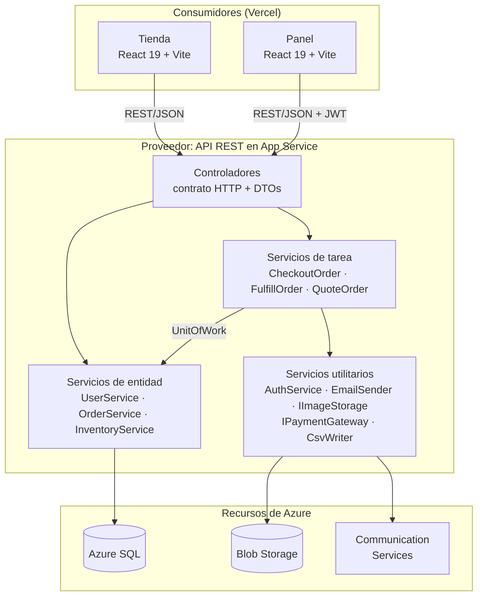
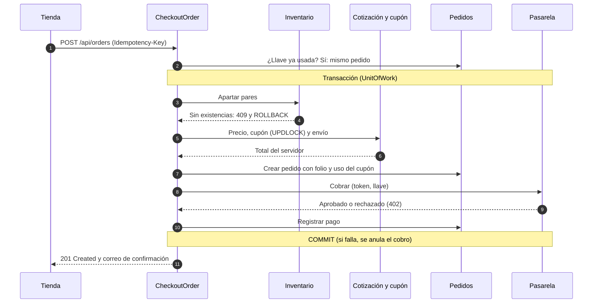
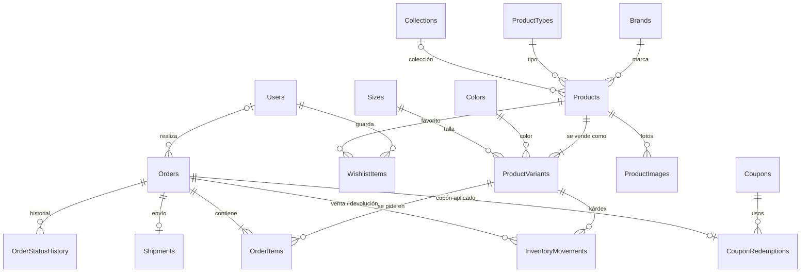
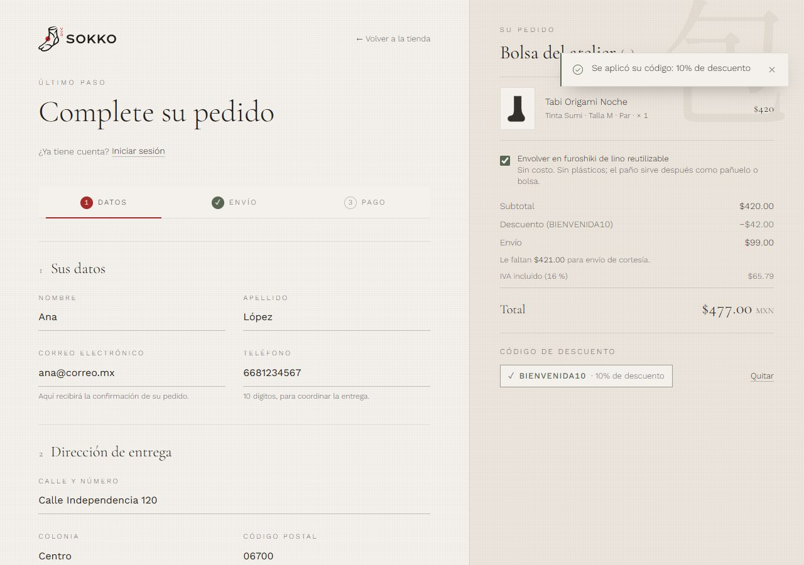
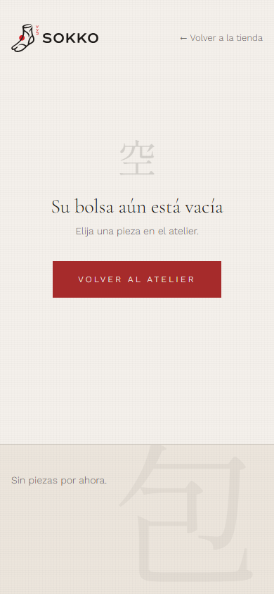
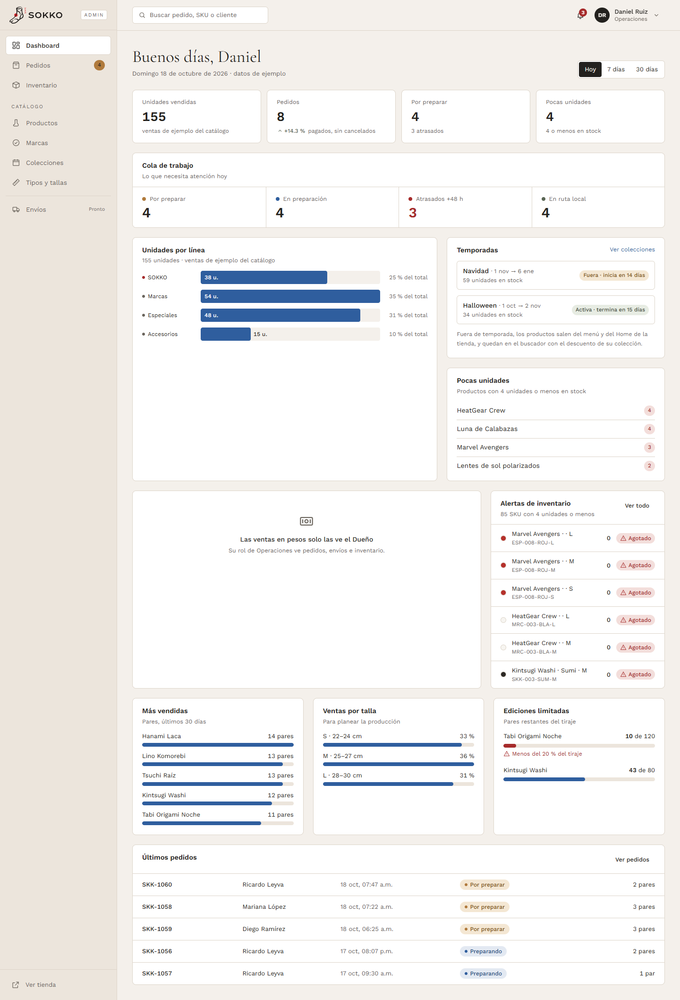
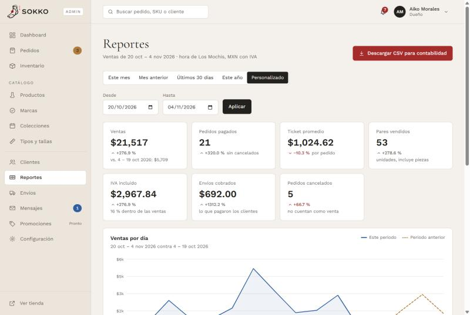

# SOKKO · Reporte técnico

**Proyecto integrador de Arquitectura Orientada a Servicios (SOA)**
Equipo NEXUS CODE: Jesús Cervantes López, Lucio Adrián Martínez Pérez, Said Eduardo Sarmiento Santillanes y Carlos David Ponce Gamboa.
Docente: María de los Ángeles López Atondo. Universidad Autónoma de Occidente, Unidad Regional Los Mochis. Licenciatura en Ingeniería de Software, 7.º semestre, Grupo 01 Matutino.

> Fuente del reporte. Las cifras salen del repositorio y de comandos reproducibles; cada sección cita el archivo de donde provienen. La versión con portada institucional (.docx y .pdf) se genera con `docs/entrega/build_reporte.py`.

## 1. Resumen ejecutivo

SOKKO es el comercio electrónico de un atelier de calcetines en Los Mochis, Sinaloa. El sistema se compone de un proveedor de servicios, una API REST en ASP.NET Core (.NET 10), y dos consumidores independientes: la tienda pública y el panel administrativo, ambos en React. La API concentra las reglas de negocio en servicios clasificados según Thomas Erl (entidad, tarea y utilidad) y persiste en SQL Server mediante Entity Framework Core.

El sistema está en producción: la tienda (https://sokko-tienda.vercel.app) y el panel (https://sokko-panel.vercel.app) se publican en Vercel, y la API (https://app-sokko-qifdnnh6tfjpc.azurewebsites.net) en Azure App Service con Azure SQL, Blob Storage, Communication Services, Key Vault y Application Insights. El despliegue es automático desde GitHub Actions con OIDC, sin secretos guardados en GitHub, y la infraestructura se diseñó para operar con costo $0 dentro de las ofertas gratuitas de Azure for Students.

La API expone 88 operaciones en 24 controladores, el modelo tiene 21 tablas y 9 migraciones, y la calidad se respalda con 1,304 pruebas automatizadas (847 de la API, 206 de la tienda, 241 del panel y 10 de extremo a extremo), todas en verde al cierre.

## 2. Problema y objetivos

**Problema.** El atelier vendía por canales informales, sin inventario confiable, sin control de apartados ni registro de pedidos. Necesitaba vender en línea a invitados y clientes registrados y, al mismo tiempo, que el equipo interno (Dueño y Operaciones) surtiera pedidos y controlara existencias sin exponer información financiera a quien no le corresponde.

**Objetivo general.** Diseñar, construir y desplegar un comercio electrónico con arquitectura orientada a servicios, en el que una sola API REST sirva a una tienda pública y a un panel interno, con reglas de negocio centralizadas, permisos aplicados en el servidor y operación continua en la nube.

**Objetivos específicos.**

1. Definir contratos de servicio explícitos (DTOs, ProblemDetails y OpenAPI) consumidos por dos frontends desacoplados.
2. Modelar el dominio (catálogo multilínea, inventario con kárdex, pedidos, envíos, cupones) con integridad garantizada en la base de datos.
3. Implementar un checkout transaccional que no venda de más ni cobre dos veces.
4. Separar permisos por rol (Dueño y Operaciones) en la API, no solo en la interfaz.
5. Automatizar pruebas, integración continua y despliegue, con infraestructura como código y costo $0.

## 3. Alcance

**Incluye.**

- Tienda: catálogo de cuatro líneas, búsqueda, ficha con galería, bolsa, checkout como invitado o con cuenta, cupones, tarjeta simulada y OXXO Pay, confirmación por correo, cuenta del cliente, favoritos, rastreo con guía, contacto y páginas informativas.
- Panel: dashboard, pedidos y envíos, inventario con kárdex e importación CSV, catálogo (productos, fotos, marcas, colecciones, tipos y tallas), clientes, reportes con exportación CSV, bandeja de mensajes, promociones y configuración.
- Infraestructura en Azure y Vercel, CI/CD y pruebas automatizadas.

**Queda fuera a propósito.**

| Exclusión | Motivo | Evidencia |
|---|---|---|
| Pagos reales | Requieren contrato con una pasarela y certificación; el proyecto es académico. Se implementó una pasarela simulada detrás de `IPaymentGateway`, de modo que una real se conecta sin tocar el checkout | `Services/PaymentGateway.cs`, `DESIGN_CHECKOUT.md` §6 |
| Facturación electrónica (CFDI) | El cliente usa un contador externo; el panel entrega ventas, IVA y envíos por periodo en CSV. CFDI quedó para una fase 2 | `DECISIONES_ADMIN.md` (Facturación) |
| Paquetes armados (packs) | El cliente no los pidió; el paquete del proveedor se modela como un producto con `UnitsPerPack` | `DESIGN_DB.md` D-35 |

## 4. Arquitectura orientada a servicios

### 4.1 Vista general

La solución es un monorepo con un proveedor (`apps/api-service`) y dos consumidores (`apps/web-store` y `apps/admin-panel`) que solo conocen el contrato HTTP/JSON. Cada consumidor tiene una única capa que conoce la URL de la API (`src/services/api.js`), configurada con `VITE_API_URL`.

### 4.2 Mapa de servicios y su clasificación

La clasificación sigue a Erl y está documentada en `docs/design/DESIGN_DB.md` §6. La regla de capas es que **cada tabla tiene un solo servicio de entidad que la escribe** y los servicios de tarea nunca escriben directamente en el `DbContext`: llaman a los de entidad dentro de una transacción compartida (`IUnitOfWork`).

| Tipo | Servicio | Responsabilidad (cita del código) |
|---|---|---|
| Entidad | `UserService` | "Único escritor de `Users` y `PasswordResetTokens`" (`Services/UserService.cs`) |
| Entidad | `InventoryService` | Único escritor de `ProductVariants` e `InventoryMovements` (D-25) |
| Entidad | `OrderService` | `Orders`, `OrderItems`, `OrderStatusHistory`, `Shipments` |
| Entidad | `CatalogService`, `BrandService`, `ProductTypeService`, `CollectionService` | Catálogo; `CatalogService` expone `GetEffectivePrice` e `IsInSeason` (D-38) |
| Entidad | `SettingsService`, `CouponService`, `WishlistService` | Configuración y zonas, cupones, favoritos |
| Tarea | `CheckoutOrder` | "Crea el pedido en una sola transacción y recalcula todo en el servidor" (`Services/CheckoutOrder.cs`) |
| Tarea | `FulfillOrder` | "Surte o cancela el pedido en una sola transacción" (`Services/FulfillOrder.cs`) |
| Tarea | `QuoteOrder`, `QuoteShipping` | Cotización del pedido (subtotal, cupón, envío) usada por la bolsa, la vista previa del cupón y el checkout |
| Tarea | `AdjustInventory`, `ImportInventory`, `RegisterCustomer`, `ResetPassword`, `InviteUser`, `SubmitContactMessage` | Procesos que cruzan entidades |
| Utilidad | `AuthService` | Hash de contraseñas, JWT y validación |
| Utilidad | `EmailSender` (`IEmailSender`) | Correo: registro en Development, Azure Communication Services en producción |
| Utilidad | `IImageStorage` | Fotos: carpeta local en Development, Azure Blob en producción |
| Utilidad | `IPaymentGateway` | "Proxy hacia la pasarela de pago: una pasarela real se conecta implementando esta interfaz" |
| Utilidad | `CsvWriter`, `ExportService`, `IClock` | CSV para Excel sin inyección de fórmulas, exportes y hora del negocio |

### 4.3 Principios SOA aplicados

| Principio | Cómo lo aplicamos | Evidencia en el repo |
|---|---|---|
| Contrato estandarizado | Entradas y salidas son DTOs, nunca entidades; errores como ProblemDetails (RFC 9457); enums en JSON con códigos fijos (`snake_case`); documento OpenAPI | `apps/api-service/DTOs/`, `Program.cs` (`AddProblemDetails`, `JsonStringEnumConverter`, `AddOpenApi` en `/openapi/v1.json`), `DESIGN_DB.md` §1.6 |
| Bajo acoplamiento | Controladores dependen de interfaces inyectadas; los frontends solo conocen el contrato y pueden correr con datos simulados (`VITE_USE_MOCKS=true`) | `Program.cs` (registro DI), `apps/*/src/services/api.js` |
| Abstracción | La lógica vive en `Services/`; los controladores traducen HTTP. La pasarela, el correo y el almacenamiento ocultan su implementación | `IPaymentGateway`, `IEmailSender`, `IImageStorage` |
| Reutilización | Una sola API atiende a la tienda y al panel; `QuoteOrder` la usan la bolsa, `POST /api/coupons/preview` y el checkout (D-40) | `Services/QuoteOrder.cs`, `DESIGN_DB.md` D-40 |
| Autonomía | Cada app se compila, prueba y despliega por separado; CI corre solo el job de la app que cambió; la API controla su propio esquema (migraciones) | `.github/workflows/ci.yml` (`dorny/paths-filter`), `deploy.yml` |
| Sin estado | La sesión viaja en un JWT firmado (120 min por omisión); la API no guarda sesiones en memoria | `Services/AuthService.cs` (`Jwt:LifetimeMinutes`) |
| Descubrimiento | Documento OpenAPI y Swagger UI en Development; `GET /api/health` y `/api/health/live` describen el estado | `Program.cs`, `Controllers/HealthController.cs` |
| Composición | El checkout compone inventario, catálogo, cupones, envío, pedido, pago y correo en una transacción | `Services/CheckoutOrder.cs` (§4.5) |

### 4.4 REST frente a SOAP

| Criterio | REST/JSON (elegido) | SOAP/XML | Aplicación en SOKKO |
|---|---|---|---|
| Consumidores | Nativo para navegadores (`fetch`) | Requiere bibliotecas y sobres XML | Los dos consumidores son SPA en React |
| Tamaño del mensaje | JSON compacto | XML con sobre y espacios de nombres | Catálogo y listados del panel por red móvil |
| Contrato | OpenAPI | WSDL | OpenAPI generado por ASP.NET Core |
| Errores | Códigos HTTP + ProblemDetails | SOAP Fault | 401/403/404/409/422/429 con ProblemDetails |
| Caché e intermediarios | Semántica HTTP (GET idempotente, CORS) | Casi todo es POST | Catálogo público con GET |
| Seguridad | HTTPS + JWT Bearer | WS-Security | JWT con roles; WS-Security no aporta para este caso |
| Transacciones distribuidas | No las estandariza | WS-AtomicTransaction | No se necesitan: una sola BD y transacciones locales |

Se eligió REST porque los consumidores son navegadores, el contrato OpenAPI cubre la documentación que daría un WSDL, y las garantías transaccionales se resuelven dentro del servicio (una BD, `UnitOfWork`), sin necesitar los estándares WS-*.

### 4.5 Composición: secuencia del checkout

## 5. Diseño de datos

El esquema completo está en `docs/design/DESIGN_DB.md` (versión 0.5). El modelo tiene 21 tablas (`DbSet` en `Data/SokkoDbContext.cs`) y 9 migraciones en `Data/Migrations/`, de `InitialCreate` a `AddCoupons`.

Un pedido sin usuario es de un invitado. Tablas de apoyo no dibujadas: `PasswordResetTokens`, `Settings` (fila única), `LocalDeliveryZones` y `ContactMessages`.

| Decisión | Qué resuelve |
|---|---|
| D-08 · Folio por `SEQUENCE` y columna calculada `SKK-####` | Folio legible, único y separado de la llave interna, sin condición de carrera de `MAX()+1` |
| D-09 y D-10 · Copias en el pedido | Datos del cliente, envío y precio histórico se copian: el pedido no cambia si cambia el catálogo o el perfil |
| D-11 y D-18 · `CHECK Reserved <= Stock` y `UPDATE` atómico condicionado | La BD impide la sobreventa; dos compras simultáneas del último par no pueden apartarlo ambas |
| D-07 · Borrado lógico y FK `NO ACTION` | La historia contable no se borra en cascada; `CASCADE` solo en tokens y favoritos (D-39) |
| D-15 · `CK_Orders_PaymentBeforeFulfillment` | Un pedido OXXO sin pagar no puede surtirse |
| v0.4.5 · Idempotencia (`IdempotencyKey` único filtrado + `IdempotencyHash` SHA-256) | Un doble clic no crea dos pedidos; la misma llave con otros datos responde 422 |
| D-40 · `CK_Orders_Total`: `Total = Subtotal − DiscountAmount + ShippingCost` | Una sola fórmula del total, verificada por la BD; cupones en `Coupons` y `CouponRedemptions` con bloqueo `UPDLOCK, HOLDLOCK` |
| D-23 · Intercalación `Modern_Spanish_100_CI_AI` | Búsqueda sin distinguir mayúsculas ni acentos |

## 6. Catálogo de endpoints

Extraído de los atributos `[Route]`, `[Http*]` y `[Authorize]` de `apps/api-service/Controllers/` (88 operaciones). Rol: **Público** (sin sesión), **Cuenta** (cualquier usuario con sesión), **Equipo** (Dueño y Operaciones) o **Dueño**.

| Método | Ruta | Rol | Propósito |
|---|---|---|---|
| GET | `/api/health`, `/api/health/live` | Público | Estado con y sin revisar la BD |
| GET | `/api/config` | Público | Configuración pública: tarifas y umbral de envío, IVA, aviso de pocas piezas |
| GET | `/api/catalog/nav` | Público | Menú de líneas, marcas y colecciones |
| GET | `/api/products`, `/api/products/{slug}` | Público | Listado paginado con filtros y ficha |
| POST | `/api/shipping/quote` | Público | Cotización de envío por CP |
| POST | `/api/coupons/preview` | Público | Vista previa del cupón con el total final |
| POST | `/api/orders` | Público o Cuenta | Checkout (idempotente) |
| GET | `/api/orders/{folio}` | Público (con correo) | Rastreo del pedido |
| POST | `/api/orders/{folio}/oxxo/simulate-payment` | Público (con correo) | Simula el pago en OXXO |
| GET | `/api/orders/mine` | Cuenta | Mis pedidos |
| POST | `/api/auth/login`, `/register`, `/forgot-password`, `/reset-password` | Público | Acceso, registro y recuperación |
| GET, PUT | `/api/auth/me` | Cuenta | Ver y editar Mi perfil |
| POST | `/api/auth/change-password` | Cuenta | Cambiar contraseña |
| GET, PUT, DELETE | `/api/wishlist`, `/api/wishlist/{slug}` | Cuenta | Favoritos |
| POST | `/api/wishlist/merge` | Cuenta | Fusiona favoritos del invitado al iniciar sesión |
| POST | `/api/contact` | Público | Mensaje de contacto (5 por hora por IP, honeypot) |
| POST | `/api/admin/auth/login` | Público | Acceso al panel (solo Dueño u Operaciones) |
| GET | `/api/admin/auth/me` | Equipo | Sesión del panel y permisos |
| GET | `/api/admin/dashboard` | Equipo | KPIs (sin pesos para Operaciones) |
| GET | `/api/admin/orders`, `/summary`, `/couriers`, `/{folio}`, `/{folio}/packing-list` | Equipo | Pedidos, resumen, repartidores, detalle y lista de empaque |
| PUT | `/api/admin/orders/{folio}/note` | Equipo | Nota interna |
| POST | `/api/admin/orders/{folio}/transitions`, `/cancel` | Equipo | Avanzar estado (preparar, enviar con guía, entregar) o cancelar |
| POST | `/api/admin/orders/{folio}/payment` | Dueño | Confirmar un pago |
| GET | `/api/admin/inventory`, `/{sku}`, `/{sku}/movements` | Equipo | Existencias y kárdex |
| POST | `/api/admin/inventory/{sku}/movements` | Equipo | Ajuste de inventario |
| GET, POST | `/api/admin/inventory/import/template`, `/import/preview`, `/import` | Dueño | Importación CSV |
| GET | `/api/admin/catalog`, `/products`, `/products/{slug}` | Equipo | Catálogo del panel (costos solo para el Dueño) |
| POST, PUT | `/api/admin/products`, `/products/{slug}` | Dueño | Alta y edición de productos |
| POST, PUT, DELETE | `/api/admin/products/{id}/images` (subir, ordenar, texto alternativo, borrar) | Dueño | Fotos en Blob Storage |
| GET | `/api/admin/brands`, `/product-types`, `/collections` (y su detalle) | Equipo | Taxonomía |
| POST, PUT | `/api/admin/brands`, `/product-types`, `/collections` | Dueño | Edición de taxonomía |
| GET | `/api/admin/messages`, `/unread-count` | Equipo | Bandeja de contacto |
| POST | `/api/admin/messages/{id}/read`, `/unread`, `/archive`, `/unarchive` | Equipo | Estado del mensaje |
| GET | `/api/admin/customers`, `/{id}`, `/guest` | Dueño | Clientes con cuenta e invitados |
| GET | `/api/admin/customers/export.csv`, `/marketing.csv` | Dueño | Exportes CSV |
| GET | `/api/admin/reports/sales`, `/sales.csv` | Dueño | Reporte de ventas y su CSV |
| GET, POST, PUT, DELETE | `/api/admin/coupons` (lista, detalle, alta, edición, activar, desactivar, borrar) | Dueño | Promociones |
| GET, PUT | `/api/admin/settings` | Dueño | Configuración de envíos y negocio |
| GET, POST | `/api/admin/users`, `/users/invitations` | Dueño | Equipo e invitaciones |

## 7. Seguridad

| Control | Implementación | Evidencia |
|---|---|---|
| Autenticación | JWT Bearer firmado; contraseñas con `PasswordHasher` de ASP.NET Core; comparación con hash falso cuando el correo no existe | `Services/AuthService.cs` |
| Roles y permisos en servidor | 17 permisos; cada controlador lleva `[Authorize(Policy = …)]`. Operaciones solo tiene `orders.manage`, `inventory.adjust`, `shipping.view`, `catalog.view` y `messages.view`; el Dueño, todos | `Services/Permissions.cs`, `Services/AuthSetup.cs` |
| Operaciones sin pesos | Los DTOs de Operaciones son tipos sin campos de dinero (R-24, R-30), no campos ocultos en la interfaz | `DTOs/AdminCatalogDtos.cs`, `DESIGN_DB.md` §4 |
| Límites de peticiones | Acceso, registro, recuperación, checkout y cupones: 10 por minuto; contacto: 5 por hora por IP; respuesta 429 con `Retry-After` | `Services/AuthSetup.cs`, `Services/ContactLimits.cs` |
| Encabezados del navegador | CSP estricta (`connect-src` solo a la API, `img-src` solo a Blob, `frame-ancestors 'none'`), `nosniff` y `Referrer-Policy` | `apps/*/vercel.json` |
| CORS | Solo los orígenes de la tienda y el panel | `Program.cs`, `Services/FrontendUrls.cs` |
| Honeypot | El campo oculto `Website` descarta el mensaje con la misma respuesta, sin delatar el filtro | `Services/SubmitContactMessage.cs` |
| Inyección CSV | Celdas que empiezan con `=`, `+`, `-`, `@`, tabulador o retorno se neutralizan | `Services/CsvWriter.cs` |
| Datos de tarjeta | El número se cambia por un token en el navegador; nunca llega a la API | `web-store/src/services/paymentToken.js` |
| Secretos | Clave JWT y cadena de ACS en Key Vault; SQL y Storage con identidad administrada, sin contraseñas | `infra/main.bicep`, `docs/infra/AZURE.md` §6 |
| Despliegue sin secretos | GitHub entra a Azure con OIDC y una credencial federada ligada a los ID numéricos del repositorio | `.github/workflows/deploy.yml`, `infra/README.md` |
| Transporte | HTTPS obligatorio, TLS 1.2 mínimo, FTPS deshabilitado | `infra/main.bicep` |

## 8. Infraestructura y despliegue

**Recursos.** En Azure (grupo `rg-sokko-prod`, región `westus`): plan de App Service B1 Linux, App Service de la API (.NET 10, identidad administrada), servidor y base Azure SQL serverless, Key Vault, Communication Services con dominio administrado, Application Insights sobre Log Analytics, cuenta de Storage con el contenedor `product-images` e identidad del workflow para OIDC. En Vercel: los proyectos `sokko-tienda` y `sokko-panel`. Inventario completo en `docs/infra/AZURE.md` §7; plantillas en `infra/main.bicep` e `infra/storage.bicep`.

**Pipeline.**

1. Cada PR a `main` corre CI: lint, pruebas y build por app; la API se prueba contra SQL Server 2022 en un contenedor.
2. Al fusionar, CI corre en `main` y, si pasa y `DEPLOY_ENABLED=true`, inicia `deploy.yml`.
3. `deploy.yml` publica la API, genera un `dotnet ef migrations bundle` autocontenido, entra a Azure por OIDC, aplica las migraciones **antes** de publicar (la API nueva nunca corre sobre un esquema viejo) y despliega el paquete.
4. Vercel compila y publica la tienda y el panel desde su integración con GitHub.

**Estrategia de costo $0.**

| Medida | Efecto | Evidencia |
|---|---|---|
| Azure SQL con oferta gratuita (`useFreeLimit`) y `freeLimitExhaustionBehavior: AutoPause` | Si se agota la cuota gratuita, la BD se pausa en lugar de cobrar | `infra/main.bicep` |
| Serverless con `autoPauseDelay` de 60 min y 0.5 vCore mínimo | Sin uso, la BD se pausa | `infra/main.bicep` |
| Sondeo de salud en `/api/health/live` | El sondeo de App Service no despierta la BD | `infra/main.bicep` (`healthCheckPath`) |
| Plan B1 en oferta gratuita hasta el 2 de mayo de 2027 | Sin cargo por el cómputo de la API | `docs/infra/AZURE.md` §6 |
| Log Analytics con tope de 0.16 GB al día | Se queda en la ingesta gratuita | `infra/main.bicep` (`dailyQuotaGb`) |
| Vencimiento de OXXO una vez al día | Menos despertares de la BD | `infra/README.md` |
| Tienda y panel en Vercel | Sin costo de hospedaje estático en Azure | `docs/infra/AZURE.md` §6 |

## 9. Calidad

Cifras obtenidas al cierre ejecutando cada suite (4 de noviembre de 2026):

| Proyecto | Comando | Resultado |
|---|---|---|
| `apps/api-service.Tests` | `dotnet test -c Release` | 847 correctas, 0 errores |
| `apps/web-store` | `npm test` | 206 correctas en 23 archivos |
| `apps/admin-panel` | `npm test` | 241 correctas en 23 archivos |
| `apps/web-store/e2e` | `npm run test:e2e` | 10 correctas |
| **Total** | | **1,304** |

**Tipos de prueba.**

- **Unitarias de dominio:** máquina de estados del pedido, reglas de cupones, cotización de envío, temporadas, utilidades de reportes (`OrderStateMachineTests`, `CouponRulesTests`, `QuoteShippingTests`, `SeasonTests`, `ReportUtilitiesTests`).
- **Integración de la API:** `WebApplicationFactory` contra SQL Server real en la base `Sokko_Tests`, que se crea, migra y siembra en cada corrida (`TestDatabase.cs`); cubren permisos por rol, concurrencia, idempotencia y respuestas ProblemDetails.
- **Esquema:** `Migrations_are_in_sync_with_the_model` falla si el modelo cambia sin migración; `SeedTests` compara la semilla .NET con el catálogo de la tienda.
- **Componentes y servicios del frontend:** Vitest con jsdom (checkout, cupón, rastreo, contacto, rutas de cuenta, retroalimentación de UX).
- **Extremo a extremo:** Playwright sobre la build de producción en modo mock; verifica que no haya scroll horizontal en 9 anchos (320 a 1920 px) y 4 páginas, y que las líneas del catálogo cambien de lugar en el punto de quiebre de 1024 px.

**Accesibilidad y responsive.** Diseño móvil primero (capturas a 390 y 1440 px en `docs/design/screenshots/`), foco visible y gestionado en formularios (el primer campo con error recibe el foco), etiquetas `aria-label`, trampa de foco en diálogos (`useFocusTrap`), contraste del color `matcha` ajustado a 4.5:1 (`CONTEXTO_MAESTRO.md` §1.1) y texto alternativo editable para cada foto de producto.

## 10. Experiencia de usuario

| Principio | Aplicación |
|---|---|
| Confirmaciones claras | Acciones destructivas con confirmación en sitio ("¿Borrar?") y mensajes que dicen qué pasó y qué sigue (PR #27) |
| Ubicación | Migas de pan en la tienda (`components/layout/Breadcrumbs.jsx`), título de página por vista y sección activa marcada en el panel |
| Estados vacíos | Bolsa vacía, sin resultados y bandeja vacía con una acción para continuar |
| Errores accionables | Tarjeta rechazada, sin existencias o cupón inválido explican cómo resolverlo (`DESIGN_CHECKOUT.md` §4) |
| Accesibilidad | Ojo para mostrar la contraseña, marca de tarjeta detectada, foco y etiquetas (PR #27) |

*Figura 1. Checkout con cupón aplicado y total recalculado por el servidor.*

*Figura 2. Estado vacío de la bolsa en móvil.*

*Figura 3. Dashboard de Operaciones: mismos indicadores, sin montos en pesos.*

*Figura 4. Reportes del Dueño con exportación CSV.*

## 11. Gestión del proyecto

El flujo de trabajo sigue el *Manual de Flujo de Trabajo y Git - SOKKO (NEXUS CODE)* (`docs/Manual de Flujo de Trabajo y Git - SOKKO (NEXUS CODE).pdf`):

- **`main` protegida:** está prohibido hacer commit directo; solo contiene código probado que compila.
- **Una rama por tarea** con la nomenclatura `Nombre/Area-cambio` (por ejemplo, `Said/Frontend-login`), creada desde `main` actualizada.
- **Pull Request hacia `main`:** otro integrante revisa, GitHub debe indicar "Able to merge" y, desde el PR #6, el CI debe pasar.
- **Contexto compartido:** `CONTEXTO_MAESTRO.md` sincroniza al equipo y a las herramientas de IA antes de programar.

En la práctica, los títulos de los PR siguen Conventional Commits (`feat`, `fix`, `docs`, `ci`, `chore`) y la mayoría se fusionó con *squash*, de modo que cada bloque es un commit en `main`. Las decisiones de diseño se registran con identificadores (D-xx, P-xx, R-xx, T-xx) que se citan en código, migraciones y PR.

| PR | Fecha | Título |
|---|---|---|
| 1 | 2026-10-16 | feat(web-store): Home Kyoto Artisan |
| 2 | 2026-10-19 | feat(web-store): acceso de cuenta (login, registro, recuperar, bienvenida) |
| 3 | 2026-10-20 | feat(admin-panel): panel administrativo (dashboard, pedidos, inventario, configuración) |
| 4 | 2026-10-22 | docs(db): esquema de base de datos de Sokko para revisión |
| 5 | 2026-10-22 | fix: alinea frontends con DESIGN_DB v0.3 |
| 6 | 2026-10-22 | ci: GitHub Actions para web-store, admin-panel y api-service |
| 7 | 2026-10-27 | docs(db): catálogo multilínea (v0.4) |
| 8 | 2026-10-27 | feat(store): catálogo multilínea |
| 9 | 2026-10-28 | feat(admin): catálogo multilínea |
| 10 | 2026-10-30 | feat(api): base de datos con EF Core (SQL Server) |
| 11 | 2026-10-30 | chore: limpieza de main y aprobación de DESIGN_DB |
| 12 | 2026-10-30 | feat(api): catálogo público |
| 13 | 2026-10-30 | feat(api): semilla alineada con la tienda y disponibilidad por combinación |
| 14 | 2026-10-31 | feat(api): autenticación con JWT y roles |
| 15 | 2026-10-31 | feat: checkout y pedidos |
| 16 | 2026-10-31 | feat(admin): API de catálogo, configuración y usuarios |
| 17 | 2026-10-31 | feat(admin): API de pedidos, inventario y dashboard |
| 18 | 2026-11-02 | feat: despliegue en Azure |
| 19 | 2026-11-02 | docs(infra): base de Azure para SOKKO |
| 20 | 2026-11-02 | fix(deploy): activar el workflow con una variable de repositorio |
| 21 | 2026-11-02 | fix(infra): subject de OIDC con los ID numéricos de GitHub |
| 22 | 2026-11-02 | fix(api): el bootstrap no necesita la clave JWT |
| 23 | 2026-11-03 | feat: fotos de productos |
| 24 | 2026-11-04 | docs: almacenamiento de fotos en Azure |
| 25 | 2026-11-04 | feat(tienda): páginas informativas y contacto |
| 26 | 2026-11-04 | feat(tienda): mi perfil, rastreo con guía y favoritos |
| 27 | 2026-11-04 | fix(ux): confirmaciones claras, ojo de contraseña, marca de tarjeta y ubicación |
| 28 | 2026-11-04 | feat(panel): clientes, reportes con CSV y bandeja de mensajes |
| 29 | 2026-11-05 | feat: cupones de descuento en checkout y panel |
| 30 | 2026-11-05 | fix: pulido antes del cierre (header, pruebas, clientes, bundle) |

Fechas de fusión en UTC, tomadas de GitHub (`gh pr list --state merged`).

## 12. Resultados, lecciones aprendidas y trabajo futuro

**Resultados.**

- Sistema completo en producción: tienda, panel y API con despliegue continuo.
- 88 operaciones REST con permisos aplicados en servidor y contratos documentados.
- Checkout transaccional sin sobreventa ni doble cobro, verificado con pruebas de integración.
- 1,304 pruebas automatizadas en verde y CI obligatorio en cada PR.
- Operación dentro de las ofertas gratuitas de Azure.

**Lecciones aprendidas.**

| Lección | Origen |
|---|---|
| Las restricciones de la suscripción definen la arquitectura física: México Central no está permitida y `westus2` tiene cuota 0 de App Service, por eso los recursos están en `westus` | `docs/infra/AZURE.md` §2 |
| El *subject* de OIDC de GitHub usa los ID numéricos de cuenta y repositorio; el formato corto falla con `AADSTS700213` | PR #21, `infra/README.md` |
| Las reglas críticas van en los dos lados: el servicio da el mensaje y la BD es la red de seguridad (`CHECK`, índices únicos) | `DESIGN_DB.md` §4 |
| Migrar con un *bundle* antes de publicar evita que la API corra sobre un esquema viejo | `deploy.yml`, PR #30 |
| Una BD exclusiva de pruebas (`Sokko_Tests`) elimina fallos intermitentes por bloqueos de la BD de desarrollo | PR #30, `TestDatabase.cs` |
| Documentar decisiones con identificadores facilita revisar PR y justificar cambios | `DESIGN_DB.md` §8 |

**Trabajo futuro.**

- Conectar una pasarela de pago real implementando `IPaymentGateway`.
- Facturación electrónica (CFDI) y servicio de auditoría (`AuditService`, P2).
- Varios roles por persona (`UserRoles`, P-01) y un rol de Contabilidad.
- Paquetes armados (D-35) y nuevos consumidores de la misma API, como una app móvil.

## 13. Referencias y anexos

**Producción.**

| Servicio | URL |
|---|---|
| Tienda | https://sokko-tienda.vercel.app |
| Panel | https://sokko-panel.vercel.app |
| API (salud) | https://app-sokko-qifdnnh6tfjpc.azurewebsites.net/api/health |
| Repositorio | https://github.com/SaidSar/socks-ecommerce-hub |

**Cuentas de prueba en producción.**

| Rol | Correo | Contraseña |
|---|---|---|
| Cliente | cliente@sokko.mx | Pruebas2026 |
| Operaciones | daniel@sokko.mx | Pruebas2026 |
| Operaciones | kevin@sokko.mx | Pruebas2026 |
| Dueño | — | La entrega el equipo |

**Documentación del repositorio.** `CONTEXTO_MAESTRO.md`; `docs/design/DESIGN.md`, `DESIGN_DB.md`, `DESIGN_AUTH.md`, `DESIGN_CHECKOUT.md`, `DESIGN_ADMIN.md`, `DESIGN_CATALOG_UI.md`, `DECISIONES_ADMIN.md`, `DECISIONES_CATALOGO.md`; `docs/infra/AZURE.md`; `infra/README.md`.

**Bibliografía.**

- Erl, T. (2016). *Service-Oriented Architecture: Analysis and Design for Services and Microservices* (2.ª ed.). Prentice Hall.
- Fielding, R. T. (2000). *Architectural Styles and the Design of Network-based Software Architectures* (tesis doctoral). University of California, Irvine.
- IETF (2023). RFC 9457: *Problem Details for HTTP APIs*.
- OpenAPI Initiative. *OpenAPI Specification*.
- Microsoft. Documentación de ASP.NET Core, Entity Framework Core y Azure.
